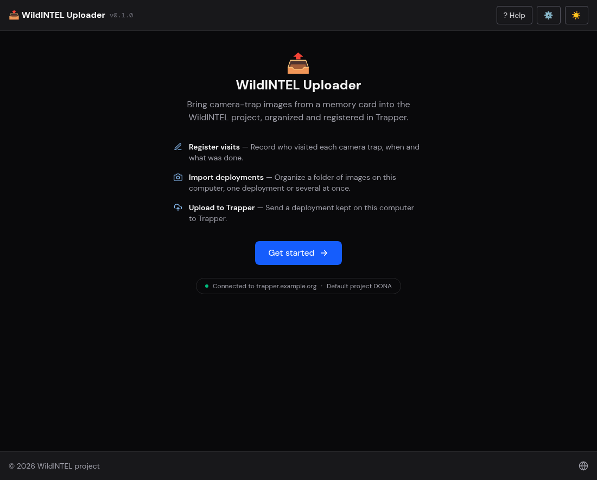
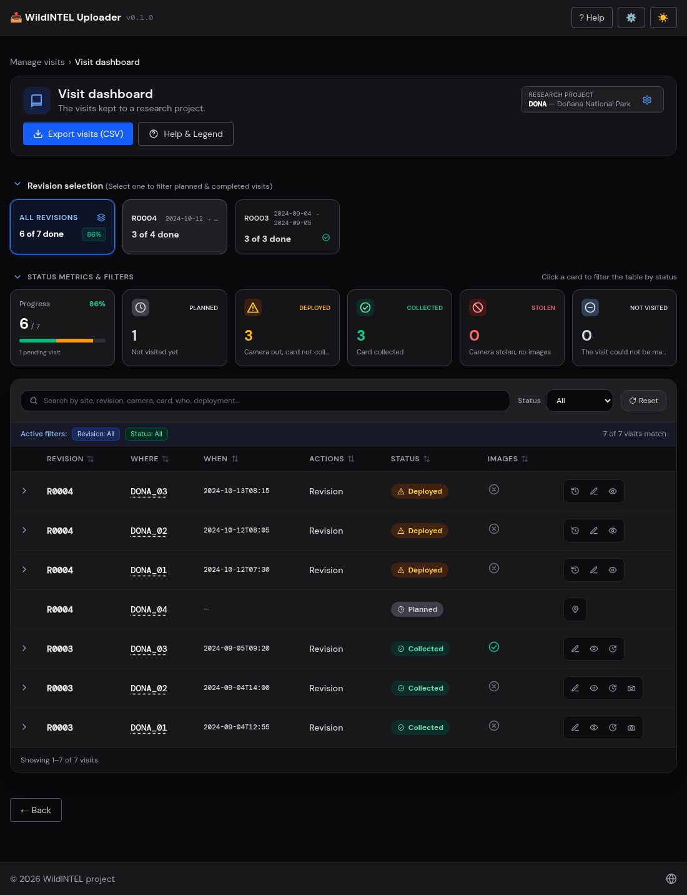
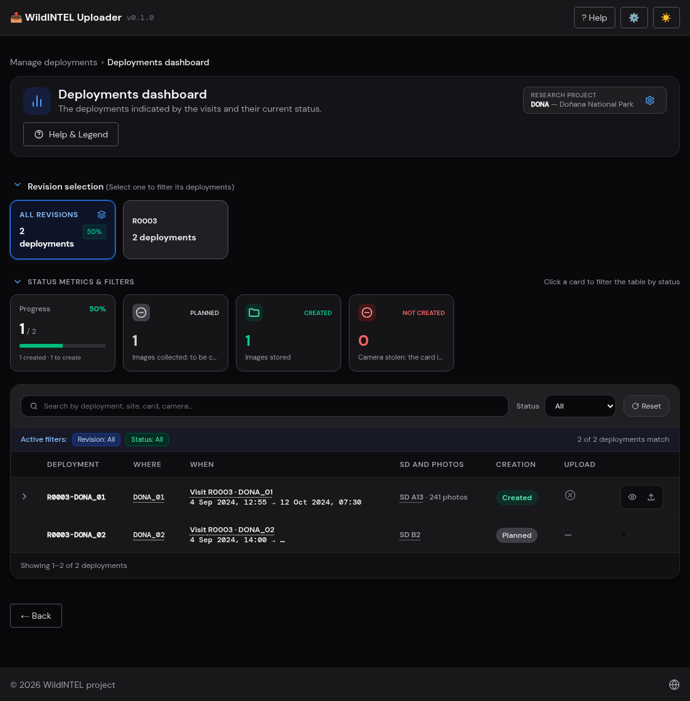
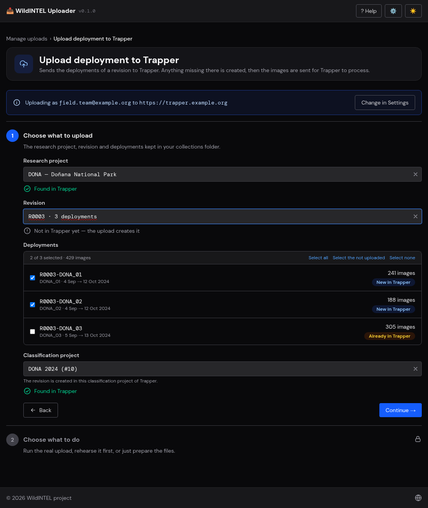

#  wildintel-uploader


[](https://wildintel.eu/)
[](https://gitlab.com/trapper-project/trapper)

<hr>

## Web tool to keep the field work of WildINTEL camera traps and upload its deployments to Trapper

**wildintel-uploader** is an open-source application that takes the camera-trap work of the
[WildINTEL](https://wildintel.eu/) project from the field to [Trapper](https://gitlab.com/trapper-project/trapper).
It keeps the **visits** to the cameras — who went, when and what was done —, and from the visits it works out the
**deployments** of each revision: a camera is left with a card in a visit and its card is collected in the next one.

Each deployment is then imported from a local folder of images (copied off the camera's memory card, which is never
touched): the images are validated, the details of the deployment are filled in from the visits, and the images are
organized renamed, resized and tagged with authorship and license metadata. The deployments are finally uploaded to
Trapper — creating the location and the deployment there if they are missing —, with a dry run first.

<table>
  <tr>
    <td align="center"></td>
    <td align="center"></td>
    <td align="center"></td>
    <td align="center"></td>
  </tr>
  <tr>
    <td align="center">Welcome screen</td>
    <td align="center">Visit dashboard</td>
    <td align="center">Deployments dashboard</td>
    <td align="center">Upload to Trapper</td>
  </tr>
</table>

## ✨ Features

**Field work**

- Register visits by hand, with the rules of the field work: one visit to each location in a revision, a revision starts when the one before it is finished, where each camera and each SD card is
- Read the visits from a CSV file — with the columns matched by hand — or from the CSV of a WildINTEL Epicollect5 project, creating the locations, cameras and SD cards that do not exist (a *New site* makes its site on the spot)
- Visit dashboard by revision and state — deployed, collected, stolen, not visited —, with a panel for each visit and its deployment

**Deployments**

- Import a deployment, or a session of several at once, from a local folder: validation checks, dates from the visits, the images or the timestamp log of the collection, and a form with the details Trapper's own deployment form asks
- Organize the images renamed, resized and tagged with metadata, and seal the deployment so that any later change is noticed
- Dashboard of the deployments with their visit, card and images, and a browser of their photos; repair of the ones that are not valid any more

**Upload to Trapper**

- Creates the location and the deployment in Trapper if they are missing and sends the images in zips, with a dry run and the progress of each deployment
- Dashboard of the uploads by revision, with where each deployment is and what failed

**General**

- Utilities: sync the collections folder with what Trapper holds, backups that the browser downloads and their restoration, reports of every check and import
- Settings for the entities of each research project — locations, cameras, SD cards and trappers — and for the checks
- A guided web app and a smaller command line (`wucli`), on the same core and settings; a sibling of [wildintel-zooniverse](https://github.com/wildintelproject/wildintel-zooniverse), with the same architecture
- One executable per platform, or a development mode with hot reload

## 📋 Requirements

- Python 3.12+ with [uv](https://docs.astral.sh/uv/)
- Node.js 22+ / npm (to build the frontend)
- The [Trapper SDK](https://github.com/wildintelproject/wildintelproject-trapper-sdk), which `setup.sh` clones next to this repository

## 📚 Documentation

Full documentation is available at  **https://wildintelproject.github.io/wildintel-uploader/**

## 🚀 Quick start

```bash
git clone https://github.com/wildintelproject/wildintel-uploader.git
cd wildintel-uploader
./setup.sh
source .venv/bin/activate
uv run wucli dev
```

Or, once packaged, download the executable for your platform from the
[releases page](https://github.com/wildintelproject/wildintel-uploader/releases) — no
installation needed.

## 🤝 Contributing

Contributions are welcome! Please feel free to submit a Pull Request.

To report a bug or request a new feature, please open an [issue](https://github.com/wildintelproject/wildintel-uploader/issues).

## 🏛️ Funding

This work is part of the [WildINTEL project](https://wildintel.eu/), funded by the [Biodiversa+](https://www.biodiversa.eu/) Joint Research Call 2022-2023 "Improved
transnational monitoring of biodiversity and ecosystem change for science and society (BiodivMon)". Biodiversa+ is the
European co-funded biodiversity partnership supporting excellent research on biodiversity with an impact for policy and
society. Biodiversa+ is part of the European Biodiversity Strategy for 2030 that aims to put Europe's biodiversity on a
path to recovery by 2030 and is co-funded by the European Commission.

WildINTEL has been co-funded by the [European Commission](https://commission.europa.eu/) (GA No. 101052342) and the following funding organisations: [Agencia Estatal de Investigación](https://www.aei.gob.es/) (Spain, PCI2023-145963-2, PCI2024-153489), [National Science Centre](https://www.ncn.gov.pl/?language=en) (Poland, UMO-2023/05/Y/NZ8/00104), the [Research Council of Norway](https://www.forskningsradet.no/en/) (Norway, NFR350962) and the [German Research Foundation](https://www.dfg.de/en/) (Germany).

## 📝 License

This project is licensed under the GNU General Public License v3.0 or later - see the [LICENSE](LICENSE) file for details.

This program is free software: you can redistribute it and/or modify it under the terms of the GNU General Public License
as published by the Free Software Foundation, either version 3 of the License, or (at your option) any later version.
