# WildINTEL Uploader — User Manual (web)

This manual covers the web interface. What it shares with the command line — [installation, the
general concepts and the folders it creates](user-manual.md) — is in the common part; read that
first. Part of what the web app does can also be done from a terminal: see the
[command-line manual](user-manual-cli.md).

---

## Table of Contents

1. [Getting started](#1-getting-started)
2. [Settings](#2-settings)
3. [The task menu](#3-the-task-menu)
4. [Unfinished runs](#4-unfinished-runs)
5. [Manage visits](#5-manage-visits)
6. [Manage deployments](#6-manage-deployments)
7. [Import deployments](#7-import-deployments)
8. [Upload a deployment to Trapper](#8-upload-a-deployment-to-trapper)
9. [Utils: sync, repair and fix dates](#9-utils)
10. [Troubleshooting](#10-troubleshooting)

---

## 1. Getting started

[Install](user-manual.md#1-installation) the app and run it with no arguments. It starts a small server on your computer
and opens the app in your default browser (<http://127.0.0.1:8769>, or the next free port). **Keep the window it
opened until you finish** — closing it stops the app. Everything stays on your machine: the only thing the app talks to is
the Trapper server you configure. The welcome screen says what it does; press **Get Started**.

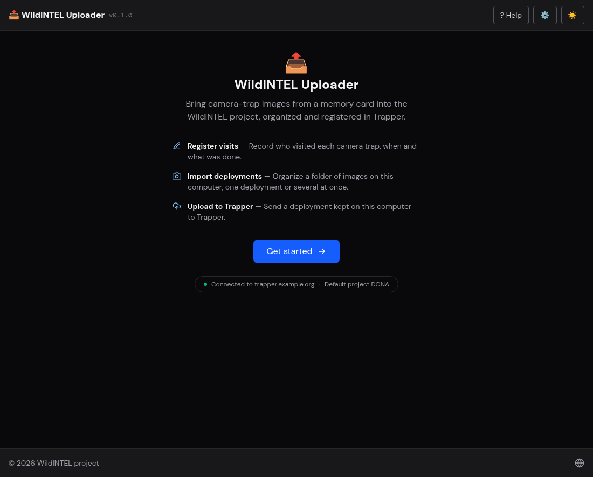

### Defining the entities

We are going to follow one study from the start: the research project `WICP_02`, with four locations where cameras are put up, whose images we bring home and upload to Trapper. Everything the visits and the deployments refer to is defined first, in the settings.

!!! info "Many entities to create"
    When there are many entities to create, they do not have to be added one by one: each tab of Entities can be filled in at once from a CSV file, with **Import CSV**. There are examples of every file in `examples/entities_example/wicp_02`.

#### The research project

The first thing to do is to create the [research project](user-manual.md#21-research-projects). For that we go to **⚙️ Settings › Entities** (see [Settings](#2-settings) and [Entities](#entities)), and in the **Research projects** tab we press **New research project**. The form is filled in as follows: the **acronym** `WICP_02` and the **name** `WICP_02 Doñana census`, a **description** and some **keywords** — type each one and press Enter —, and the **design of the study**, as Trapper asks for it: here, a *systematicRandom* sampling design. The abstract and the methods are optional. We leave the project *Active* and press **Add**.

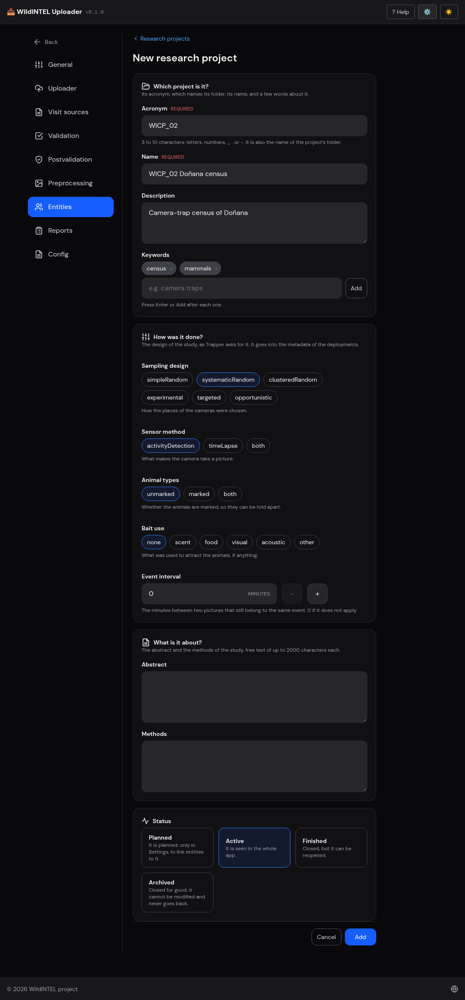

#### The trappers

Once the research project is defined, we create the [trappers](user-manual.md#22-trappers-and-roles) who are going to do the study. For that we go to the **Trappers** tab of the same section and create one or more by pressing **New trapper**. For example, to create the trapper Pedro Pérez we put his **full name** — it is how a visit says who went to the field — and his **affiliation**, and leave him *Active*, so that he is offered when a visit is registered. We press **Add**.

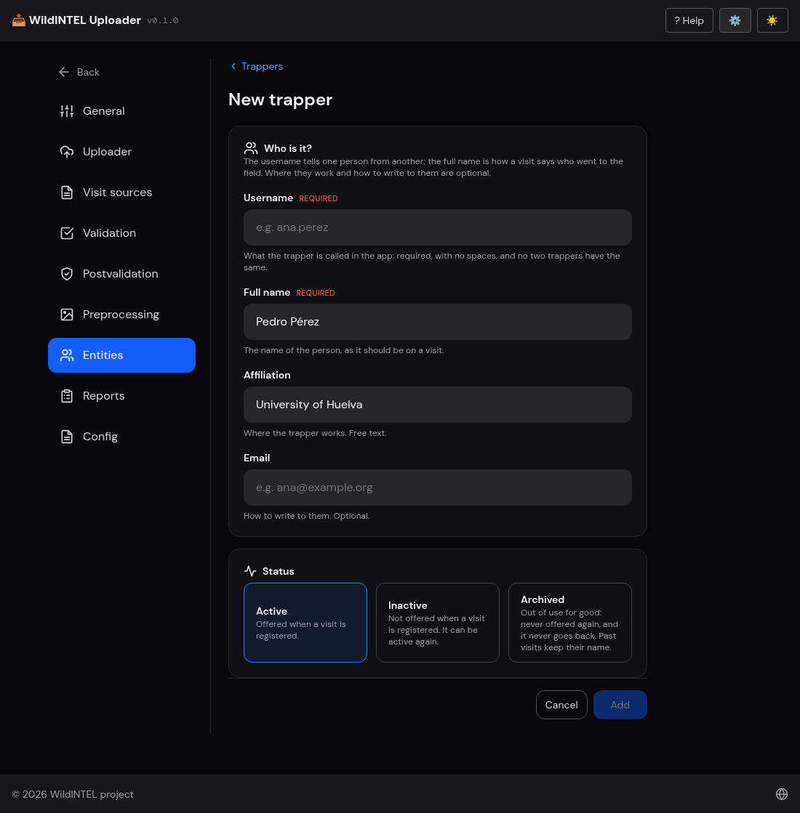

#### The locations

Now the [locations](user-manual.md#23-locations): the places where the cameras will be put up. The locations, the cameras and the SD cards belong to a research project, so in their tabs we pick first `WICP_02`. In **Locations** we press **New location** for each one. For the first, we give its **id** `WICP_02_001` — it is how the visits refer to it —, a **name**, its **coordinates** (`37.0123`, `-6.4412`) and how far off they could be, and its **time zone**, which we leave as it comes, `UTC`, the standard that is used, with the switch **The cameras here ignore summer time** on. We leave it *Ready*, to have a camera put up, and press **Add**. We create the four in the same way: `WICP_02_001` to `WICP_02_004`.

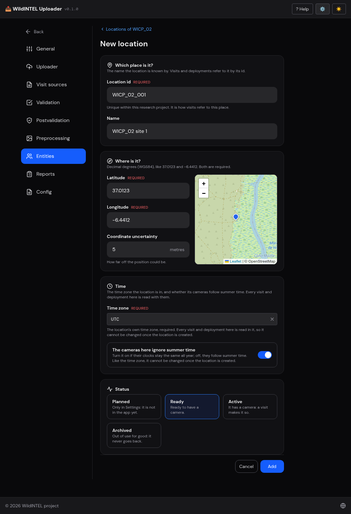

#### The cameras

In **Cameras** we press **New camera** for each one of the four [cameras](user-manual.md#24-cameras) that are going to be put up. We give each its **label** — how it is called in the field: `CAM-001` —, its **camera id** — its serial number — and its **model**, and leave it *Ready*: available, and not in the field yet.

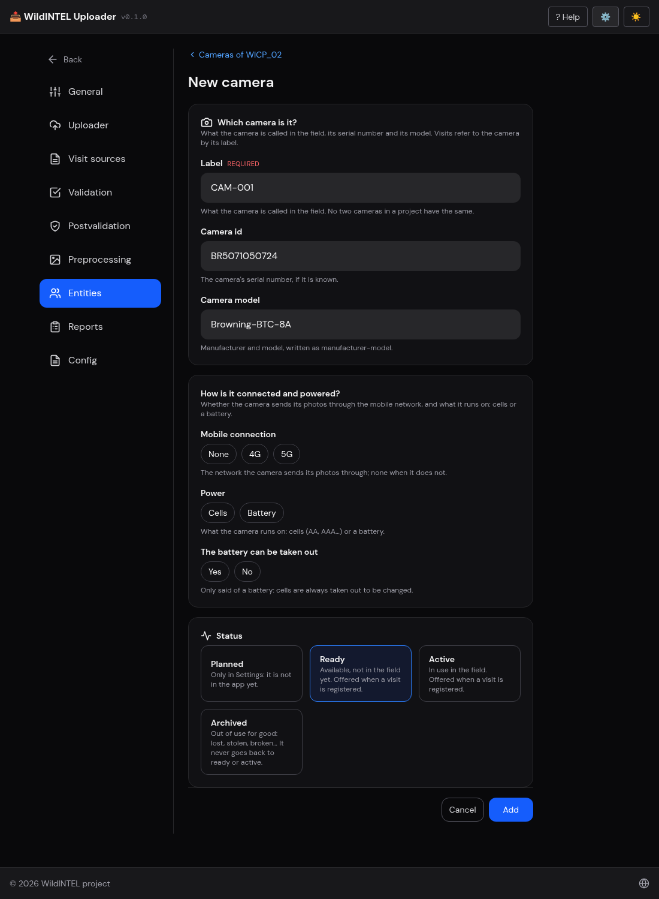

#### The SD cards

In the same way, in **SD cards** we press **New SD card** for each [SD card](user-manual.md#25-sd-cards): its **label** — the number written on it: `1` —, its brand and its capacity. They are left *Ready* too. For the study we create eight cards: four for the first visits and four more for the next ones.

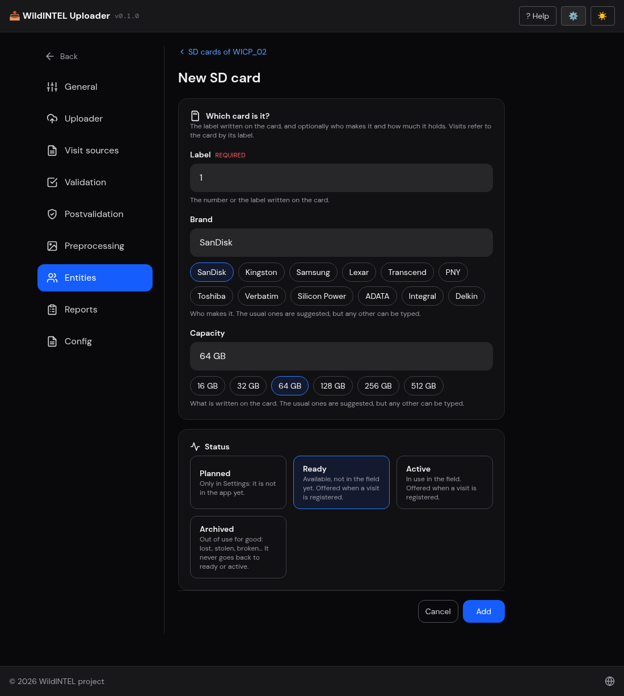

### Managing visits

Once the entities are defined, we can start with the visits (see [Manage visits](#5-manage-visits)). Following our example, we have four locations to visit. From the menu we press **📋 Manage visits › Register visits**, and choose **By hand**.

!!! info "Registering many visits at once"
    By hand is the way to register a few visits. To register many at once, the visits can be read from a file instead: with **Custom CSV**, a CSV of any shape in which we say which column gives each field of a visit, or with **WildINTEL Epicollect CSV** (and **WildINTEL Epicollect Legacy CSV**), the CSV downloaded from the WildINTEL Epicollect project. See [Register visits](#register-visits).

To register the visit to the first location we go through the steps of the form. We pick the location, `WICP_02_001`; we say who went, Pedro Pérez, and when; and we say what was done: as no camera is known there yet, the visit is an *Installation*. We open the **Camera** section and choose the camera that is installed, `CAM-001`, say that it was calibrated, and give its height, its tilt and its heading and the delay between triggers; and in **SD card** we pick the card that is left in it, the `1`.

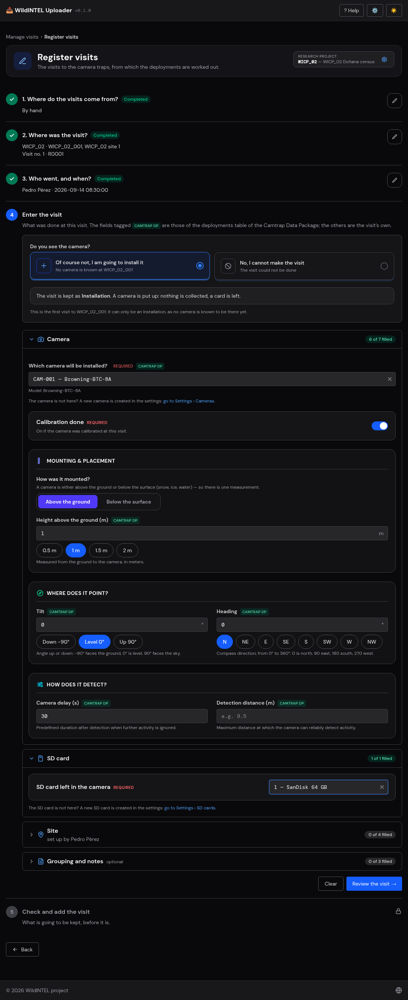

We press **Review the visit**, check what is going to be kept and confirm it. Once the visit is registered, we go to the **Visit dashboard** (see [Visit dashboard](#visit-dashboard)) and we see that the first revision, `R0001`, has been created, and the state of its visits: all of them are *Planned*, but the one already made, which is *Deployed*: the camera is out.

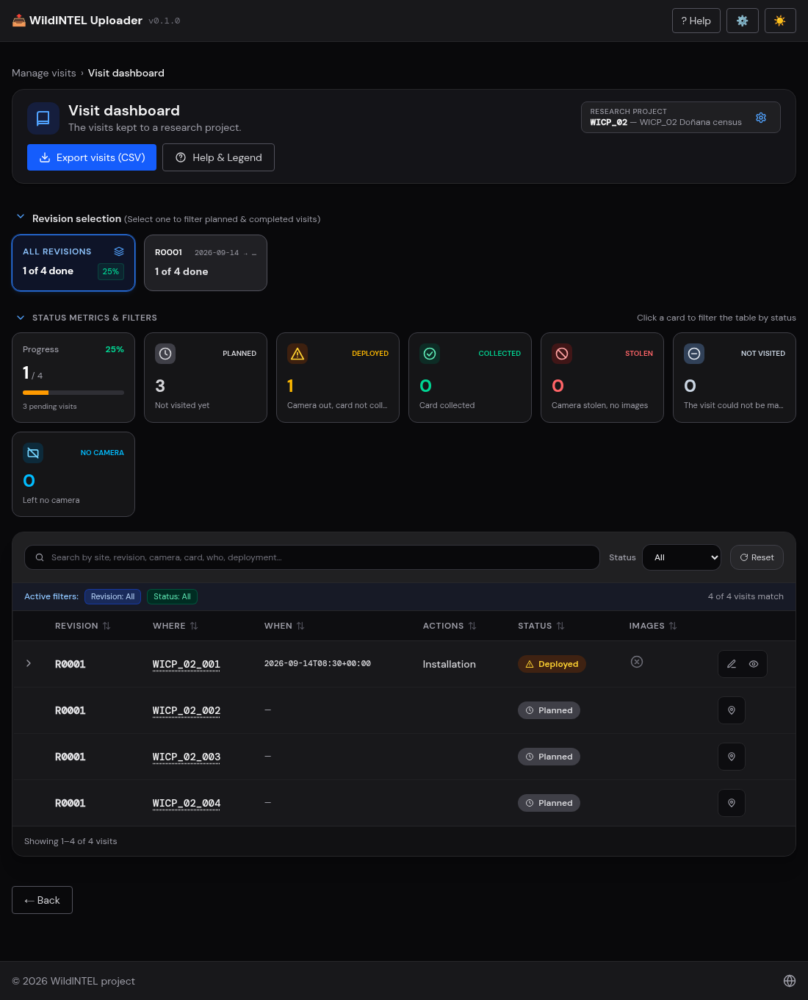

In the same way as we have registered the first visit to the first site, we do it with the three that are left, each one with its camera — `CAM-002` to `CAM-004` — and its card. When the process ends, the dashboard shows the first revision complete: its four visits are *Deployed*.

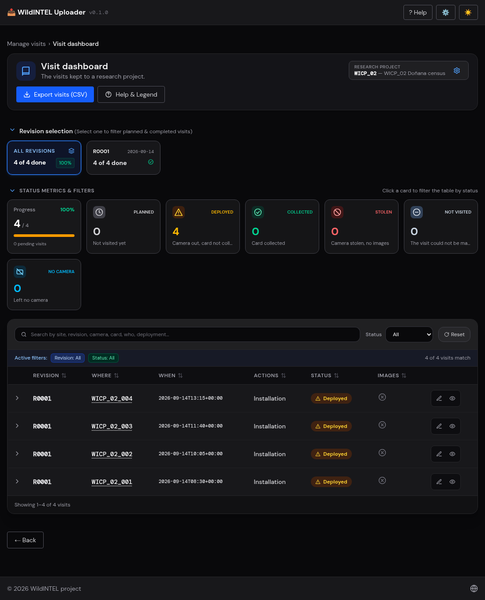

Some time later we go back to the locations to make the second revision. We register the visit to the first one in the same way, but now the camera is there, so we answer that we see it, and that it is well: the visit is a *Revision*. The camera is the one the visit before says, so it is not asked; we say that it was calibrated and, in **SD card**, how many photos the card collected has and which card is left, the `5`.

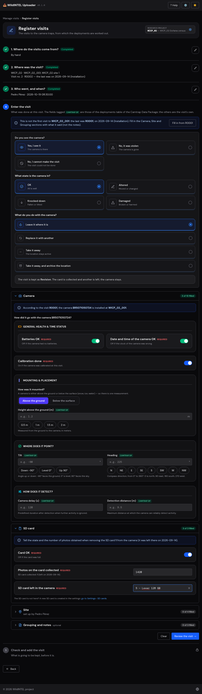

We do the same with the other three. When the second revision is finished, the dashboard shows that the visits of `R0001` are now *Collected*: the cards were collected, and the deployments are closed — their images can be imported —, while those of `R0002` are *Deployed*: the cameras are out again.

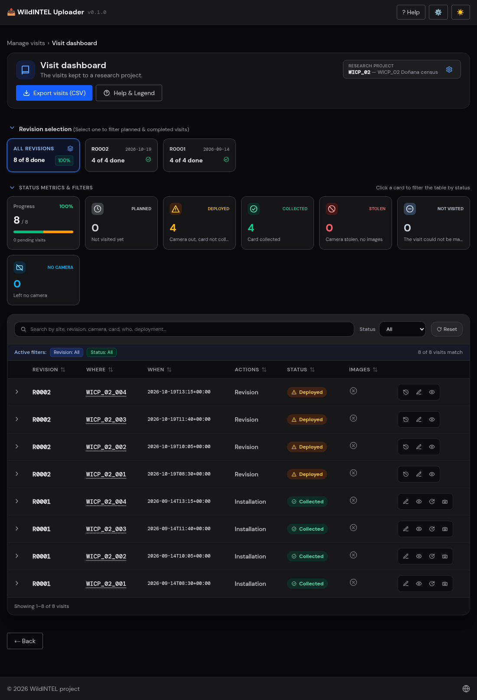

### Managing deployments

The images of each card collected are a **deployment**. With the cards copied to our computer, from the menu we press **📷 Manage deployments** and **Import deployment** — one folder of images from one camera — or **Import deployments** — a folder with the images of several cameras (see [Manage deployments](#6-manage-deployments) and [Import deployments](#7-import-deployments)). The app checks the images and keeps them in the collections folder, one **collection** for each revision. The location, the camera and the dates are taken from the visits.

The images go through a preprocessing that adds data to each one — who owns it, who publishes it, where it was taken and under which license — so those data have to be configured first. In Settings, in **Preprocessing › Authorship**, we fill in, for example, **Owner** and **Publisher**: `University of Huelva`, and **Coverage**: `Parque Nacional de Doñana` (see [Preprocessing](#preprocessing)).

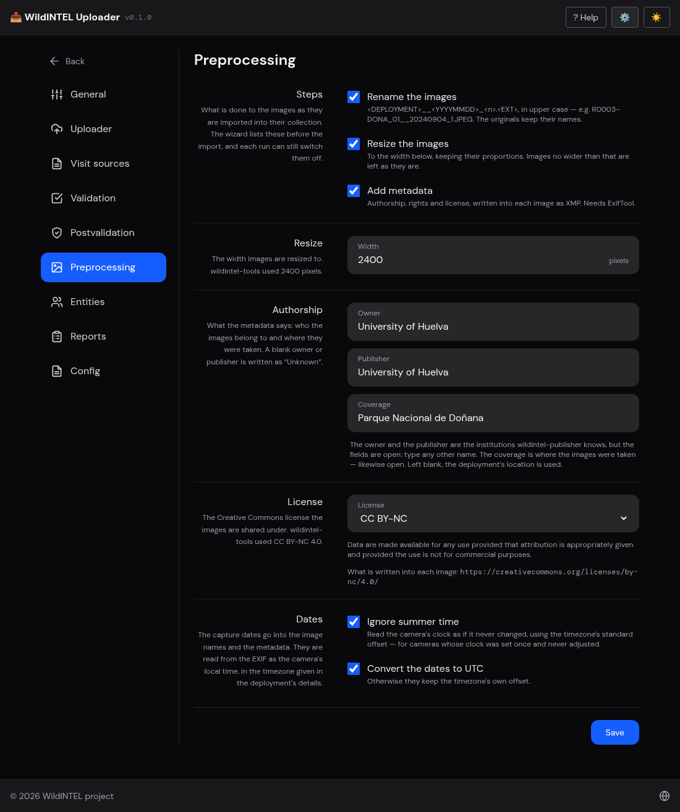

### Managing uploads

Last, the collections are uploaded to Trapper. First, in Settings, in **Uploader › Trapper**, we fill in the server, our username and our password — we can test them right there (see [Trapper](#trapper)). Then we press **☁️ Manage uploads › Upload deployment to Trapper**, choose `WICP_02` and the collection — `R0001` — and what to upload (see [Upload a deployment to Trapper](#8-upload-a-deployment-to-trapper)). The uploads dashboard says what has been uploaded and what is still to be.

## 2. Settings

Press **⚙️ Settings**. It has its own sections on the left; one **Save** saves them all, and a red
dot marks a section with an invalid value.

### General

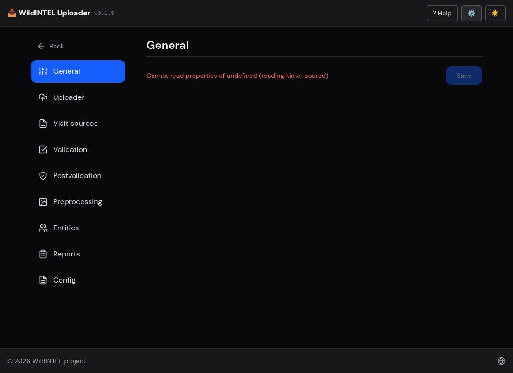

- **Data folder** — where the app keeps what it makes: the collections, the reports and the packages, each in a folder inside it. Blank uses
  `Documents/wildintel-uploader`; a path must be absolute (or start with `~`).
- **Collections folder**, **Reports folder** and **Packages folder** — where the collections, the reports of the checks and the packages made to upload to Trapper are kept. Blank, each is a folder (`collections`, `reports`, `packages`) inside the data folder; set one to keep it somewhere else, on another disk for instance. A path must be absolute (or start with `~`). What is already kept in the old place is not moved: do it by hand.
- **Workers** — how many images are validated and preprocessed at once. Up to the number of
  processors of your machine pays off; the default is that number, up to 4.
- **Log level** — how much the app logs (`ERROR`, `WARNING`, `INFO`, `DEBUG`). At `DEBUG` it logs
  every step.
- **Log file** — download it, or delete it. It lives in the log folder of your system (`~/.local/state/wildintel-uploader/log` on Linux), which can't be changed. It rotates at 5 MB keeping the last 5. Attach it to any
  bug report.
- **About** — at the top: the app's name and version, **Check for updates** (it offers the download when there is a newer version), and links to **Report a problem** (a GitHub issue that already says the version and your browser), the **Documentation**, the **GitHub** project and **What's new** (the release notes).

- **Keep the seconds in the logs** — the start and the end of the deployments written in the `FileTimestampLog` and the `FieldworkLog`, for the visits of any origin. Off by default: they are cut to the minute.

### Uploader

The platforms a deployment can be uploaded to, each set up on its own tab. **Trapper** is the only one for now; the section is there so that other platforms can be added in a future version.

#### Trapper

Each platform can be **used or not** — a check at the top of its tab (a green dot on the tab says it is used). One not used is not offered, and has no card in the Uploads dashboard.

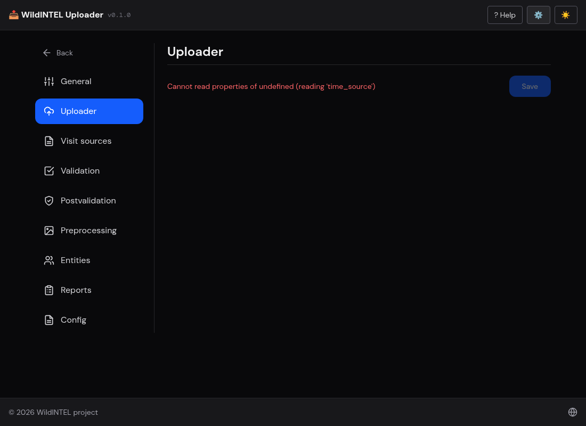

The server's **URL**, and the **username** (its email — Trapper's import form only accepts
that) and **password** of your account. **Test connection** reports the research projects it can
see. The password is saved in `settings.toml` but never sent back to your browser.

**Upload packages — Largest package** is the size, in MB, of the packages an [upload](#8-upload-a-deployment-to-trapper) makes: the
images of each deployment are uploaded in packages of this size at most (500 by default, up to 5000).

#### Agouti

What an upload to Agouti needs: the address of its API (usually `https://api.agouti.eu`), the **API key** that Agouti's support gives (kept private, and a blank key on saving keeps the saved one) and the **id of the project**. Nothing is uploaded to Agouti yet: the form only keeps these, and it is off by default.

### Visit sources

The places the visits of a research project can be taken from, besides entering them by hand, each set up on its own tab — the sources are **WildINTEL Epicollect Legacy CSV**, **WildINTEL Epicollect CSV**, **Custom CSV** and **Epicollect**. Each can be **used or not** — but Custom CSV, which is always offered —: a check at the top of its tab (and a green dot on the tab); a source not used is not offered in *Register visits*. The section is there so that other sources can be added in a future version.

#### WildINTEL Epicollect Legacy CSV

The visits are read from the **CSV file downloaded from the original WildINTEL Epicollect project** (*Register visits › WildINTEL Epicollect Legacy CSV*), with the datasheet of visits if you have it: no connection to Epicollect is needed. Here is how the file is read:

- **The time of a visit** — *when its entry was created* (`created_at`, UTC; the default) or *the date and the hour typed in the form*. The hour typed is the wall clock of the visit's location, and is used when the row has a date and an hour; otherwise the time of the entry. The day typed that differs from the day of the entry is warned of.
- The columns are found by their names (`1_Responsable`, `4_Location`, `6_Action`, and the Camtrap DP fields by their names), whatever the case or the number in front, in English or in Spanish: there is nothing to say about them.

#### WildINTEL Epicollect CSV

The visits are read from the **CSV file downloaded from the new WildINTEL Epicollect project**, the form of the field flow (*Register visits › WildINTEL Epicollect CSV*). There is nothing else to set up: the columns are found by the label of their question.

#### Custom CSV

Always offered in *Register visits*, and it cannot be turned off. There is nothing to set up: the columns are matched when each file is read (see [Custom CSV](#custom-csv)).

#### Epicollect

The connection to Epicollect5 and the mapping of its questions, to read the entries of a project directly: for the details of a deployment and, as a **Custom CSV**, for visits — its entries are downloaded as a CSV and read like any other.

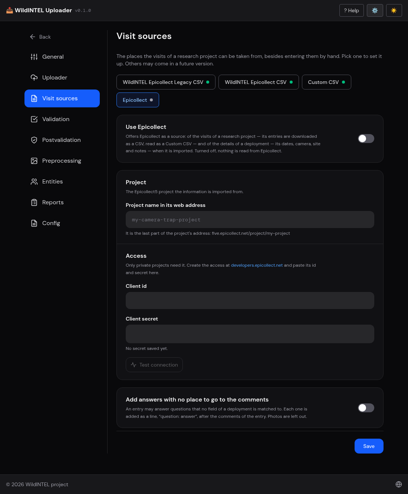

The Epicollect5 project the deployments' information will be imported from (see [Dates and details](#stage-3-dates-and-details)): its **slug**, the
name in its URL (`five.epicollect.net/project/<slug>`), and, only if the project is private, the **client id** and **secret** of
its API client, which you create at <https://developers.epicollect.net>. **Test connection** reads the project with what is typed — saved or not — and says its name and how many inputs
it has; a blank secret is the saved one. The **Import deployment information from Epicollect5** switch turns the use of Epicollect5 on or off — it is off until you turn it on, and while it is off nothing is read from Epicollect5. **Add them to the comments** sends what an entry answers in the inputs that are not mapped to any field to the comments of the deployment, a line each (*question: answer*; photos are left out). Below, the **Mapping** relates each field of a deployment to an input of the project's form. Epicollect5 has no input for a date and a time together, so the day and the time of the start and of the end are mapped apart, along with the revision. What an entry gives fills the camera, the site and the notes of a deployment; it is **no longer a source of its dates** — those come from the visits, the timestamp log or the photos.

### Validation

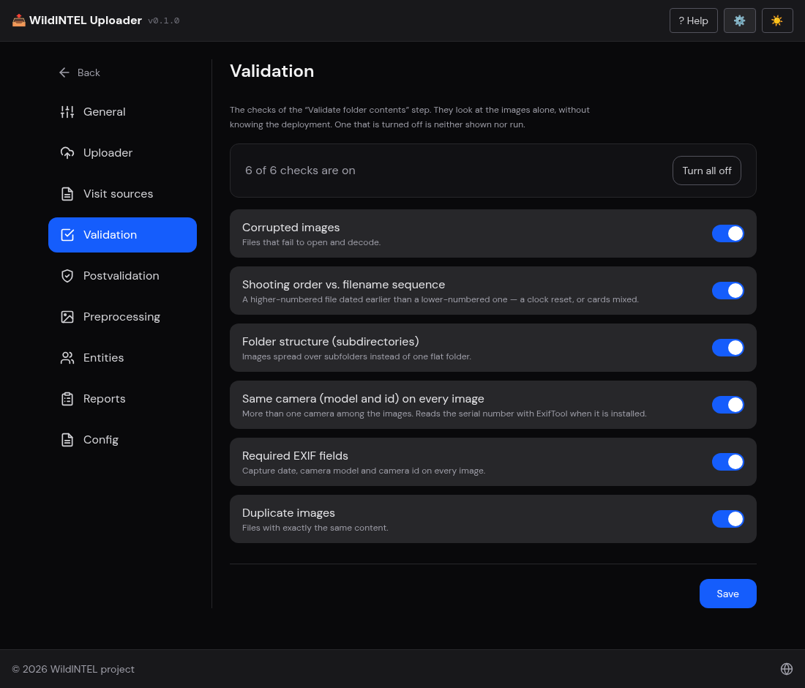

Which of the [folder checks](#stage-2-images) the wizard shows. Each is an entry with a switch;
turn off the ones you never want to see. They are all on by default.

### Postvalidation

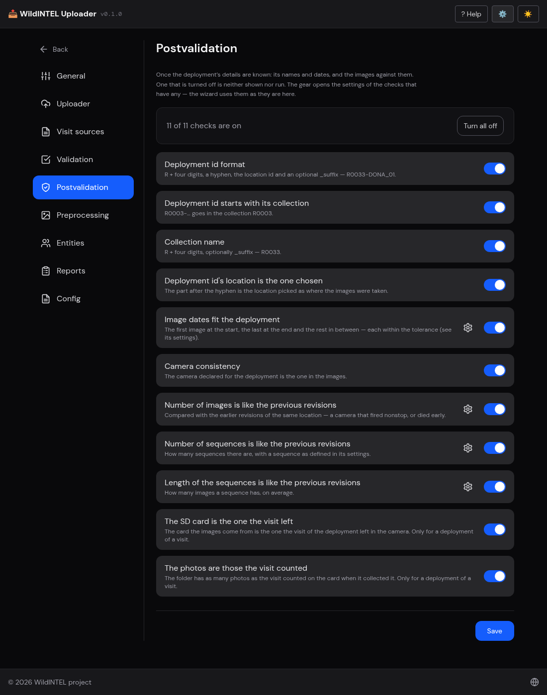

Which of the [postvalidation checks](#stage-4-check-details) the wizard shows, and what the ones
that take a value mean:

| Setting | Default | |
|---|---|---|
| Tolerance | 1 hour | Leeway around a deployment's start and end for the image dates. |
| Sequence gap | 60 s | What a *sequence* is: a new one starts when the gap to the previous image is at least this. |
| Compared with | median | What this revision is compared to: the **median** or **mean** of the earlier ones, the **last** one, or the **range** they span. |
| Previous revisions needed | 2 | With fewer, the statistical checks are skipped. |
| Number of images / sequences / length of sequences | 50 % each | How different a value can be and still count as similar. |
| SD card / Photo count | on | The two checks of a deployment [of a visit](#stage-4-check-details): that the card is the one the visit left and that the photos are those it counted. |

### Preprocessing

What a new import does to the images — the wizard lists it before preparing, and a run can still
switch each step off.

- **Steps** — rename, resize, add metadata.
- **Resize width** — 2400 px by default; wider images are shrunk to it, narrower ones left alone.
- **Authorship** — **Owner**, **Publisher** and **Coverage** (where the images were taken; blank
  uses the deployment's location), written into each image. A blank owner or publisher is written
  as "Unknown".
- **License** — picked from a list: **CC0** (any use, no requirements), **CC BY** (any use with
  attribution) or **CC BY-NC** (with attribution, not for commercial purposes), the default. What is
  written into each image is the license's URL, shown beside each name.
- **Dates** — **Ignore summer time**, and **Convert the dates to UTC**.

### Entities

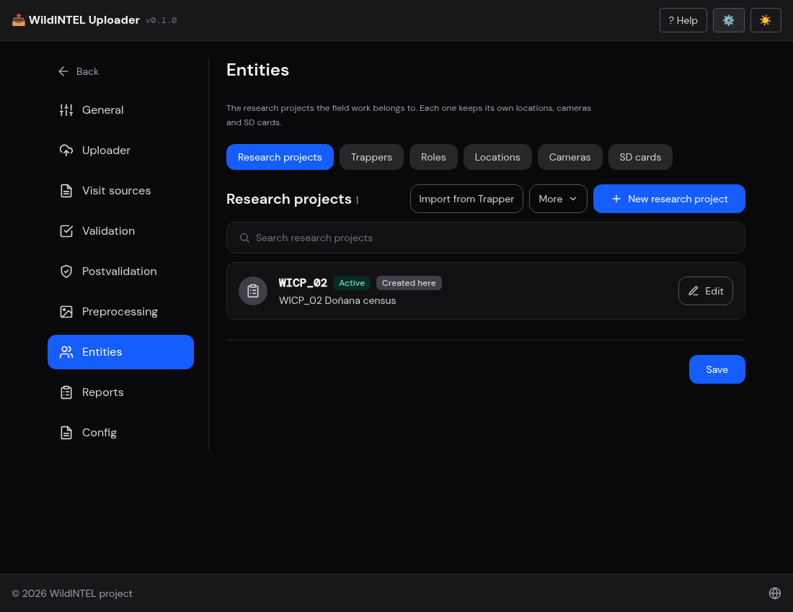

The things the visits and the deployments refer to, one tab each: **Research projects**, **Trappers**, **Roles**, **Locations**, **Cameras** and **SD cards**.
Each can be added one at a time, taken from Trapper (research projects and locations) or loaded from a CSV with **Import CSV** (there are
examples in `examples/entities_example/big` (and a small one in `small`), explained in `examples/CSV.md`). Locations, cameras, SD cards and roles belong to a research project: pick it first. The **trappers**, the people, belong to none: they are the same whatever the project, and what each is in a project is its **role**. The page of each location, SD card and camera shows its **QR code** (it says `wildintel:<camera|sdcard|location>:<research project>:<id>`), with a button to download it as an SVG to print on a label.
A location's **time zone** (UTC unless you say another) and whether its cameras ignore summer time are chosen when it is created and **cannot be changed afterwards**: the instant of every visit to it was worked out with them. The **locations**, **cameras**, **SD cards** and **roles** belong to a research project and are kept in its folder of the collections folder (`<research project>/locations.json`, `cameras.json`, `sd_cards.json` and `roles.json`, beside its `visits.json`), so they travel with its collections. The **trappers**, the people, are kept beside the folders of the research projects (`trappers.json` in the collections folder), not in the settings. Cameras, cards, roles and trappers kept in the settings file by an earlier version are moved to where they belong the first time they are needed. A camera or a card can be *active* or not; the visits only offer the ones in use.

A **trapper** has a **username** — required, with no spaces, and no two trappers have the same, whatever its case, as the label of an SD card is —, a **full name** (how a visit says who went), an **affiliation** and an **email**, which are optional. The trappers kept before the username existed get one made from their name (`Ana Pérez` is `ana.perez`) when the settings are read. In **Import CSV** the columns are `username`, `name`, `affiliation` and `email`: a row with no username or no full name is left out, and said.

The visits and the roles remember **which** location, camera, SD card or trapper they are of, not only what it is called. So correcting the label of an SD card, the id of a camera or the username of a trapper changes nothing else: the visits and the roles are still of the same one, and say the new name.

**Nothing is deleted for good.** What is deleted — a research project, a location, a camera, an SD card, a role or a trapper — is kept, with the day it was deleted, and is only no longer listed; if it is added again it comes back with the day it was created. Everything also says when it was created and when it was last changed. What is no longer used is *archived*, which is a status of its own: an archived location, camera or SD card is still listed. A location can be deleted unless it has visits or comes from Trapper, and an SD card can be marked as stolen. Press **Save** to keep what you changed.

### Reports

Every **validation**, **postvalidation**, **preprocessing** and **repair** leaves a **report** of what it checked and did,
image by image. The step shows it right below its results — the same file you can download, so what you see is
what is kept:

- the **checks**, with how many images passed and how many failed each;
- the **images that failed**, with the check and why — *IMG_0087.JPG · Duplicate images · same content as IMG_0087 (copy).JPG* —
  that can be narrowed to one check, and are shown 100 at a time;
- **Download CSV** — a row per image and check, to open in a spreadsheet — and **Download JSON**, with everything: when it
  was made, the folder, the parameters it was run with and every entry.

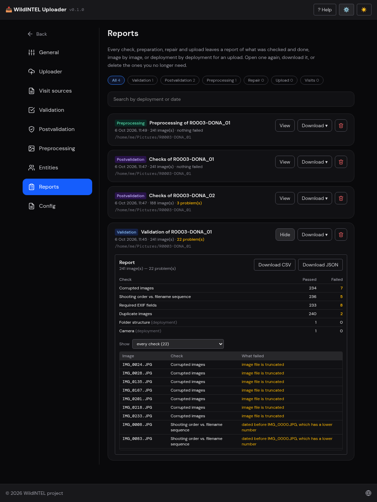

What each report holds:

| Report | An entry for | Says |
|---|---|---|
| **Validation** | each image and check — corrupted, shooting order, EXIF fields, duplicates —, and the folder for the structure and camera checks | The ones that passed too, so the report says what was checked, not only what failed. |
| **Postvalidation** | the deployment for the naming and statistical checks, and each image for its date and camera | Why a check failed — *241 images — like the previous revisions (median 238, ±50 %)*. |
| **Repair** | each image and check, and each metadata file | What the repair wrote and what the images passed, as the new seal says — and the preprocessing checks: names, size, metadata. |
| **Preprocessing** | each image | What was done — *IMG_0001.JPG → R0003-DONA_01__20240904_1.JPEG; date 2024-09-04T11:10:00+00:00 (exif); resized* — and the ones that were **skipped**, with the reason. |

**Settings › Reports** lists all of them, newest first, with *View*, *CSV*, *JSON* and *Delete* (which
asks again). They are kept in the `reports` folder of the data folder until you delete them. A check you run twice
makes two reports.

### Multiple configs

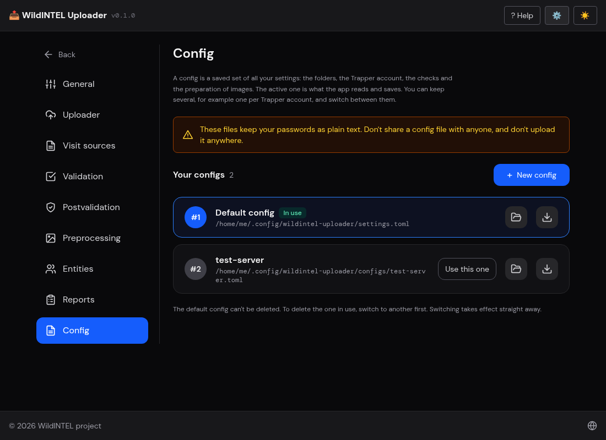

The application lets you define several different configurations: **+** adds one with the default
values, and choosing one makes it the active one — handy to switch between two Trapper servers (a
test one and the real one) or two sets of authorship. Each can be downloaded, and its folder opened.

## 3. The task menu

Once it is configured, the menu is where you choose what you want to do:

| Task | What it's for |
|---|---|
| 📋 **Manage visits** | **Register visits** to the camera traps — who went, when, to which site and what was done — or the **visit dashboard**. The deployments are worked out from the visits. |
| 📷 **Manage deployments** | **Import deployment** — check one folder of images and organize it in the collections folder —, **Import deployments** — one or several closed visits — or **show the status of the deployments**. |
| ☁️ **Manage uploads** | **Upload deployment to Trapper** — send deployments already kept locally — or **show the status of the uploads**: each revision with how many of its deployments are on Trapper, and the deployments still to be uploaded. |
| 🧰 **Utils** | *Check and fix dates and times* compares the dates of a folder's images with the period of the visit, when the camera clock went wrong, and shifts or removes the ones that cannot be trusted (every fix is written down). Maintenance of the local collections: *Sync local collections* brings the collections folder up to date with what Trapper already has, and *Repair local deployments* checks which deployments are still valid and writes the metadata files of the others again from their folders. |

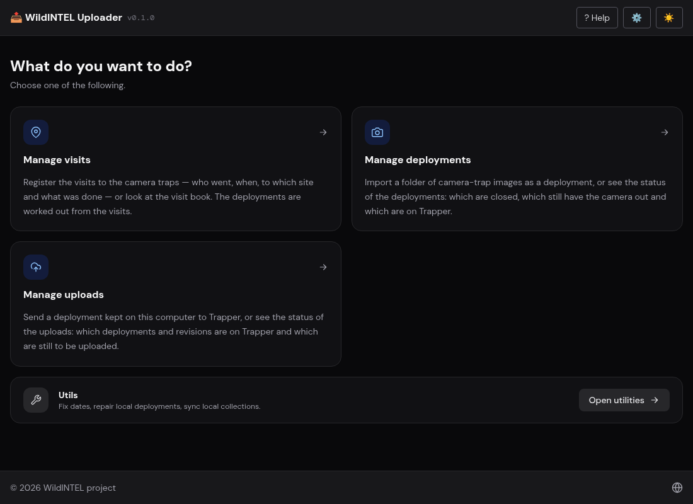

The usual order is **Register visits** first, then **Import** (or **Import deployments**) — which take the location, the camera and the dates from the visits — and then **Upload**. *Sync* is for when
Trapper already holds deployments that this computer's collections folder doesn't know about (**Utils › Sync**).

The title in the top bar takes you back to the welcome screen at any time; **? Help** opens this
documentation, and the sun/moon button switches between dark and light.

If the app was closed in the middle of an import, the first thing you see is the list of
**unfinished runs** — see [Unfinished runs](#4-unfinished-runs).

## 4. Unfinished runs

An import saves its progress as you go. If you close the app, or it fails, the next time you start
it the first screen lists the **unfinished runs** — the folder, the research project and when it
was started — each with **Resume** and **Discard**. Resuming takes you back to the step after the
folder was chosen. Passwords are never saved with a run.

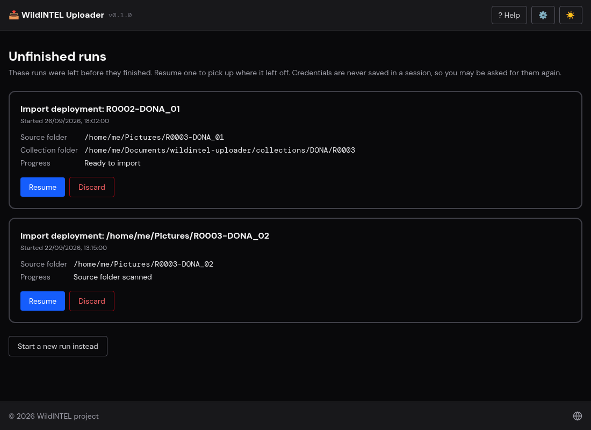

## 5. Manage visits

Press **📋 Manage visits**: it offers **Register visits** and **Visit dashboard**.

### Visit dashboard

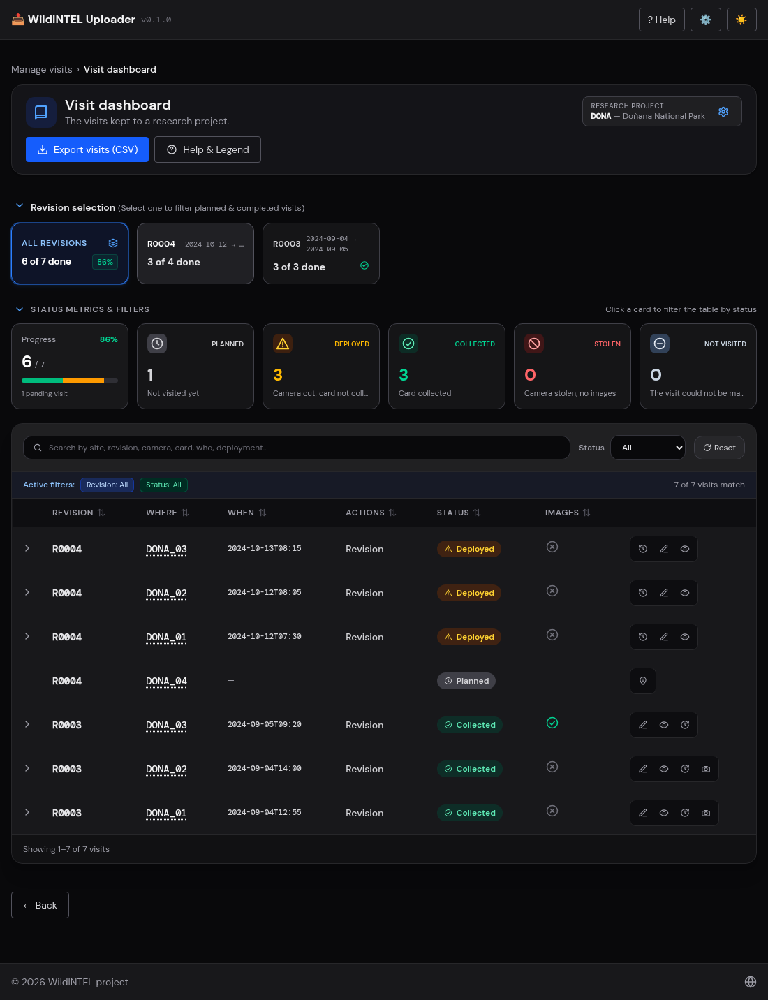

The dashboard is of the **default research project** (the one set in Settings › General). Its head has the title, a line of buttons under it and, at the far right, the **research project** card — its label, its acronym and name, and a gear that goes to the settings where it is changed:

- **Export visits (CSV)** — downloads the visits kept as a CSV that [Register visits › Custom CSV](#custom-csv) reads back as they are (it is there when the project has visits).
- **Help & Legend** — opens a panel at the right with the legend: the *overall progress*, the *visit states*, the *data states* and the *filters and search*. It closes with its cross, with **Got it, close**, by pressing the background or with Escape.

Under the head are three blocks, in this order:

1. **Revision selection** — a revision is one visit to every site. A card for *All revisions* (the visits done of all, and the percentage) and one for each of the five most recent revisions (*R0003*, *R0002*… with the days it went from and to, *N of M done* and a tick when every visit is done); the older ones are in the **Older revisions** list at the right of the title. Picking one narrows everything below to it.
2. **Status metrics & filters** — the **Progress** card (the share of visits done, with a bar and the number pending) and a card for each state, with its count: *Planned*, *Deployed*, *Collected*, *Stolen* and *Not visited*. Pressing a card shows only those visits; pressing it again shows them all.
3. **The table** — one panel with the search, the filters and the rows.

The chevron at the left of *Revision selection* and of *Status metrics & filters* **folds the block away**, to leave only the table; press it again to bring the block back.

**The table.** At the top, a search (by site, revision, camera, card, who, deployment…) with a cross to clear it, the **Status** list and **Reset**, which puts every filter back (the search, the status and the revision). Under them a line tells the **active filters** — *Revision: R0003 · Status: Collected* — and how many visits match. The list is paged, ten rows at a time, with its foot (*Showing 1–10 of 24 visits*, *Prev*, the pages and *Next*), and can be **sorted by a column** — press its name, and again to turn it round (the rows not made always go last).

Besides the visits made, the table has a row — status **Planned**, with no day, no actions — for each location of the research project (but the archived ones) that has no visit in a revision the visits have: if the project has 60 locations, each revision has 60 rows. A revision before the first visit of a site is **Unknown**: nothing is known of it, and it can be filled in with the pencil button.

A visit is one row: its **Revision**, **Where** (the site), **When**, the **Actions**, its **Status** — *Planned* (not made yet), *Deployed* (it left a camera that is still out), *Collected* (a later visit collected the card it left), *Stolen* (the camera it left was stolen: its deployment is closed with no images, and there is nothing to create), *Not visited* (the visit could not be made) and *Unknown*; nothing for a visit that left no camera — and **Images**: a tick once the deployment is made and its images are stored, which opens [Deployments dashboard](#deployments-dashboard) on that deployment; a grey crossed circle when they are not stored, because the card was not collected or the camera was stolen.

**The details of a visit.** The **chevron** at the left of a row opens its details, and the row is marked with a blue band while they are open; press the chevron — now pointing down — to close them. The eye button in the row does the same. The details show everything the visit says: the actions, who went, the camera and its model, the **SD card left** and the **SD card collected** — the one the visit before it left at the site, with the photos it holds; when no visit before it is known (the revisions before are unknown) it says so —, the status of the camera, the card and the batteries, the coordinates, the notes and its instant in UTC.

**The buttons of a row** are together, in a box of their own, and only the ones that apply are there: the visit of the revision **before** and the one **after**, to the same site; **edit** the visit; **fill in** an unknown visit; **create the visit** that was planned; **view** its details; and **create the deployment** — it opens [Import deployment](#import-a-deployment) with the research project and that visit already chosen — on a *collected* visit that has none yet.

The [Deployments dashboard](#deployments-dashboard) and the Uploads dashboard have the same head, panel of help, folding blocks and table.

### Register visits

Press **Register visits**.

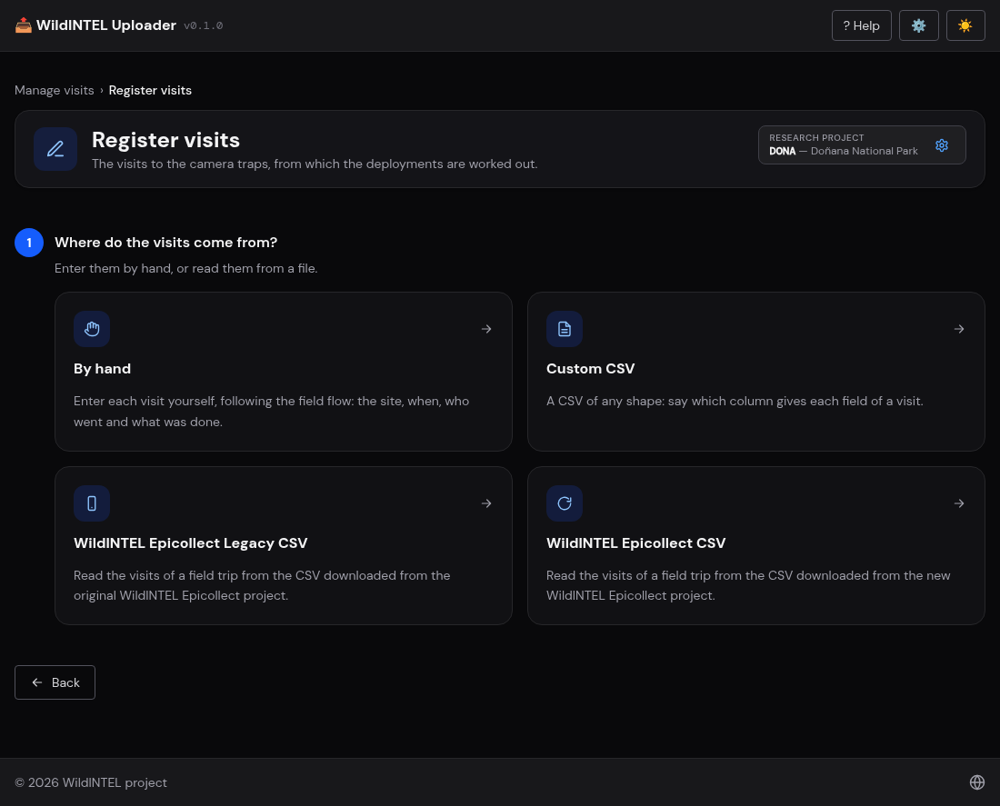
 A **visit** is one trip to a camera trap: when it was, which site, who went and what was
done. The visits of a research project are kept in its `visits.json`, and the deployments are worked out from them: a
deployment goes from the visit that **left** a camera to the one that **collected** its card. Choose the research project and how
the visits come in:

| Source | What it does |
|---|---|
| **By hand** | You fill in each visit yourself, following the field flow: the site, when, who went and what was done. |
| **Custom CSV** | A CSV of any shape: the page shows its columns and you say which one gives each field of a visit. When Epicollect is turned on in the settings, the CSV can also be **the entries of an Epicollect5 project** (*Epicollect5 project › Download the entries*), read the same way. |
| **WildINTEL Epicollect Legacy CSV** | Reads the visits of a field trip from the CSV downloaded from the original WildINTEL Epicollect project. The time is the `created_at` of the entry, put in the timezone of the location — or the date and the hour typed in the form, as the settings say. |
| **WildINTEL Epicollect CSV** | Reads the visits of a field trip from the CSV downloaded from the new WildINTEL Epicollect project (the form of the field flow): the columns are found by the label of their question. |

The sources that are turned off in the [settings](#visit-sources) are not offered, but *By hand* and *Custom CSV*.

A file can come with a **history of visits** (optional): the fieldwork datasheet, an `.xlsx` workbook whose first sheet has a Site and an Action column (Trappers, Session, Date, Time, Camera, NumPhotos, SD… or Tramperos, Sesion, Fecha, Hora…
— found by their names, as in an Epicollect download). The history **completes the visits kept**, and then the file's are applied on top of both: sessions, what is already kept and what is odd are told with all of it in front. Its visits come first in the list, and its rows
that cannot be read appear as *History row N*.

Besides the visits and the rows with problems, reading a file says what is **worth knowing** without being wrong — the sites visited on the trip before and not on this one (their cameras are still out and
their deployments stay open), visits where nothing was collected (*Not revised*), visits with no photo count —, and warns of a **jump in the session numbers** and of a row whose **session, site, camera and actions** are those of a
visit already kept (it is that visit, left as it is). When the visits are kept, **a report** of the import is written beside them (`visits_import_<day>_<time>.txt`), and **Show the deployments** lists, by collection, the deployments the
visits say: the closed ones and the ones whose camera is still out.

When a file is read, the visits that were found are listed and the ones that are fine can be kept; the rows that cannot be read or that break a rule are listed with why, and are **not kept**.

#### The rules of a visit

A visit follows the same rules **by hand and from a file**: the one that breaks them is refused — by hand, with the reason; from a file, with its row and a **label of its own** for each rule. The rules compare the visit with the visits before it **by date** — not only with the revision before — and with the other visits of its revision:

| Label in the results | What it says |
|---|---|
| *Site is not a location* | The site is not a location of the research project (see *Sites that are not locations*, below). |
| *Visit already there at that time* | The site already has a visit on that day and at that time. |
| *Site visited twice in a revision* | A revision is **one visit to each site**, whatever the day. |
| *Visit not after the last one of the site* / *Revision out of order* | A visit is after the last one to its site, and a revision is after the revisions before it and before the ones after it. |
| *Revision started before the one before is finished* | A revision starts when the one before it has a visit in every location that is not archived. |
| *Revision closed* | Every location has its visit in that revision: nothing new is added to it. |
| *First visit is not an Installation* | The first visit to a site puts the camera up. |
| *Something its actions ask is missing* | An Installation asks for the camera and the card it leaves; a Revision, the camera and the photos it collected (not when the card was full); a Desinstallation, the camera and the photos; a Stolen camera, the camera. |
| *Not the camera at the site*, *Camera already installed here*, *Camera installed at another site* | A Revision, a Desinstallation or a Stolen camera is of the camera that is at the site (to change it, add an Installation to the visit); a camera is not put up where it already is, nor while it is at another site. |
| *SD card archived*, *SD card left is the one collected*, *SD card in another camera*, *SD card collected in this revision* | The card left is not archived, is not the one the visit collects, is not in the camera of another site, and was not collected in the same revision. |
| *Site archived*, *Archive with an Installation*, *Camera still there when the site is archived* | An archived site has no visits after the day it was archived; a visit that archives it puts no camera up and takes the one that is out away (or finds it stolen). |
| *Camera not in the research project*, *SD card not in the research project*, *Trapper not in the settings* | The camera, the SD card and who went have to exist — by hand and in a file — unless the import is asked to create the camera or the card. |

What the form only **questions** — a Revision with no photos, a camera or a card at two sites in a revision — is still kept, with a warning.

**What an unknown revision hides is not checked.** A revision before the first visit of a site is *unknown*: nothing is known of it — no day, no camera, no card. So the first visit to a site in a revision after `R0001` may be any, and what a visit left at a site (which camera is there, which card is in it) is **not trusted for a later visit when an unknown revision of that site lies between them**: nobody knows what was done in it. An unknown revision counts as a visit to finish its revision, and a real visit that comes later takes its place.

**A visit already kept** is the one of the **same revision and site**, whatever the day: a row like that is left as it is and counted as *already kept*. Only a row with no revision — it gets the next of its site — is told by the site, the day and the time.

- **Sites that are not locations.** A site of the file that is not a location of the research project may be a site that is really new or one misnamed in the field. Its visits
  are held, and the site is shown with what tells the two apart: **how far** its first visit was from the nearest location, and the locations whose id is **one character apart**
  from its own (*it may be a misprint*). If it is new, **Add … as a location** keeps it with the coordinates of its first visit and reads the file again (**Add the N sites with coordinates as locations** does it for all the ones whose file has the coordinates and that do not look like a misprint — no id one character apart, no location within 100 m); if it is a misprint, correct
  the id in the file and read it again.

#### By hand

A visit is a form with these parts:

1. **Actions** — one or several of *Installation* (a camera is put up and a card left), *Revision* (the card is collected and another left),
   *Desinstallation* (the camera is taken away with its card) and *Stolen*. The rest of the form depends on what is chosen: what the actions do not
   ask is left out. When the camera was already visited, **the Camera, Site and Grouping sections come filled in from the last visit** (not its notes).
2. **Camera** — the camera (picked from the active ones of the project, or added from here) and how it is placed and set: height or depth, tilt,
   heading, delay, detection distance, its status, whether the batteries and the clock were right. **It comes before the SD card**.
3. **SD card** — the card left in the camera, how many photos the card collected, and whether it was full. It says which card was in the camera
   according to the visit before.
4. **Site** and **Grouping and notes**, as in the details of a deployment.

Each field is marked *required* or *optional* according to the actions.

The camera and the SD card are picked from those of the research project, and who went from the trappers of the settings; the form is refused if they are not. The rules above are checked by the server, whatever page sends the visit, and the form says why a camera or a card cannot be used as soon as it is chosen. A visit that is wrong can be **edited** from the dashboard, with the same rules checked — also on the visits after it that the change touches.

#### Custom CSV

Any spreadsheet with a row per visit. Press **Register visits › Custom CSV**; the research project is the default one. The steps:

1. **Choose the spreadsheet file.** When Epicollect is turned on in the settings, first say **where the CSV is**: *A file on this computer* or *Epicollect5 project* — with the latter, **Download the entries** reads them from the project of the settings and goes on as a file does. Pick the CSV (optionally, the *history of visits* `.xlsx`). Choosing the file does **not** move on: the step stays open with **Create what does not exist yet** — switches for the **locations**, the **cameras** and the **SD cards** the file names that are not in the project, each created with the visits; each asks for more fields in the matching, where a default can also be given — and the buttons **Back** (to the research project) and **Continue**.
2. **Match the columns.** For each field of a visit, the column of the file that gives it. The fields are in groups, as in the form of a visit by hand — *Who*, *Where*, *When*, *The visit*, *SD card*, *Camera*, *Site*, and *Grouping and notes* —, each with an example from the file. Each group is a card with a **chevron at the left** that folds it away, and says how many of its fields are matched (*3 of 5 matched*). What has the name of a field (`location_id`, `session`, `date`, `time`, `actions`, `trappers`, `camera_id`, `sd`, `num_photos`…) is matched by itself; pick the rest, or give a **default** for a field the file has no column for. The site and the actions are required; the time is a date and a time, or — when the file has it — the instant of an entry (`created_at`), as the *visit sources* setting says. Dates may be written day first. A visit with no revision gets the next one of its site. Press **Read the visits**.
3. **Check and add the visits.** What the file says, before it is kept: *N visits to add · N already kept · N rows with a problem*, the new sites, what is worth knowing and what is odd. Then the **rows** of the file, laid out like a dashboard:
   - **Revision selection** — a card for *All revisions* and one for each revision the file has (the five most recent as cards, the older ones in the **Older revisions** list, for a file with many). Picking one narrows what is below to its rows.
   - **Status metrics & filters** — the **Progress** card and a card for *Rows read*, *Ready* (new visits), *Skipped / Existing* (already kept, or ignored) and *With problems*. Pressing one shows only those rows; pressing it again shows them all.
   - **The table** — the search (by row, site, visit, action…), **Group by** — *Row* or *Error* — and **Reset**, with a line of the **active filters**. Grouped **by row**, each row of the file has its **Row**, **Visit**, **Site ID**, **Actions**, **When** and **Status** (*Add*, *Add · to check*, *Skipped / Existing*, *Skipped / Ignored* or *Error*); the **chevron** at the left of every row opens its details — what is wrong with it, when something is, and what it says when it is fine — and marks the row with a blue band while they are open; the **eye** button shows what the row says, field by field. Grouped **by error**, each kind of error is a row with how many rows have it, and its chevron opens those rows.

   Press **Add N visits** to keep them.

When the visits are kept, the end says how many were added and, if they **closed other visits** — a visit closes the one that left the camera whose card it collects —, how many: **pick their revision and import their images** is a link to [Import deployment](#import-a-deployment) on the research project. A **report** of the import is written with the other reports.

The rows are read as their fields take them: *a date that is not a date*, *actions that are not Installation, Revision, Desinstallation, Stolen or Archive*, a card code that is not OK, Card full, No batteries or Card full and no batteries, or photos that are not a whole number, are rows with a problem, and none of them is kept. The visits are then checked with [the rules of a visit](#the-rules-of-a-visit), in the order of their instants, each against the ones kept and the ones of the file before it. The visits of a file that fill unknown revisions of the visits kept are checked together, with the ones after them that they touch.

There are example files of every case — all correct, three revisions, a revision that starts before the one before is finished, unknown sites, rows that cannot be read, a card that is left where it cannot be, a theft and a site given up, columns to match by hand — in [`examples/visits_example`](https://github.com/wildintelproject/wildintel-uploader/tree/main/examples/visits_example), in folders by the group of entities they are made for: `custom_csv/small` (the research project `WICP`), `custom_csv/wicp_02` (`WICP_02`) and `custom_csv/aicc` (`AICC`), and the downloads of Epicollect in `wildintel_csv` and `legacy_wildintel_csv`.

**The deployments the visits say, and the logs of the collections.** Each site's visits, in order, give a deployment for every pair where the first **left a camera** (an Installation or a Revision)
and the second **collected its card**: it goes from the one to the other and is *closed*. It belongs to the collection **the session of the visit that collected it names, minus one** — R0013
collects the deployments of R0012 — and that is the revision [Import deployment](#import-a-deployment) gives it. A camera that was left and has not been collected is *open*: it will belong to
the collection that the visit that collects it names. When a visit is registered — by hand or from a file — the **folder of each collection it changes is made**, with its `collection.json`, and so are its logs — they are written automatically, with no button for it, in the folder of each collection, its `<R000N>_FileTimestampLog.csv` (the
closed deployments' start and end, as the cameras' wall clock) and its `<R000N>_FieldworkLog.csv` (every deployment, closed or open, with its fields as Camtrap DP names them, in UTC, in the order of the
[`FieldworkLog` columns](#import-a-deployment)). When the visit that left a camera and the one that collected it say different things of a field, both are kept: a text as `Setup: … | Retrieval: …`
(who set it up, the habitat), the tags and groups of both together, and a number, a yes/no or a feature type as the setup says it with the retrieval's value noted in the comments.

## 6. Manage deployments

**When the visits are registered** — by hand, from a CSV file or from Epicollect — the app says how many were added and asks what next: **register more visits** (it starts again at *Where do the visits come from?*), **back to the visits menu**, or **back to the main menu**.

### Deployments dashboard

Press **📷 Manage deployments**, then **Deployments dashboard**. It is of the **default research project**, and it has the same head — with the research project card at the top right and the **Help & Legend** button — as the [visit dashboard](#visit-dashboard). Under the head are three blocks, in this order:

1. **Revision selection** — a card for *All revisions* and one for each of the five most recent revisions (*R0003*… with how many deployments each has); the older ones are in the **Older revisions** list. Picking one narrows everything below to it.
2. **Status metrics & filters** — the **Progress** card (the share of the deployments that are created, with a bar and how many are to create) and a card for each state, with its count: *Planned* (the card was collected, so the images are to be imported and the deployment created), *Created* (the images are stored) and *Not created* (the camera was stolen, so there are no images: it is left out of the progress). Pressing one shows only those; pressing it again shows them all.
3. **The table** — one panel with the search, the *Status* filter and **Reset**, the **active filters** and how many deployments match, the rows and the foot with the pages.

The chevron at the left of the first two blocks folds them away, to leave only the table.

A deployment is one row: the **deployment** (`R0003-DONA_01`), **where**, **when** — the visit that started it (a link that opens the [visit dashboard](#visit-dashboard) on that visit, with its details) and the period —, its **SD card and photos**, its **Creation** (*Planned*, *Created* or *Not created*) and its **Upload**. The chevron at the left of a row opens its details, and the eye button does the same.

**The buttons of a row** are together, in a box of their own, and only the ones that apply are there: the deployment of the revision **before** and the one **after**, to the same site; **view** its details; **create the deployment** — a *planned* one, whose card was already collected: it opens [Import deployment](#import-a-deployment) with the research project and the visit that left the camera already chosen —; and **upload** — on a created deployment not uploaded yet (it opens the upload page on its revision). In the **Upload** column an uploaded one has a tick (the platform and the day, in its tip) that opens the uploads dashboard on its uploads. The camera still out or the card not imported is the state of the *visit*, not of the deployment. The **Show image details** button of a visit of the visit dashboard opens it on that deployment.

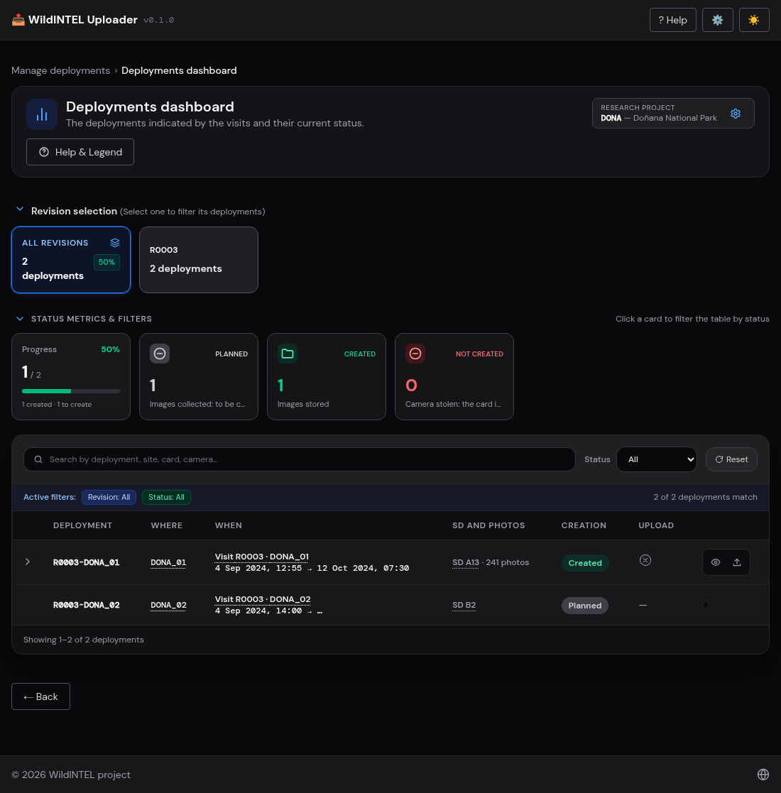

### Import a deployment

Press **📷 Manage deployments**, then **Import deployment**. This option is meant to import the set of images that come from a **single camera**: one
folder, one deployment. For a folder with the images of several cameras, one subfolder each, use
[**Import deployments**](#7-import-deployments).

It is a wizard of five stages — the bar at the top shows where you are, and a
stage can have steps of its own, which open one after the other. Each stage is **done** (a tick and a
summary, with a pencil to go back and change it), **open** or **locked** until the ones before it are
done. **Back** and **Continue** move between them.

| Stage | What it asks |
|---|---|
| 1. **Origin** | The research project and the visit (or the location) the images are of. |
| 2. **Images** | Which folder, which SD card, which checks, and how the images did. |
| 3. **Dates and details** | The revision, the period, and what you know of the camera and the site. |
| 4. **Check details** | The deployment's names and dates, the images against them, and against the visit. |
| 5. **Prepare and save** | The preprocessing, and saving the deployment in the collection. |

The bar of chips above each stage fills in as you go: the research project, the visit with its range of dates, the number of images and the card, and,
at the end, the id the deployment will have, its location and its dates.

### Stage 1 — Origin

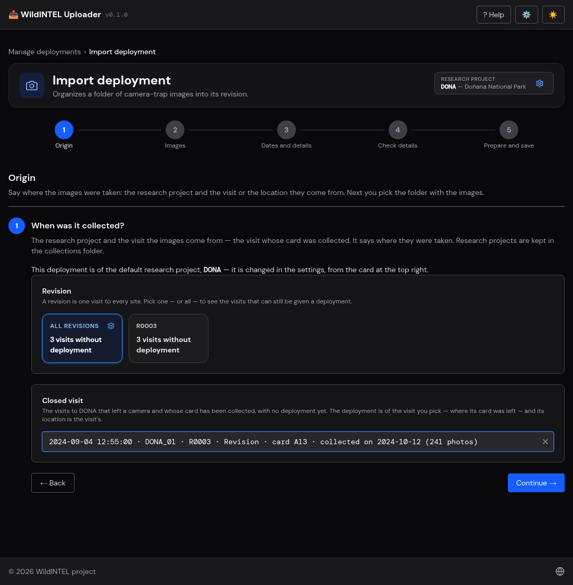

Where the images were taken, which tells the app what the deployment is **of**. It is of the **default research project** (the one set in Settings › General): the step says which it is, and it is changed in the settings, from the card at the top right. If there is no default one, the step first asks for the **research project**: pick one of those in the collections folder, or add a new one **by hand** (its name and acronym, which names its folder, and the rest of its fields) or **from Trapper** (tick one or more of those of your account: they are copied here; the app connects by itself with the account saved in the settings — it never asks for the credentials again; if there isn't one, it says so).

**When the project has closed visits** the step is **When was it collected?**:

- **Revision** — a revision is one visit to every site. A card for *All revisions* and one for each revision that has visits that can still be given a deployment, with how many. Pick one — or all — to narrow the list below.
- **Closed visit** — the visits to the project that left a camera and whose card has been [collected](#5-manage-visits), and that have **no deployment yet** (a visit that already has one is not offered). Picking one gives the deployment its **location**, its **revision** (the session of the visit) and, later, the camera, the site and the period: the deployment is *of that visit*.

If you start from a visit — from [Register visits](#5-manage-visits), or with **Create the deployment** of the [Deployments dashboard](#deployments-dashboard) — the project and the visit are already chosen.

**When the project has no closed visit** the step is **Where was it taken?**, and you pick the **location** yourself — one of those of the project, kept in the collections folder — and everything else is asked by hand. A new location can be added:

- **By hand** — a location's id, name, latitude, longitude, coordinate uncertainty, **timezone** and whether its cameras ignore summer
  time. A new location is **UTC, following summer time**, unless you say otherwise: the cameras' clocks are taken as UTC, and
  the time of a field visit is read in the timezone of its location.
- **From Trapper** — pick the project, or its locations, from your Trapper account and they are copied here, with their coordinates and timezone.

### Stage 2 — Images

In this stage you tell the app **which images** you are importing and find out, before anything else is done, **whether they
are in good shape**. You choose the folder with the images of the camera and the app counts what is in it; then you
choose which checks to run over the images alone — corrupted files, shooting order, subfolders, a single camera, the
photo data they need and duplicates — and how strict each one is. The result tells you how many images are valid and which
ones have problems, so you can fix them before going on. **Nothing is copied or changed yet: the source folder is only read.**

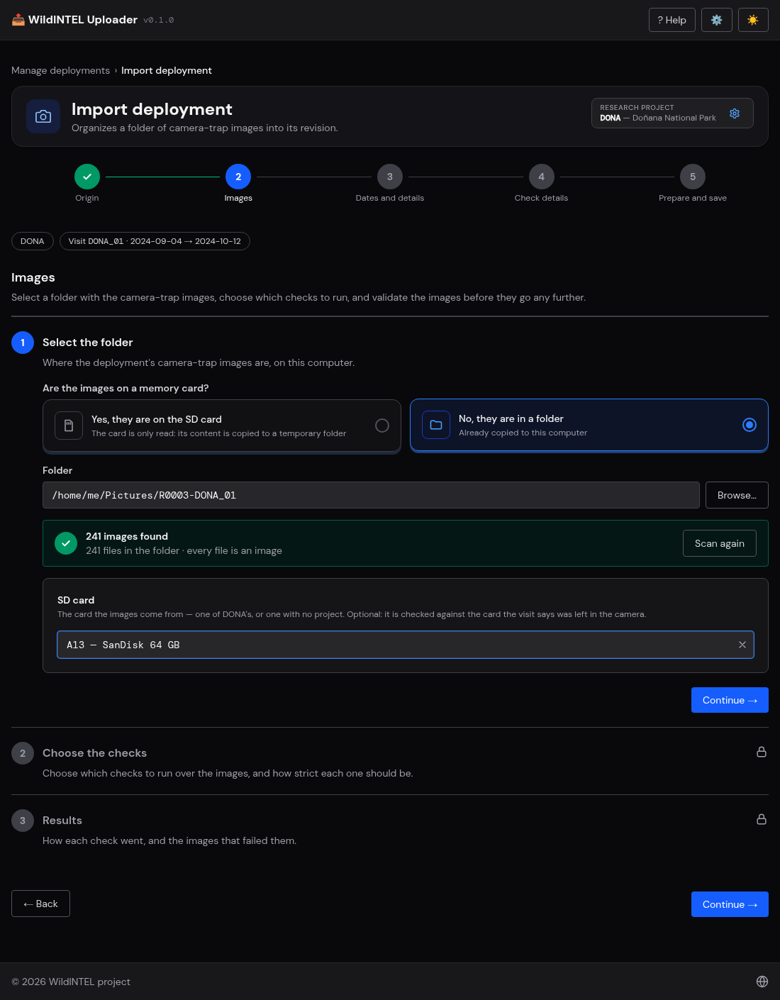

The stage has three steps (the first one also asks the SD card):

**1. Select the folder.** First say whether **the images are on a memory card**:

- **Yes, they are on the SD card** — say where the card is (**Browse…**, or type it) and press **Copy the card**. The card is **only read**: its content is copied to a **temporary folder** of this computer, with the progress of the copy, and the card is ejected so that it can be taken out. The process goes on with the copy as with any folder, and the copy is removed when the import is over.
- **No, they are in a folder** — press **Browse…** and choose the folder with the deployment's images (or type its path), then **Scan**.

The scan only **counts**: how many files there are and how many of them are images (by
their extension) — *241 images found* — with a warning if the folder is empty or has no
images. It doesn't open them, which is why it is instant however many there are: reading the
images is what the next steps are for. A folder you choose is read where it is, and **nothing in it is changed**.

Once the folder is scanned, the app asks the **SD card** the images come from, among the cards of the research project (**Select an SD card…**; optional). If the deployment is
of a visit, the card is checked against the one the visit left — see [Check details](#stage-4-check-details).

**2. Choose the checks.** Checks over the images alone, before anything is known about the deployment:

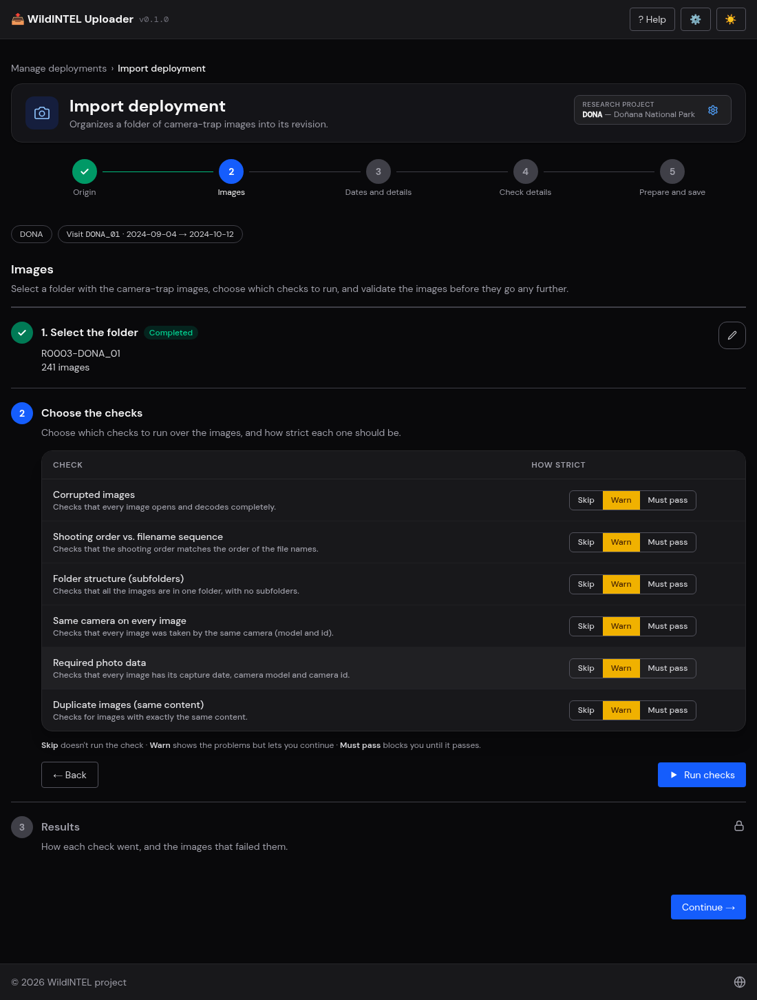

| Check | Looks for |
|---|---|
| Corrupted images | Files that aren't readable images. |
| Shooting order vs. filename sequence | Images whose order by name differs from their order by time. |
| Folder structure | Subfolders inside the deployment's folder. |
| Same camera | More than one camera model or id among the images. |
| Required photo data | Images missing the capture date, camera model or id. |
| Duplicate images | Files with the same content. |

For each check you choose **how strict** it is: **Skip** doesn't run it, **Warn** shows the problems but lets you
continue, **Must pass** stops you from going on while it fails. The ones that are turned off in the
[settings](#validation) are not shown. Press **Run checks**.

**3. Results.** When it was last run, with the download of its [report](#reports), and then two blocks like those of the dashboards, each of which folds away:

- **Images status & filters** — *Images reviewed* (all of them, with a bar split between the ones that are fine and the ones with errors), *Without errors* and *With errors*.
- **Checks status & filters** — *Checks finished*, *Checks passed* and *Checks failed*.

Pressing a card filters the **table of results** below, and each block filters on its own. A message says whether you can continue, and the table has a search, **Group by** — *Test* or *Image* —, *Results* (*All results*, *Only issues / failures* or *Only passed*), **Reset** and a line of the **active filters**:

- **By test**, one row per check with its status (✔ passed, ⚠ failed, ✘ failed and *Must pass*), how strict it is and how many images failed it. The **chevron** of a check that failed opens **which images failed it**: as pictures, each with what is wrong with it (*No date*, *Duplicate*, *Out of order*…) and when it was taken, or as a list (the two buttons of the view). You can **search by file name**, filter by the kind of error and go through the pages. A check of the whole folder (the structure, or the camera) has no pictures: it says what it found.
- **By image**, one row per image with how many checks it failed (*1 failure of 4*); the chevron lists **every** check, passed or not, and the two buttons of the toolbar show the images as a list or as pictures.

**View details** of an image opens a panel at the right with the image bigger, when it was taken and the result of each check on it. **Run again** repeats the checks.

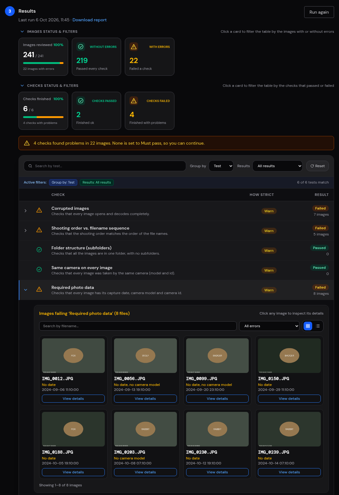

Reading the camera's model and id uses ExifTool, because the serial number of a camera trap lives
in the manufacturer's own metadata. Without it the app falls back to the standard EXIF tags,
which are less complete — it says which it used.

### Stage 3 — Dates and details

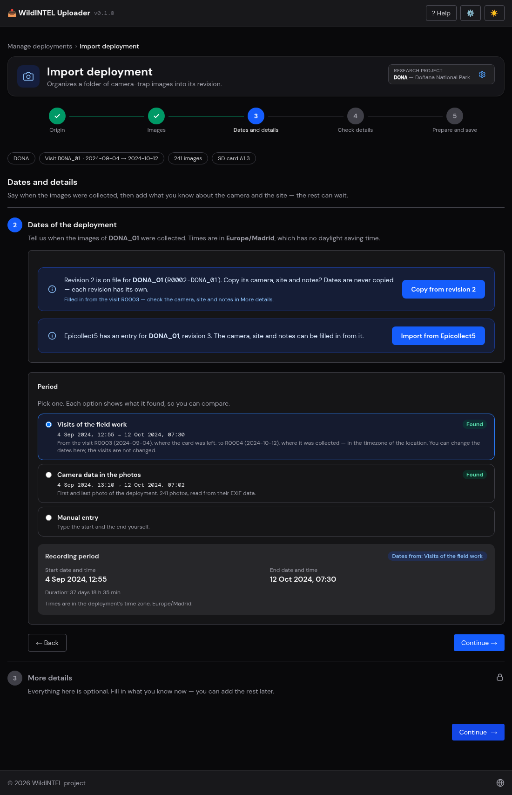

Here you tell the app **when** the images were taken and what you know of the camera and the site. With this the deployment gets its id
(`R0003-DONA_01`) and its details. **Only the dates are required: the rest can be completed later.** The stage has two steps.

**1. Dates of the deployment** — called *When was it collected?* when the deployment is of no visit.

First, the **revision**. If the deployment is of a visit it is the session of the visit, and is not asked; otherwise it starts as the next one expected for the location
— one more than the highest kept — and says so; change it if needed, and the **deployment id** is built (`R0003-DONA_01`). If an earlier revision of this
deployment is kept, a notice offers to **copy from it** its camera, site and notes — the dates are never copied. If the deployment **already exists** in the
collections folder you are told, and the import would be refused as it would mix two sets of images: choose another revision or location, or move that
folder away.

Then the **period**: when the camera started and stopped recording, as the clock of the location's timezone. The dates are not typed from scratch — the app looks for
them in several **sources**, and shows **what each one found** so you can compare them and **pick one**:

| Source | Where the dates come from |
|---|---|
| **Visits of the field work** | Only if the deployment is of a visit: from the visit where the card was left to the one where it was collected, in the timezone of the location. You can change the dates here; **the visits (the field sheet) are not changed**. |
| **Camera data in the photos** | The first and the last photo of the folder: the earliest and the latest capture date in their EXIF data. |
| **Manual entry** | You type the start and the end yourself. It is the only one that lets you edit them. |

Each option says **Found** — with the start and end it found — or **Nothing found**. Below them, **Recording period** shows the dates taken, which source they are
**from**, and the **duration**. The app picks for you the first source that has dates: **the visits, then the photos**; by hand only when neither has found anything. A better
source that turns up later replaces the one taken — until you pick one yourself.

If the deployment's collection has a `<COLLECTION>_FileTimestampLog.csv` (the file wildintel-tools asks for), going on from *More details*
**adds the deployment's row to that file**. A log that is already there is used for the dates in an [*Import deployments*](#7-import-deployments).

**2. More details.**

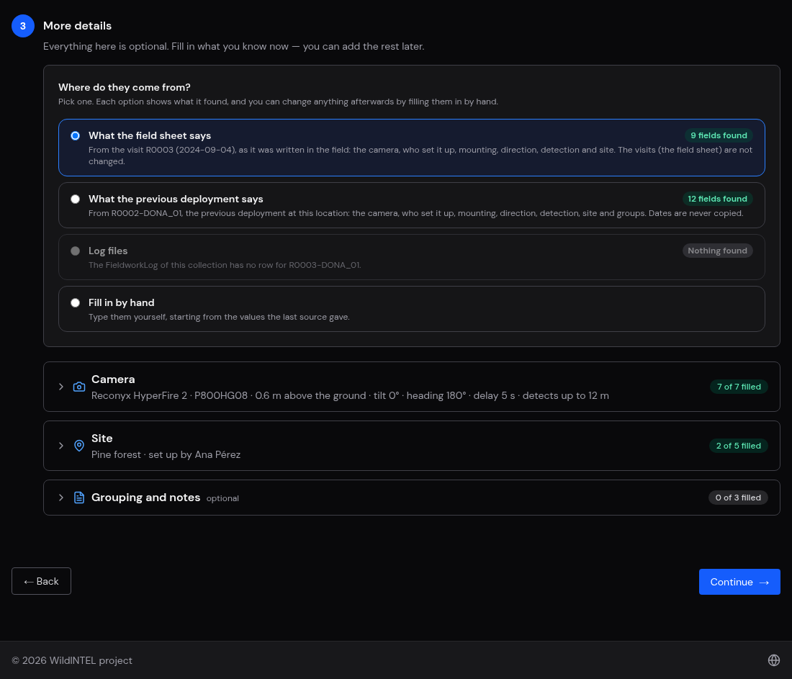

Everything here is optional, and can be completed later in Trapper. The form follows [Camtrap DP](https://camtrap-dp.tdwg.org)'s deployment table — the same
fields as Trapper's own deployment form. Each section is a card that says how many of its fields are filled in; open it, with the chevron at its left, to fill it in.

| Section | Fields |
|---|---|
| **Camera** | Camera id and model (read from the images when they all share them), delay between triggers, height *or* depth (not both), tilt, heading, detection distance. |
| **Site** | Feature type (road, trail, burrow, water source…), habitat, set up by, bait used, timestamp issues. |
| **Grouping and notes** | Deployment groups, tags, comments. |

**Where do they come from?** When the deployment is of a visit, or an earlier revision is kept, a card asks which source gives these details — *What the field sheet says*, *What the previous deployment says*, *Log files* and *Fill in by hand* — and each option says
**how many fields it found** and which parts of the form they are:

| Source | What it gives |
|---|---|
| **What the field sheet says** | What the **two visits** of the deployment — the one that left the camera and the one that collected its card — wrote down in the field, mixed as the [FieldworkLog](#5-manage-visits) mixes them: who set it up and the habitat as `Setup: … \| Retrieval: …` when they differ, the tags and groups of both, the setup's number or yes/no, and both visits' notes as `Setup: … \| Retrieval: …`. The visits are not changed. |
| **What the previous deployment says** | The camera, the site and the notes of the previous revision of the location (never its dates). Not available — *Nothing found* — when there is none. |
| **Log files** | What the `FieldworkLog` of the deployment's collection says of it: its camera, the site and the notes. Not available — *Nothing found* — when the log has no row for the deployment. |
| **Fill in by hand** | You type them, **starting from the values the last source gave**. |

With the field sheet or the previous deployment picked, the fields are shown **as that source says them, and cannot be edited**; pick *Fill in by hand* and they
open for editing without losing the values. Picking a source again restores its values (what you changed by hand is lost). What a source does not say is left empty.
When Epicollect5 [is turned on](#epicollect) and has an entry, a notice under the revision also offers **Import from Epicollect5**, which fills the camera, the site and the notes
from it (and leaves the form to be edited by hand); the location's own data are never taken from the entry.

The form is validated as you type, in the browser and again in the server: dates in order, latitude and longitude in range, tilt between −90 and 90, heading between 0 and 360.

### Stage 4 — Check details

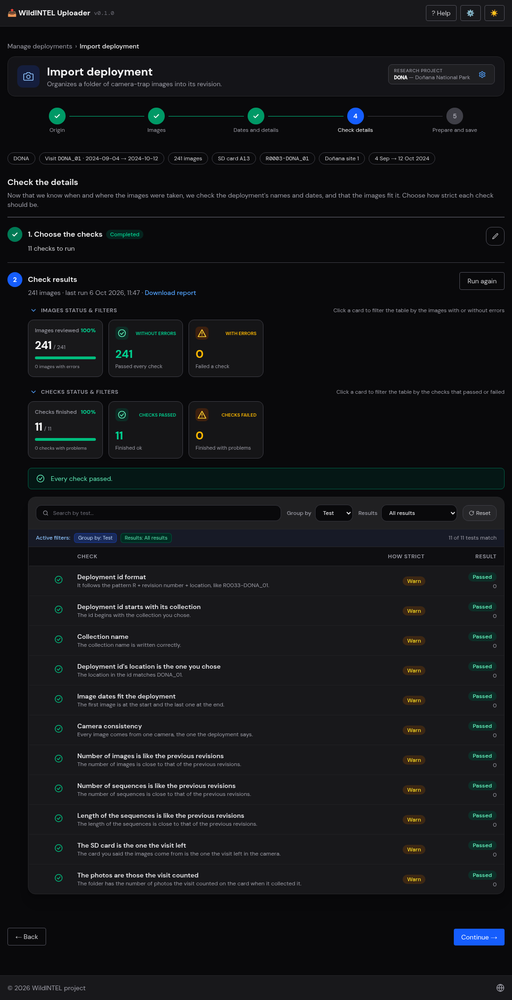

Now that you know when, how and where the images were taken, new checks are run: the deployment's names and dates, and the images against it:

| Check | Looks for |
|---|---|
| Deployment id format | `R0033-DONA_01`. |
| Deployment id starts with its collection | `R0033-…` belongs to `R0033`. |
| Collection name | `R0033`. |
| The id's location is the one chosen | The location in the id is the one from stage 1. |
| Image dates fit the deployment | The first image at the start, the last at the end, within the tolerance. |
| Camera consistency | The camera in the images is the one in the details. |
| Number of images | Like the previous revisions of the location. |
| Number of sequences | Like the previous revisions of the location. |
| Length of the sequences | Like the previous revisions of the location. |
| The SD card is the one the visit left | Only for a deployment of a visit: the card said in stage 2 is the one the visit left in the camera. A card nobody said passes, with a note. |
| The photos are those the visit counted | Only for a deployment of a visit: the number of images is the number of photos the visit that collected the card counted. A visit that counted none passes, with a note. |

The three on the number of images, the number of sequences and their length are **statistical**: a location is visited again and again, so what earlier
revisions looked like says what this one should — about as many photos, about as many sequences,
as long. A camera that fired non-stop, or died early, stands out, and is worth a look *before* it
is uploaded. They need at least the *previous revisions needed* of the settings, or they are
skipped; what a sequence is, what "similar" means and what it is compared to are the
[Postvalidation settings](#postvalidation).

For a single deployment the results are laid out as those of the images' checks — the *Images* and *Checks* blocks and the table of results, by test or by image. If some images were taken outside the deployment's dates, a notice offers **Fix the dates and times**, which goes to [Check and fix dates and times](#check-and-fix-dates-and-times); fix them there and run the checks again.

When the checks are run on a **session**, the results show the same as those of its folders: the figures, a message that says
whether you can continue, and the deployments — or, by check, the table — with the checks each one failed, **View the images**
and **Download report**.

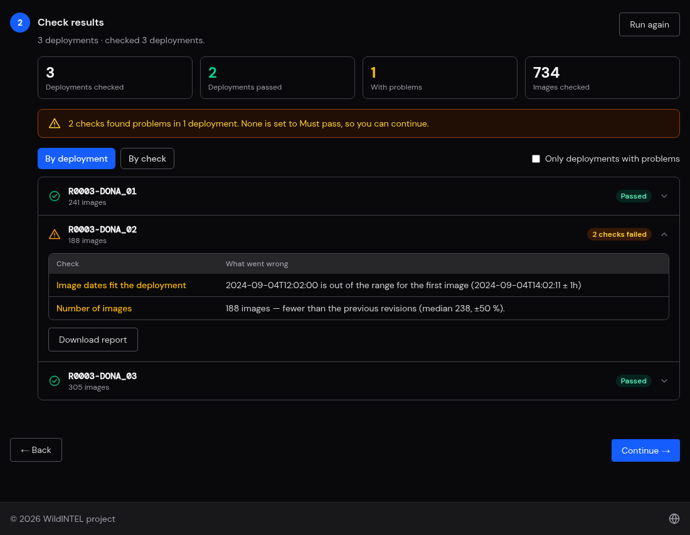

It has the same two steps as the images' checks: **choose how strict** each one is (skip, warn, must pass), press
**Run checks**, and read the **results** — when it was run, the figures, the table, and, opened from a check, the images that
failed it (*Out of range*, *Other camera*) as thumbnails. The [report](#reports) downloads.

### Stage 5 — Prepare and save

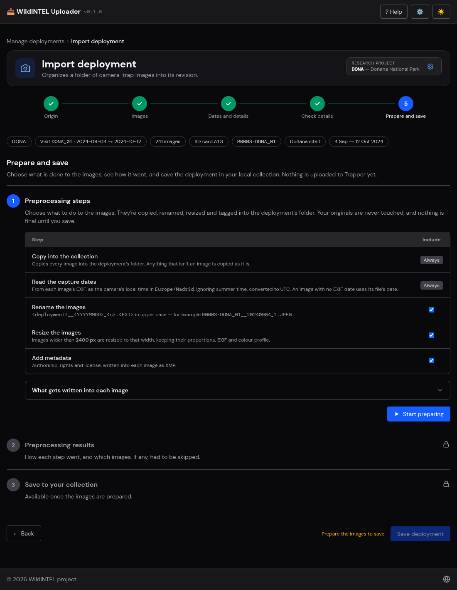

**1. Preprocessing steps.** Choose what to do to the images; the table says what each step does. Press **Start preparing**.

1. **Copy into the collection** — always. Anything that isn't an image is copied as it is.
2. **Read the capture dates** — always. From each image's EXIF, as the camera's local time in the
   location's timezone — ignoring summer time and converting to UTC, as the settings say. An image
   with no EXIF date uses its file's date.
3. **Rename the images** — `<DEPLOYMENT>__<YYYYMMDD>_<n>.<EXT>` in upper case, `.jpg` becoming
   `.jpeg`, e.g. `R0003-DONA_01__20240904_1.JPEG`; *n* is the image's place in file-name order.
4. **Resize the images** — to the width of the settings, keeping proportions, EXIF and colour
   profile. Unlike wildintel-tools, the resized image is the one that is kept.
5. **Add metadata** — authorship, rights and license, written into each image as XMP with
   ExifTool: *Creator*, *Owner*, *Publisher*, *Rights*, *License*, *Coverage* and the hash of the
   original and of the image kept, so each can be traced back. It is switched off, with the reason
   given, if ExifTool isn't available. Check the owner and publisher in the settings first: if
   they're blank, the step says so.

Each optional step can be switched off for this run (its checkbox). Its values come from the
[Preprocessing settings](#preprocessing). The images go into the deployment's folder in the collections folder; the
originals are never touched. Nothing is final yet: you can go back, change something and **Prepare again** — the folder is
simply redone.

**2. Preprocessing results.** The images processed and skipped, a status for each step and, opened from it, the skipped
images as thumbnails. The [report](#reports) says what was done to each image. **Continue to save** goes on.

**3. Save to your collection.**

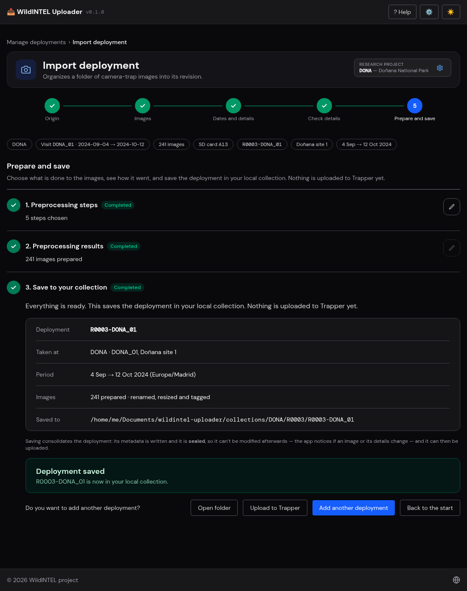

The images are ready, so this step **consolidates** the deployment: press **Save deployment** and its
`deployment.json` is written and the deployment is **sealed**. From then on it can't be modified — the app notices if an image
or its details change — and it can be uploaded.

A good save says where the deployment was kept, and offers:

- **Open folder** in the file explorer.
- **Upload to Trapper** — straight to [the upload page](#8-upload-a-deployment-to-trapper) with the
  research project and the collection already chosen.
- **Add another deployment**, which starts again at stage 1.
- **Back to the deployments menu** and **Back to the main menu**, as when visits are registered.

#### What gets written next to the images

| File | Content |
|---|---|
| `deployment.json` | The details of stage 3. |
| `images.json` | Per image: its name (and the original, if renamed), when it was taken — the camera's wall clock and the instant —, the camera, size and pixels, and hashes. It lets later checks, and the statistics of the next revisions, work without opening the images again. |
| `preprocessing.json` | What was done to each image, with its hashes: `source_hash` of the original, `hash` of the image kept, `final_hash` of the file with its metadata. |
| `seal.json` | Which validation and postvalidation checks the deployment and each image passed, and the hash of everything. |

The **seal** protects against changes by mistake: if an image or `deployment.json` is changed
after the import, the seal no longer matches, and the app can tell. It is not a signature —
whoever edits the files on purpose could seal them again.

## 7. Import deployments

Press **📷 Manage deployments**, then **Import deployments**. It works from the **visits**: first the **research project** — the default one of the settings, with a link to change it —, then a **revision** — a square for each one (*All revisions*, *R0003*…) with how many closed visits without a deployment it has — and then you tick the **visits** of that revision whose images you have.

- **One visit:** it works as [Import deployment](#import-a-deployment): the folder is the deployment's, with its images in it (no subfolders), and it is linked to the one visit. Only its SD card is asked beside it.
- **Several visits:** the folder is a **collection**: a folder with **one subfolder per visit**, as follows. A **collection** is a folder with **one subfolder per deployment** — the
usual way a field trip's images come home. The revision, the checks and the preprocessing are the
same for all; the location, dates and camera are asked for each deployment.

The stages are those of [Import a deployment](#import-a-deployment), with the differences below.

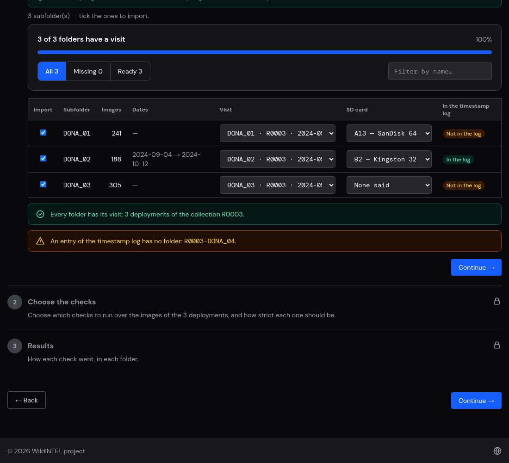

1. **Origin** — the **research project** for the whole session and, if it has closed visits (see [Register visits](#5-manage-visits)), the
   **Visits** to tick: the ones this session is of — **all of one session**, which is the revision (once one is ticked, the visits of other sessions are
   disabled). The list has a **search** (by site, card, date…). Without closed visits, the session goes on as it always did, asking a location for each folder.
2. **Images** — *Revision folder*: choose the folder and **Scan**; its subfolders are listed, each with its images and warnings, and you tick the ones to import.
   With visits, each folder is **linked to a visit** — a folder named after a site takes the visit of that site by itself; change it if it is not right — and
   says its **SD card** (optional). A header above the list says how many of the ticked folders have a visit, with a progress bar, the tabs *All*, *Missing* and
   *Ready* and a filter by name; a folder with no visit has to be linked or unticked before going on, and a visit is of one folder only.
   Then *Choose the checks* and *Results*: the checks run over every chosen deployment, by folder or by check (with *Only folders with problems*).
   **Leave them out** drops the folders that failed from the session; **Continue with N folders** goes on.
3. **Dates and details** — with visits, the **locations are the visits'**: nothing is asked of where they were taken and the stage starts at *When was it collected?*.
   Without visits, *Where were they taken?* asks the location of each deployment (the ones whose folder name matches a location are suggested, and **Assign** takes
   them all at once; no two deployments can share one).
   *When was it collected?*: first the **revision**, common to the session, which names all the deployments (`R0003-DONA_01`, `R0003-DONA_02`…); it is the session of the
   visits, or is taken from the log's ids. Then the **list** of deployments, each with its period and **where it comes from**
   (*From the visits*, *From R0003_FileTimestampLog.csv*, *From the images*, *Entered by hand*), how many are complete (*"12 of 40 deployments complete"*), a *filter by name* and
   *Only the incomplete ones*. *More details*: the camera and the site of each; for a deployment of a visit, the same
   [source card](#stage-3-dates-and-details) as in a single deployment — the field sheet, the previous deployment or by hand — for each one.
4. **Check details** — the deployments' checks, by folder or by check; for deployments of visits they include the two checks against the visit (the card and the number of photos).
5. **Prepare and save** — one list of preprocessing steps for all, then each deployment in turn, with its own result.
   If some fail, **Import the N left** resumes with the ones that are still pending. Saving seals each of them, and **links each visit to the deployment it gave**.

The chips above each stage fill in as you go: the research project, the visits with their range of dates, the images and the cards, and, at the end, the revision, the
deployments and the dates they cover.

When it ends, **Upload to Trapper** goes to the upload page with the collection chosen.

#### Where the dates of each deployment come from

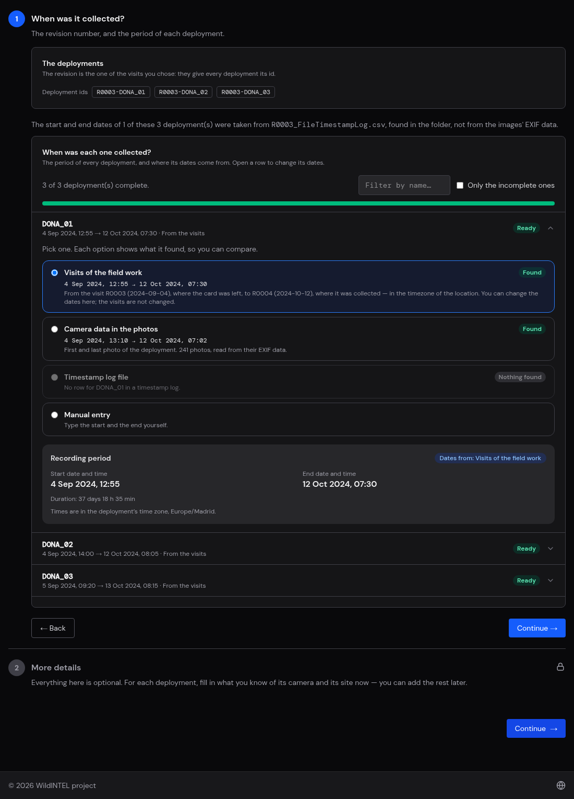

Each deployment has its own period and its own **source**. Open its row to see what **every source found** for it, as in a
single deployment, and pick one. There are four, and a session adds the **timestamp log**:

| Source | Where the dates come from |
|---|---|
| **Visits of the field work** | When the deployment is of a visit: from the visit where the card was left to the one where it was collected. You can change the dates; the visits are not changed. |
| **Timestamp log file** | The row of that deployment in the `<COLLECTION>_FileTimestampLog.csv` found in the session folder — the file wildintel-tools asks for beside a collection's deployments —, with the set-up and pick-up times someone wrote down. The row is found by the folder's name or by the id the log gives (`R0003-DONA_02`). |
| **Camera data in the photos** | The first and the last photo of that deployment's folder. They are read in the background, a folder after another, so a row may say *Reading the images…* for a moment. |
| **Manual entry** | You type the start and the end. |

Each deployment takes **the first source that has its dates, in this order: the visits, the timestamp log, the photos** — by
hand only if none does — and a better one found later replaces it, unless you picked one yourself for that deployment. So in a
session some deployments may come from the visits, others from the log and others from the photos, each row saying which.
A notice above the list says how many of the deployments the log gave dates to.

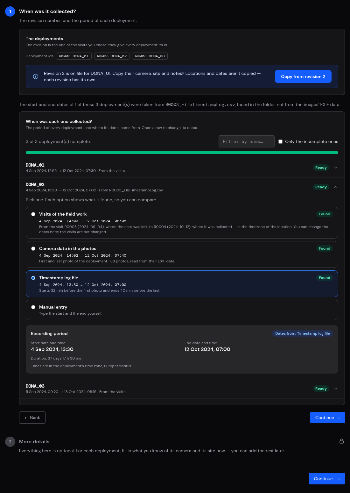

The log's option compares itself with the photos — *Starts 32 min before the first photo and ends 40 min before the last* — a
quick way to notice a log row that doesn't fit its images, which is also reported when a row or a folder matches no deployment. When
a deployment shows *Dates needed* or *To fix*, open it and pick another source or type the dates.

## 8. Upload a deployment to Trapper

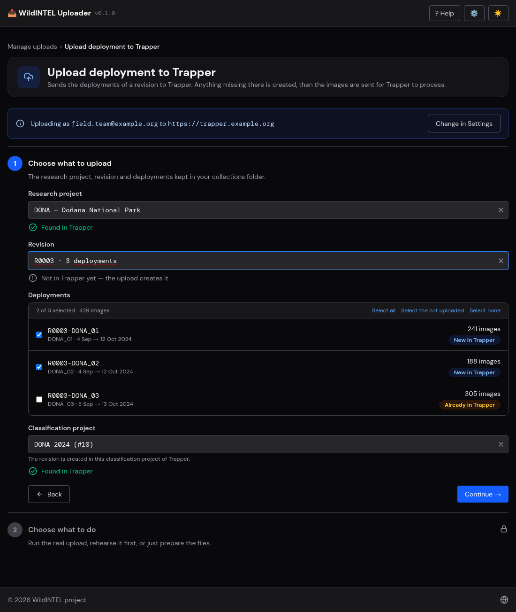

Press **☁️ Manage uploads**, then **Upload deployment to Trapper**. (The other option, **Uploads dashboard**, shows the **created** deployments of the default research project by revision: a square for each revision, to pick one, and a **ring** that counts the uploads done over the most there can be: the deployments of the revision times the uploaders picked. To its right, **where they were uploaded**: *All* and a card for each uploader (Trapper for now, more to come), which show how many went to it and pick it. The table has, for each deployment, **Where**, **When** (the visit that started it, a link that opens the visit dashboard on it, and the period) and whether it was uploaded: a **label for every uploader** it went to, with the day, or *Not uploaded*. The deployment's name is a **link** to its details in the Deployments dashboard; **View** opens the list of where it was uploaded, when, and a **link** to reach the upload; and a deployment not uploaded to the uploaders picked has an **Upload** button, which opens the upload page on its revision. There is a search and a *Show* filter (all, uploaded, not uploaded).) It sends deployments kept in the collections folder.
For each one it does what wildintel-tools did in three commands:

1. creates the **location** in Trapper, from the deployment's coordinates, if the research project
   doesn't have it, and the **deployment**, from its details;
2. packs the images in **zips** and the **yaml** that describes them — what was recorded when —,
   splitting in several parts when a zip would be larger than the limit;
3. uploads each zip and its yaml, and tells Trapper to **process them into a collection**.

The deployment must have been imported with the wizard — the yaml needs the dates its
`preprocessing.json` records. One that wasn't says "Not preprocessed — import it again through the
wizard before uploading it", and can't be ticked.

A note at the top says which Trapper account is used: the one saved in the settings (**Change in Settings** takes you
there; **Test connection** is in [Settings › Uploader › Trapper](#trapper)). The page is a wizard of its own.

### Step 1 — Choose what to upload

1. **Research project** — those kept in the collections folder.
2. **Collection** — and under it a table of its deployments: how many images, its dates, whether Trapper already has it (*New in
   Trapper* or *Already in Trapper*) and the day it was uploaded, if it was (from its `upload.json`, a local note). The ones left to send
   start ticked; **Select all**, **Select the not uploaded** and **Select none**, or the box in the table's header, change the choice.
   As soon as the research project and the collection are chosen, a message says whether it is **found in Trapper** and whether the
   collection is already there, so the upload adds to it, or the upload creates it.
3. **Classification project** — the collection is created in one of Trapper's classification
   projects for the research project: pick it (or, if there is only one, it is used). Without a
   Trapper account, type its pk.

### Step 2 — Choose what to do

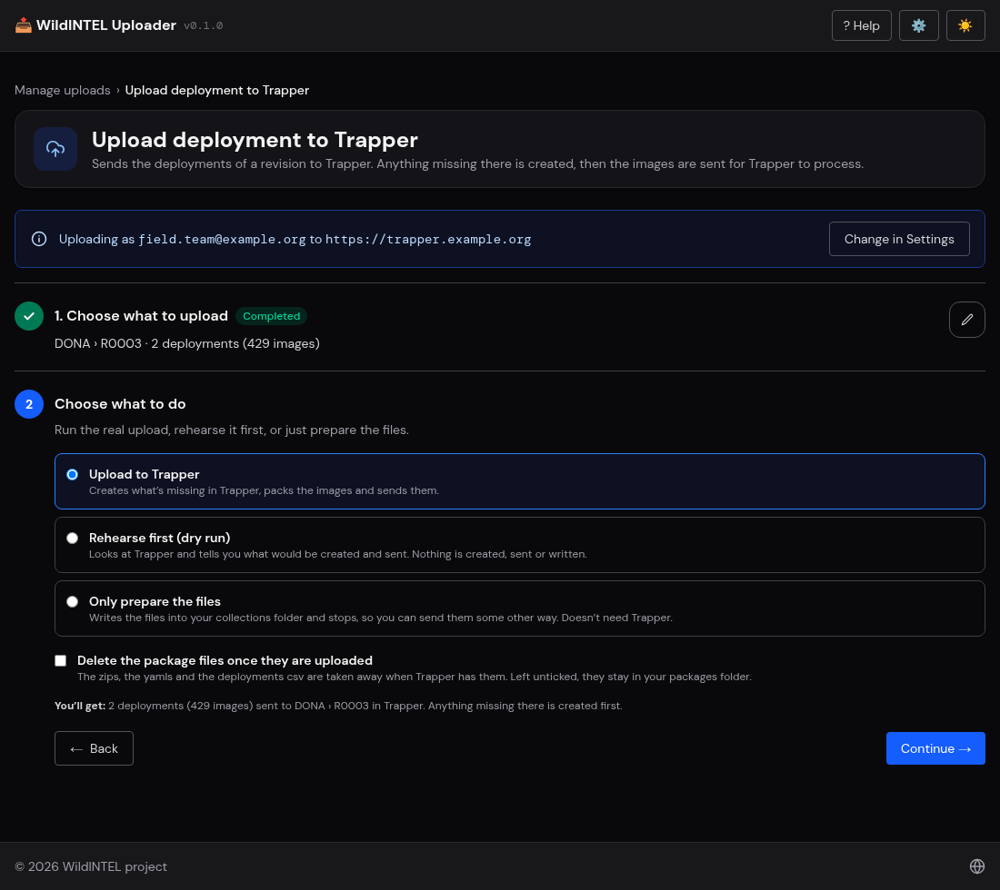

| Mode | What it does |
|---|---|
| **Upload to Trapper** | The real thing. |
| **Rehearse first (dry run)** | Looks at Trapper and says what would be created and how the images would be packed. Nothing is created, sent or written. |
| **Only prepare the files** | Writes the zips, the yamls and the collection's `_deployments.csv` and leaves them, to send some other way. Needs no account if the research project was filled in from Trapper. |

With **Upload to Trapper**, tick **Delete the package files once they are uploaded** to take the zips, the yamls and the deployment's row of the `_deployments.csv` away when Trapper has them. Unticked (the default) they stay in the packages folder, as when only preparing them, and the result says where. The option is also offered when you go on to upload files you have just prepared.

The size of the zips is a setting: [Settings › Uploader › Trapper](#trapper). The page says what you will get before you go on.

### Step 3 — Upload

Press **Continue**. The upload shows in three phases — *Set up Trapper*, *Send the images* (with a bar, the amount sent and the
time left) and *Trapper processes them*, which happens on Trapper's side and needs no waiting — and, under them, how many
deployments and images have been sent and a row for each deployment with its state. A deployment's steps (*connect*, *classification*, *location*, *deployment*, *package*, *csv*, *upload*,
*process*, *wait*) are each marked as running, done or skipped. The steps that made or found something in Trapper — the *location*, the *deployment* and, at the end, the
*collection* — show **a link to its page in Trapper** (for example `https://trapper.example.org/geomap/deployment/detail/47/`),
to check there that it was created or updated. A dry run links to what is already there; what it would create has no page yet. **Stop** ends it —
what is already in Trapper stays there. When one fails, the others go on, and the summary says so: *"1 deployment uploaded, 1
could not be uploaded."* The failed one is in the list with its reason — when Trapper refuses a deployment because its location belongs to
someone else, the reason says who owns it. The page shows the date of the run and a **Download report** link: the report of the upload is kept with the others
(*Settings › Reports*), a row per deployment and step. **Upload more** starts over.

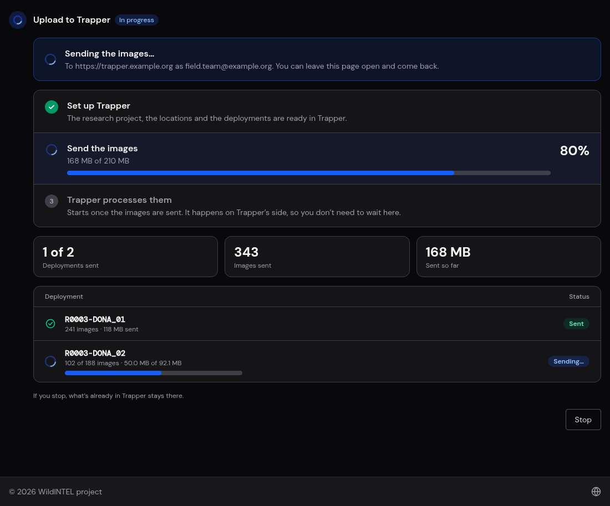

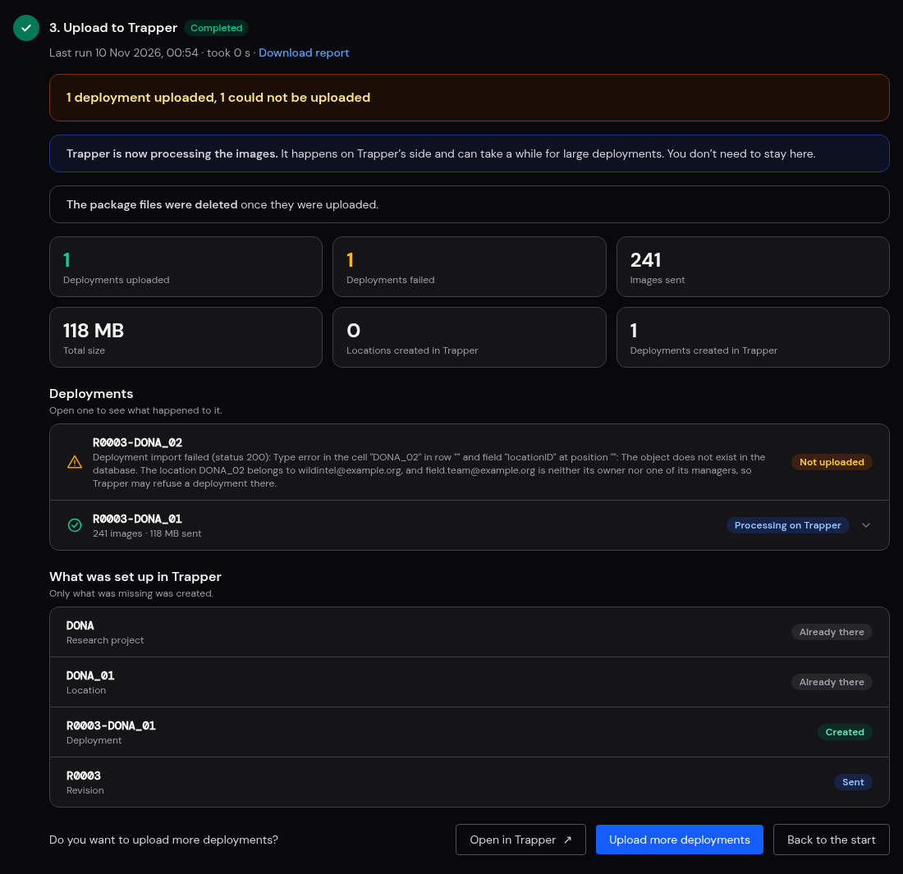

The zips and yamls are written under `<data folder>/packages/<research project>/`. A deployment
that was uploaded gets an `upload.json`, which is what the list uses to say so.

## 9. Utils

Press **🧰 Utils**, under the task cards of the menu. It holds the maintenance tasks of the local collections; pick one,
and **Back** returns to the list.

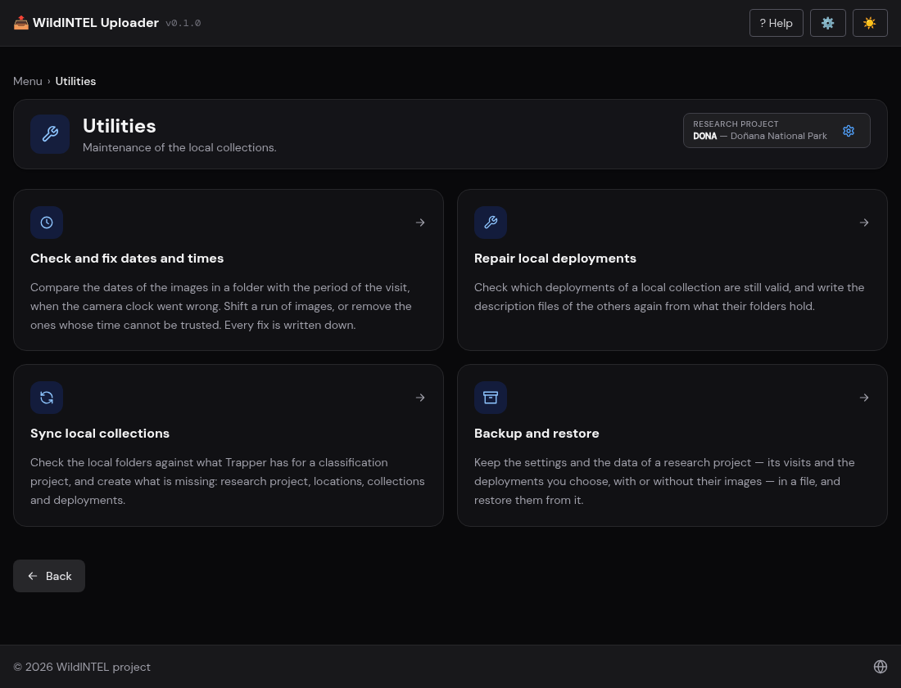

### Check and fix dates and times

For the images of a card copied to a folder whose camera **clock went wrong** — it was reset, or it was never set — and whose dates are not the days they were taken. It works on the **copy**, never on the card. It has a short head with a **Help** button that explains each option, and five steps; the last four are locked until the dates are checked.

1. **Choose the folder and the visit.** The folder (**Browse…** or type it), then the **revision** and, among its visits, the **visit that left the camera**. The research project is the default one, the one in the card at the top right. The visit is optional: without it the time jumps are found, but the dates cannot be checked against a period. With it, the period is the one of the deployment: from that visit to the next one at the site that collected the card, with a margin of a few hours. Press **Check the dates**.
2. **Check the dates.** The images are read in the order the camera numbered them and split into **segments**: a segment is a run of consecutive images taken with the clock in one setting, and a new one starts wherever the time **goes backwards** from one image to the next. You see the number of images, the period, the segments and how many images are outside it, a chart, the problems found (images with no date, jumps, images outside the period) and each segment with its state — *In its period*, *Partly outside* or *Outside its period*.
3. **Fix the segments.** For each segment that is not in its period you choose what to do with its images: **move them into the period** — the shift is shown and asked before it is made — or **remove them**. The shift suggested takes the first segment to start when the deployment started, and each later one to go on from where the one before ended. The images with **no date** can only be removed.
4. **Fix the dates.** To shift by hand any run of images — even one — from an image to another, **by an offset** (forward or back, in days, hours, minutes and seconds) or **from an image whose real time you know**. The reason is written down with the fix.
5. **Fixes made.** What was done, in order, with the day, who and why.

Every change is made on the images of the folder — a shift rewrites their dates with ExifTool, which is needed — and **no second copy is kept**: each fix is written down in `time_corrections.json`, in the folder, so a shift is undone by shifting back by the same amount. After each fix the folder is read again, so the segments, the problems and the suggestions are those of the images as they are now: two segments that were fixed so that they follow each other become one. **Removed images are deleted** and cannot be put back.

### Sync local collections

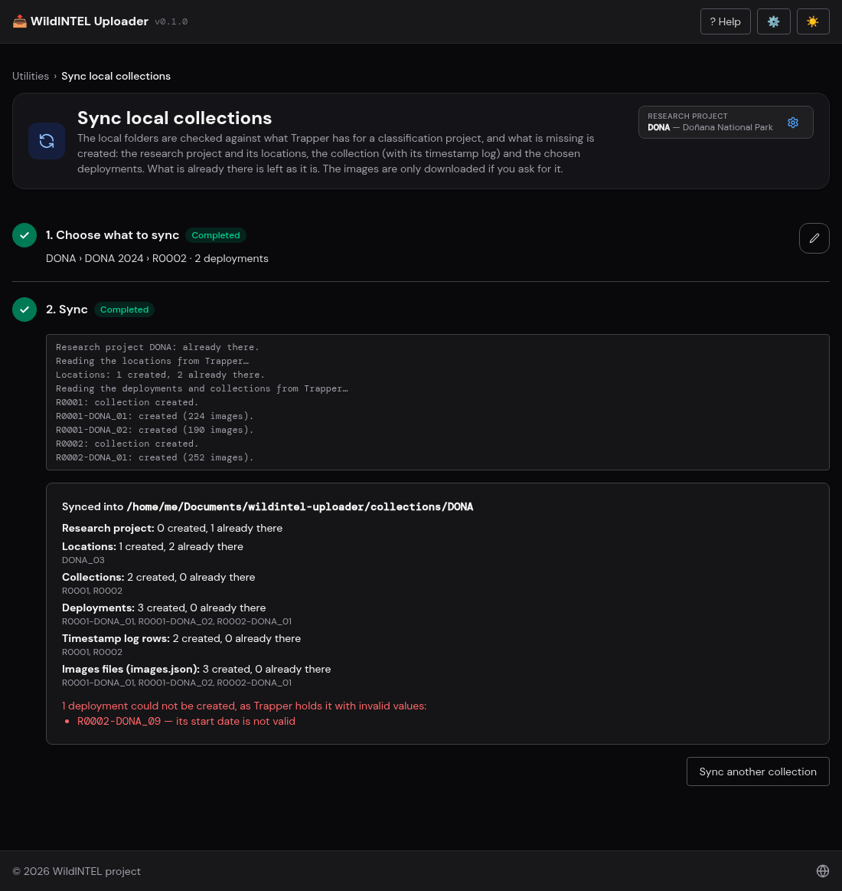

Press **🔄 Sync local collections**. Use it when Trapper already has deployments that the
collections folder doesn't — say, imported years ago, or from another computer — so that the
statistics of the *next* revisions can compare with them, and the folder reflects what Trapper
holds.

1. Pick a **research project**, then one of its **classification projects**.
2. Pick a **collection** (those of the classification project whose name starts with `R`) and,
   under it, the **deployments** to sync — with *Select all*.
3. Tick **Also download the images from Trapper** if you want them too (see below).
4. Press **Sync**.

What is missing is created, one deployment at a time, and a live log says what is happening:

- the research project (`research_project.json`) and its `locations.json`;
- the collection (with its `collection.json` and `<collection>_FileTimestampLog.csv`);
- each chosen deployment's `deployment.json`, in the collection its id starts with, and an
  `images.json` made from what Trapper holds for its images (names, when they were taken,
  observations).

What is already in the folder is **left as it is**, whatever Trapper says. **Nothing is changed in
Trapper**, and **no image is downloaded unless you ask for it** — so there is no `preprocessing.json`, and the size,
pixels and hashes are missing from `images.json`, which is marked `"source": "trapper"`. A
deployment synced this way is *read-only* for the app: what Trapper holds isn't modified here.

#### Downloading the images

With **Also download the images from Trapper** ticked, each chosen deployment's images are also downloaded, four at a time, into
its folder — named as Trapper names them (`R0003-DONA_01__20240901_1.JPEG`), the file Trapper holds. A deployment can have
thousands of images, so it can take long and need a lot of disk space. The log says how far each deployment is.

- The files come through the **classification project** you picked: Trapper only gives the access token of a file — private
  ones too, for an account that can see them — in the media of a classification project, so an image that isn't in a collection of
  that project can't be downloaded. The result says how many of each deployment weren't.
- What is already in the folder is kept, so syncing again **completes** a download that was stopped, or retries the images that failed.
  A file is written under a temporary name and moved into place when whole: a stop never leaves half an image.
- The deployment is still a *synced* one: its images aren't preprocessed, renamed or sealed, so it can't be uploaded or repaired from here.

The result lists, per kind, what was created and what was already there, the deployments no
collection of the classification project claims, and any that Trapper holds in a way that isn't a
valid deployment — with the reason — and were left out.

### Repair local deployments

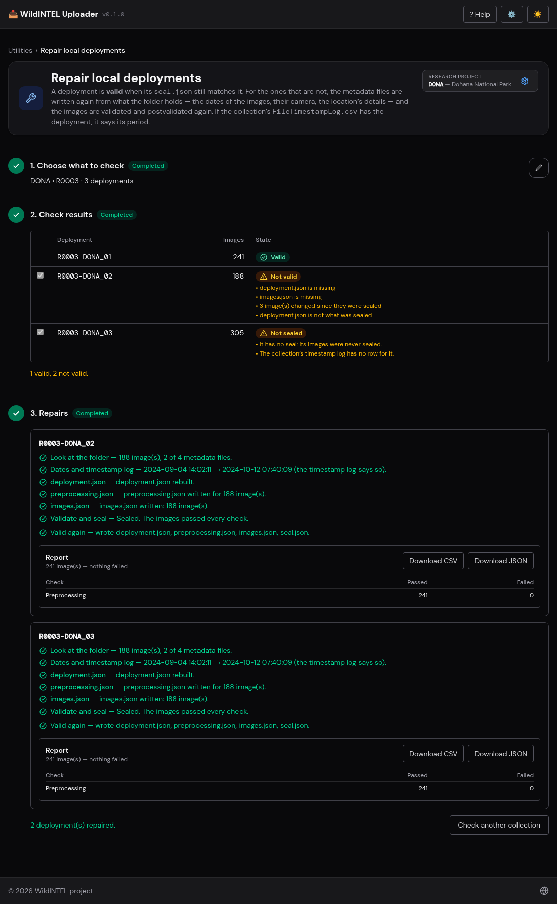

Press **🛠️ Repair local deployments**. Use it when a deployment of the collections folder has lost its metadata files, or
its images were touched — so it no longer matches its seal — and you want it back in working order.

1. Pick a **research project** and one of its **collections**, both from the collections folder.
2. Press **Check the deployments**. A deployment is **valid** if its `seal.json` still matches it: every image and its
   `deployment.json` are as they were sealed. Anything else — no seal, changed or missing images, a missing or unreadable
   metadata file — is *not valid*, and the table says what is wrong. A deployment synced from Trapper is not touched.
3. The ones that are not valid start ticked (*Select all*, *Select the not valid* and *Select none* change it). Press **Repair**.

Each deployment is repaired in turn, with its steps shown:

- **Dates.** The capture date of every image is read from its EXIF, as the camera's wall clock, and the deployment's period
  is decided: if the collection's `<collection>_FileTimestampLog.csv` has a row for it, **the log says it**, whatever the
  images say; otherwise the period is the one the `deployment.json` that is left has, or else the one of the images, and the
  row is **added to the log**. The log itself is never rewritten but to add that row.
- **`deployment.json`** — what is left of it, plus the location's details (name, coordinates), the camera of the images,
  and the period. If something required can't be known — the location has no coordinates, say — the repair stops and says so.
- **`preprocessing.json`** and **`images.json`** — one entry for every image in the folder, with its date, hashes, camera and size.
  What can't be known is left empty: the original name of a renamed image, unless an earlier `preprocessing.json` says it, and the
  hash of the original, unless the image's XMP metadata does.
- **`seal.json`** — the images are **validated and postvalidated** again, as in the wizard, and sealed with the result (marked as
  *recovered*). A deployment is sealed even if its images fail a check: the report says which.

A **report** is written, and shown, with what was written and what the images passed — and four checks of the
**preprocessing** the folder can answer: the names (`<DEPLOYMENT>__<YYYYMMDD>_<n>.<EXT>`, with the day of the capture date and each
number once), the size (not wider than the width of the settings), the XMP metadata (needs ExifTool) and that the images are
still the ones that were preprocessed. What the preprocessing *did* — the resizing, the renaming — can't be checked beyond that:
the originals are gone.

### Backup and restore

Press **🧰 Utils**, then **Backup and restore**. It keeps the settings and the data of a research project in one `.zip` file, and puts back what a file holds. It asks first whether to **make a backup** or to **restore** one.

**Making a backup.** It asks:

1. **What to back up.** The **global settings** (a check, on by default; without passwords or secrets, and without the folders of this computer) and a **research project** (the active one comes chosen; leave it empty to back up only the settings). Of the project: its **data** (the research project, locations, cameras and SD cards), the **list of visits**, and the **deployments** — each one, a whole revision, or all — with their size. A switch, **Include the images of the deployments**, says whether their images go in (off by default) and how many megabytes that adds.
2. **Where to keep it.** A folder. The file is named after what it holds and the day (`wildintel-backup_DONA_20261030-103000.zip`), and a bar shows the progress. When it is made, it says what the file holds and offers to open the folder.

**Restoring.** It asks for the backup file, and shows what it says it holds (when it was made, by which version, of which project, and the list), and what of it is already here. You pick what to restore: the settings, the data of the project, the visits and the deployments, and — if the backup has them — their images. **Replace what is already here** is off by default: what is there is left as it is and only what is missing is added; on, what the backup holds wins. **What is archived stays archived** whatever is chosen (an archived location, camera or SD card never goes back). Restoring the settings keeps the passwords and the folders of this computer.

## 10. Troubleshooting

**"Backend not reachable — is the server running?"**
:   The red bar at the top. The window that started the app was closed, or it crashed. Start the app
    again, and look at the log (Settings › General) if it recurs.

**The browser doesn't open**
:   Open <http://127.0.0.1:8769> yourself. If that port was busy the app took the next free one:
    the window that started it says which (`Server on http://127.0.0.1:8770`).

**"Incorrect Trapper username or password"**
:   The username is the **email** of your account. Check it in Settings › Uploader › Trapper and press
    **Test connection**.

**"Could not connect to the Trapper server"**
:   The URL is wrong — it needs `https://` and no trailing path — or the server is down or
    unreachable from your network.

**The metadata step is greyed out: "ExifTool is not installed"**
:   The downloadable app ships its own ExifTool. Running from the source code, install it
    (`sudo apt install libimage-exiftool-perl`, `brew install exiftool`) — or switch the step off.

**"This deployment already exists"**
:   A deployment with that id is already kept in the collections folder. Choose another revision or
    location, or move that folder away; importing would otherwise mix two sets of images.

**A location has no timezone**
:   Added by hand without one, or synced from a Trapper location that has none. Edit it in the
    *Origin* step; the app won't guess it.

**"Not preprocessed — import it again through the wizard"**
:   The deployment has no `preprocessing.json`: it was copied by hand, or synced from Trapper (which
    already has its images). Only deployments imported with the wizard can be uploaded.

**The upload says Trapper refuses the package**
:   Trapper checks the package's timezone and summer-time setting against the location's. If you
    changed them for the location in Trapper, they must be the same here — edit the location in the
    *Origin* step.

**The upload fails with "Trapper's uploader accepted the login but gave no session"**
:   The uploader's login answered without the session it should hand out. The message includes what
    Trapper said: send it to the Trapper administrator, or attach it to a bug report.

**Files ending in `_exiftool_tmp` in a deployment's folder**
:   ExifTool writes the metadata of each image through a temporary file; one it was interrupted in
    (the app stopped in the middle of an import) is left behind. The app removes them when the
    metadata step ends, or fails, but not if it was killed: delete them, and import again.

**An image was skipped**
:   The import lists skipped images with the reason, and goes on with the rest. A corrupted file is
    the usual cause; the *Corrupted images* validation finds them before importing.

**Reporting a problem**
:   Set the log level to `DEBUG` (Settings › General), repeat the steps and attach the log file
    to the report at
    [github.com/wildintelproject/wildintel-uploader/issues](https://github.com/wildintelproject/wildintel-uploader/issues).
