# WildINTEL Uploader — User Manual (web)

This manual covers the web interface. What it shares with the command line — [installation, the
general concepts and the folders it creates](user-manual.md) — is in the common part; read that
first. Part of what the web app does can also be done from a terminal: see the
[command-line manual](user-manual-cli.md).

---

## Table of Contents

1. [Getting started](#1-getting-started)
2. [Settings](#2-settings)
3. [The task menu](#3-the-task-menu)
4. [Unfinished runs](#4-unfinished-runs)
5. [Import a deployment](#5-import-a-deployment)
6. [Import a session](#6-import-a-session)
7. [Upload a deployment to Trapper](#7-upload-a-deployment-to-trapper)
8. [Utils: sync and repair](#8-utils)
9. [Troubleshooting](#9-troubleshooting)

---

## 1. Getting started

[Install](user-manual.md#1-installation) the app and run it with no arguments. It starts a small server on your computer
and opens the app in your default browser (<http://127.0.0.1:8769>, or the next free port). **Keep the window it
opened until you finish** — closing it stops the app. Everything stays on your machine: the only thing the app talks to is
the Trapper server you configure. The welcome screen says what it does; press **Get Started**.

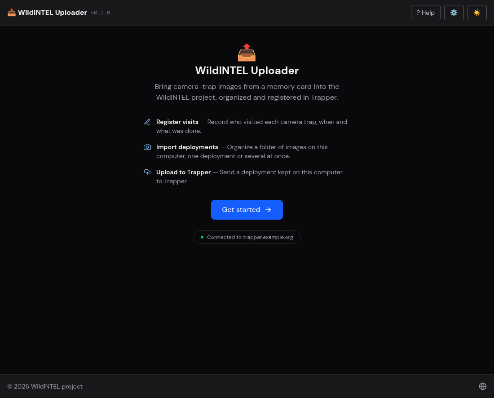

Before you start using the application it has to be configured. To do so, press **⚙️ Settings** (top right) and fill in the
**Trapper** server, username and password — see [Settings](#2-settings); you can test them right there. Also fill in who owns the
images (Prepare images › Authorship) if you are going to import some.

## 2. Settings

Press **⚙️ Settings**. It has its own sections on the left; one **Save** saves them all, and a red
dot marks a section with an invalid value.

### General

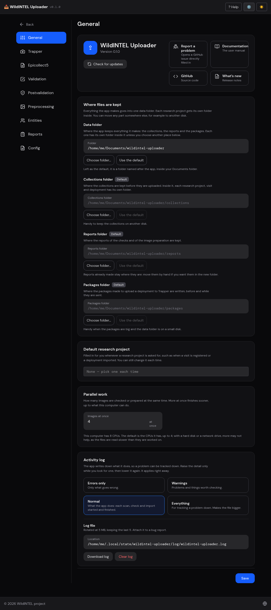

- **Data folder** — where the app keeps what it makes: the collections, the reports and the packages, each in a folder inside it. Blank uses
  `Documents/wildintel-uploader`; a path must be absolute (or start with `~`).
- **Collections folder**, **Reports folder** and **Packages folder** — where the collections, the reports of the checks and the packages made to upload to Trapper are kept. Blank, each is a folder (`collections`, `reports`, `packages`) inside the data folder; set one to keep it somewhere else, on another disk for instance. A path must be absolute (or start with `~`). What is already kept in the old place is not moved: do it by hand.
- **Workers** — how many images are validated and preprocessed at once. Up to the number of
  processors of your machine pays off; the default is that number, up to 4.
- **Log level** — how much the app logs (`ERROR`, `WARNING`, `INFO`, `DEBUG`). At `DEBUG` it logs
  every step.
- **Log file** — download it, or delete it. It lives in the log folder of your system (`~/.local/state/wildintel-uploader/log` on Linux), which can't be changed. It rotates at 5 MB keeping the last 5. Attach it to any
  bug report.
- **About** — at the top: the app's name and version, **Check for updates** (it offers the download when there is a newer version), and links to **Report a problem** (a GitHub issue that already says the version and your browser), the **Documentation**, the **GitHub** project and **What's new** (the release notes).

### Trapper

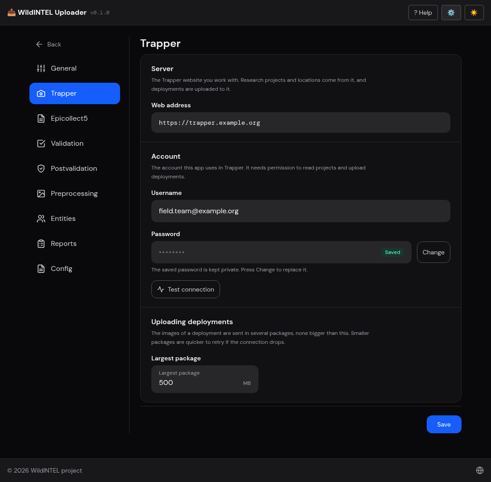

The server's **URL**, and the **username** (its email — Trapper's import form only accepts
that) and **password** of your account. **Test connection** reports the research projects it can
see. The password is saved in `settings.toml` but never sent back to your browser.

**Upload packages — Largest zip** is the size, in MB, of the zips an [upload](#7-upload-a-deployment-to-trapper) makes: a
deployment's images go up in zips of at most this size (500 by default, up to 5000), each with its own yaml.

### Epicollect5

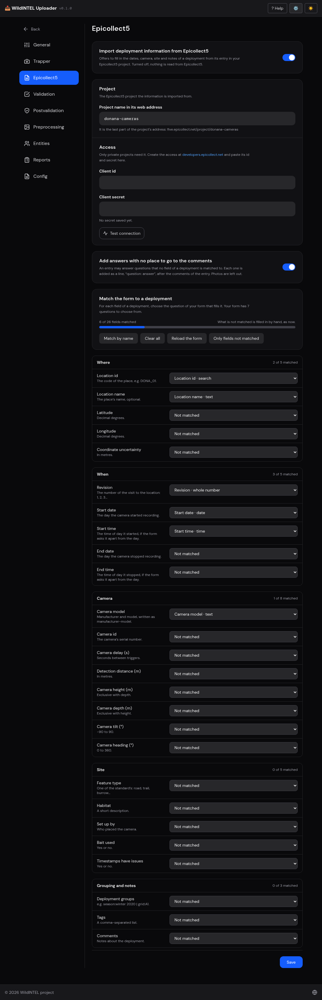

The Epicollect5 project the deployments' information will be imported from (see [When was it collected?](#stage-2-origin-and-dates)): its **slug**, the
name in its URL (`five.epicollect.net/project/<slug>`), and, only if the project is private, the **client id** and **secret** of
its API client, which you create at <https://developers.epicollect.net>. **Test connection** reads the project with what is typed — saved or not — and says its name and how many inputs
it has; a blank secret is the saved one. The **Import deployment information from Epicollect5** switch turns the use of Epicollect5 on or off — it is off until you turn it on, and while it is off nothing is read from Epicollect5. **Add them to the comments** sends what an entry answers in the inputs that are not mapped to any field to the comments of the deployment, a line each (*question: answer*; photos are left out). Below, the **Mapping** relates each field of a deployment to an input of the project's form. Epicollect5 has no input for a date and a time together, so the day and the time of the start and of the end are mapped apart, along with the revision.

### Validation

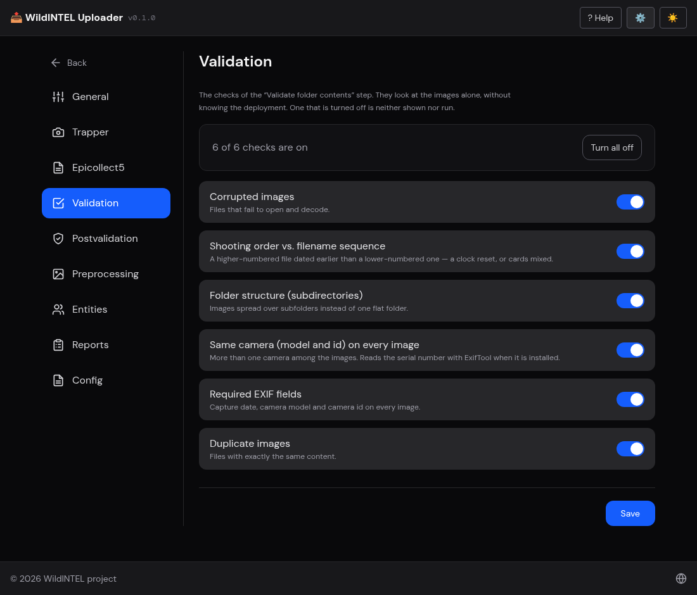

Which of the [folder checks](#stage-1-images) the wizard shows. Each is an entry with a switch;
turn off the ones you never want to see. They are all on by default.

### Postvalidation

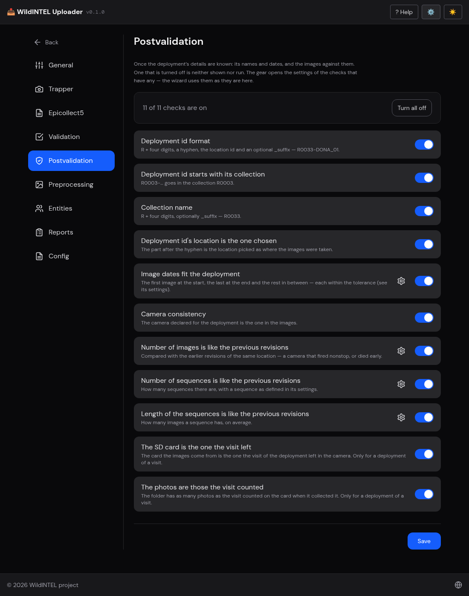

Which of the [postvalidation checks](#stage-3-check-details) the wizard shows, and what the ones
that take a value mean:

| Setting | Default | |
|---|---|---|
| Tolerance | 1 hour | Leeway around a deployment's start and end for the image dates. |
| Sequence gap | 60 s | What a *sequence* is: a new one starts when the gap to the previous image is at least this. |
| Compared with | median | What this revision is compared to: the **median** or **mean** of the earlier ones, the **last** one, or the **range** they span. |
| Previous revisions needed | 2 | With fewer, the statistical checks are skipped. |
| Number of images / sequences / length of sequences | 50 % each | How different a value can be and still count as similar. |

### Prepare images

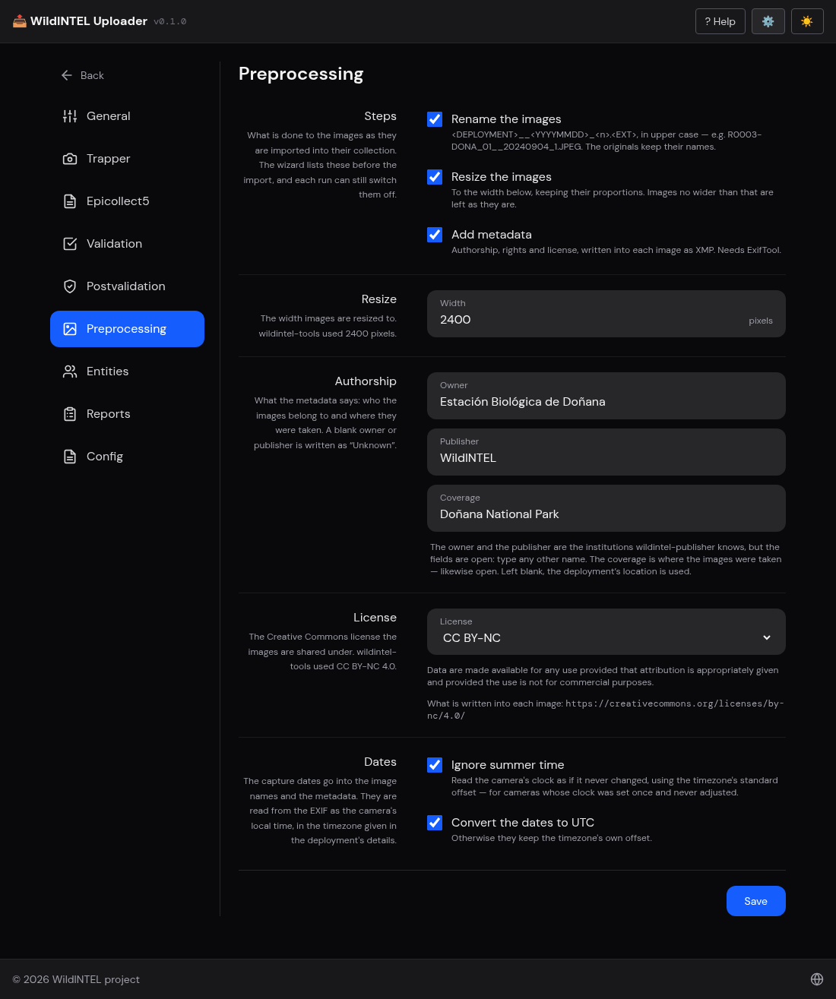

What a new import does to the images — the wizard lists it before preparing, and a run can still
switch each step off.

- **Steps** — rename, resize, add metadata.
- **Resize width** — 2400 px by default; wider images are shrunk to it, narrower ones left alone.
- **Authorship** — **Owner**, **Publisher** and **Coverage** (where the images were taken; blank
  uses the deployment's location), written into each image. A blank owner or publisher is written
  as "Unknown".
- **License** — picked from a list: **CC0** (any use, no requirements), **CC BY** (any use with
  attribution) or **CC BY-NC** (with attribution, not for commercial purposes), the default. What is
  written into each image is the license's URL, shown beside each name.
- **Dates** — **Ignore summer time**, and **Convert the dates to UTC**.

### Reports

Every **validation**, **postvalidation**, **image preparation** and **repair** leaves a **report** of what it checked and did,
image by image. The step shows it right below its results — the same file you can download, so what you see is
what is kept:

- the **checks**, with how many images passed and how many failed each;
- the **images that failed**, with the check and why — *IMG_0087.JPG · Duplicate images · same content as IMG_0087 (copy).JPG* —
  that can be narrowed to one check, and are shown 100 at a time;
- **Download CSV** — a row per image and check, to open in a spreadsheet — and **Download JSON**, with everything: when it
  was made, the folder, the parameters it was run with and every entry.

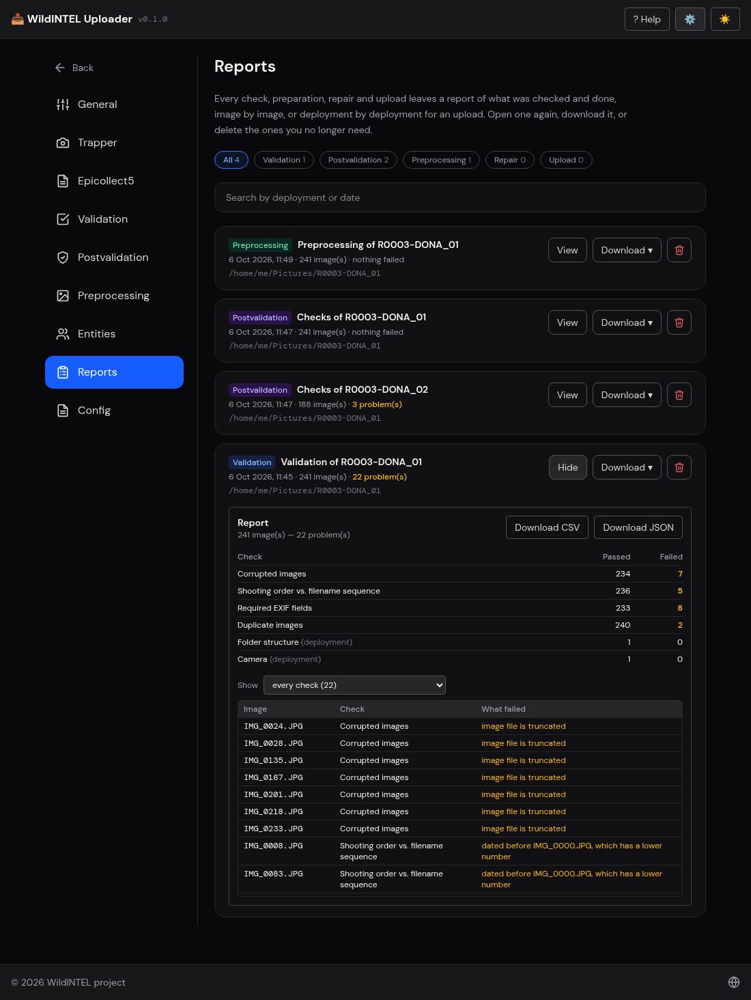

What each report holds:

| Report | An entry for | Says |
|---|---|---|
| **Validation** | each image and check — corrupted, shooting order, EXIF fields, duplicates —, and the folder for the structure and camera checks | The ones that passed too, so the report says what was checked, not only what failed. |
| **Postvalidation** | the deployment for the naming and statistical checks, and each image for its date and camera | Why a check failed — *241 images — like the previous revisions (median 238, ±50 %)*. |
| **Repair** | each image and check, and each metadata file | What the repair wrote and what the images passed, as the new seal says — and the preprocessing checks: names, size, metadata. |
| **Prepare images** | each image | What was done — *IMG_0001.JPG → R0003-DONA_01__20240904_1.JPEG; date 2024-09-04T11:10:00+00:00 (exif); resized* — and the ones that were **skipped**, with the reason. |

**Settings › Reports** lists all of them, newest first, with *View*, *CSV*, *JSON* and *Delete* (which
asks again). They are kept in the `reports` folder of the data folder until you delete them. A check you run twice
makes two reports.

### Multiple configs

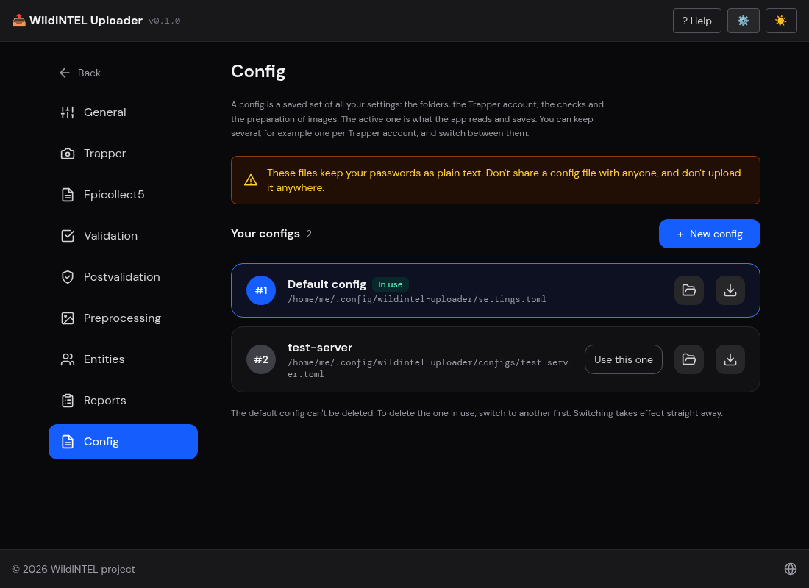

The application lets you define several different configurations: **+** adds one with the default
values, and choosing one makes it the active one — handy to switch between two Trapper servers (a
test one and the real one) or two sets of authorship. Each can be downloaded, and its folder opened.

## 3. The task menu

Once it is configured, the menu is where you choose what you want to do:

| Task | What it's for |
|---|---|
| 📷 **Import deployment** | Check one folder of images and organize it in the collections folder. |
| 🗂️ **Import session** | The same for a folder holding several deployments, one subfolder each. |
| ☁️ **Upload deployment to Trapper** | Send deployments already kept locally to Trapper. |
| 🧰 **Utils** | Maintenance of the local collections: *Sync local collections* brings the collections folder up to date with what Trapper already has, and *Repair local deployments* checks which deployments are still valid and writes the metadata files of the others again from their folders. |

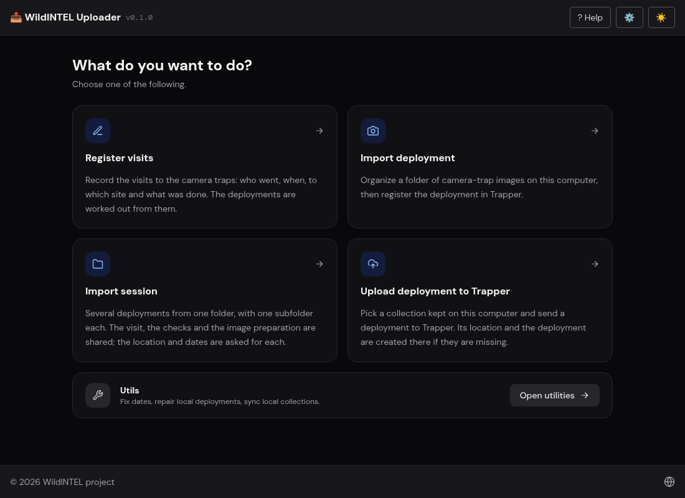

The usual order is **Import** (or **Import session**) first, then **Upload**. *Sync* is for when
Trapper already holds deployments that this computer's collections folder doesn't know about (**Utils › Sync**).

The title in the top bar takes you back to the welcome screen at any time; **? Help** opens this
documentation, and the sun/moon button switches between dark and light.

If the app was closed in the middle of an import, the first thing you see is the list of
**unfinished runs** — see [Unfinished runs](#4-unfinished-runs).

## 4. Unfinished runs

An import saves its progress as you go. If you close the app, or it fails, the next time you start
it the first screen lists the **unfinished runs** — the folder, the research project and when it
was started — each with **Resume** and **Discard**. Resuming takes you back to the step after the
folder was chosen. Passwords are never saved with a run.

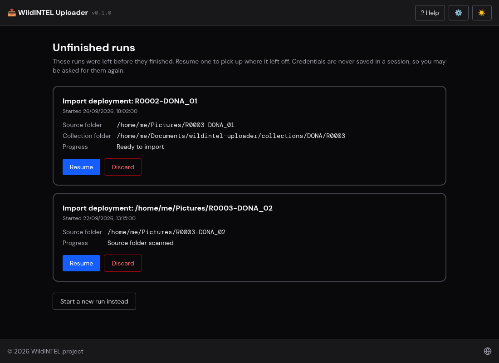

## 5. Import a deployment

Press **📷 Import deployment**. This option is meant to import the set of images that come from a **single camera**: one
folder, one deployment. For a folder with the images of several cameras, one subfolder each, use
[**Import session**](#6-import-a-session).

It is a wizard of four stages — the bar at the top shows where you are, and a
stage can have steps of its own, which open one after the other. Each stage is **done** (a tick and a
summary, with a pencil to go back and change it), **open** or **locked** until the ones before it are
done. **Back** and **Continue** move between them.

| Stage | What it asks |
|---|---|
| 1. **Images** | Which folder, which checks, and how the images did. |
| 2. **Origin and dates** | Where and when the images were taken, and what you know of the camera and the site. |
| 3. **Check details** | The deployment's names and dates, and that the images fit them. |
| 4. **Prepare and save** | The preprocessing, and saving the deployment in the collection. |

### Stage 1 — Images

In this stage you tell the app **which images** you are importing and find out, before anything else is done, **whether they
are in good shape**. You choose the folder with the images of the camera and the app counts what is in it; then you
choose which checks to run over the images alone — corrupted files, shooting order, subfolders, a single camera, the
photo data they need and duplicates — and how strict each one is. The result tells you how many images are valid and which
ones have problems, so you can fix them before going on. **Nothing is copied or changed yet: the source folder is only read.**

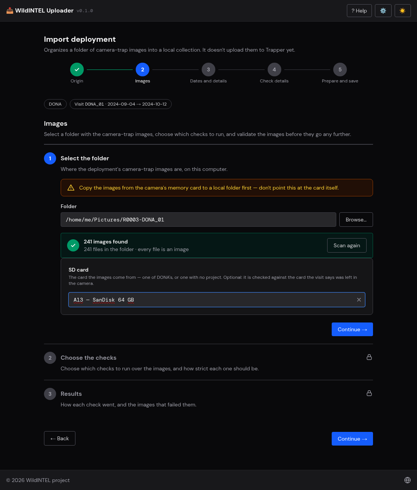

The stage has three steps:

**1. Select the folder.** Press **Browse…** and choose the folder with the deployment's images (or type its path), then
**Scan**. The scan only **counts**: how many files there are and how many of them are images (by
their extension) — *241 images found* — with a warning if the folder is empty or has no
images. It doesn't open them, which is why it is instant however many there are: reading the
images is what the next steps are for. Copy the images off the camera's memory card first; don't point the app at the card.

**2. Choose the checks.** Checks over the images alone, before anything is known about the deployment:

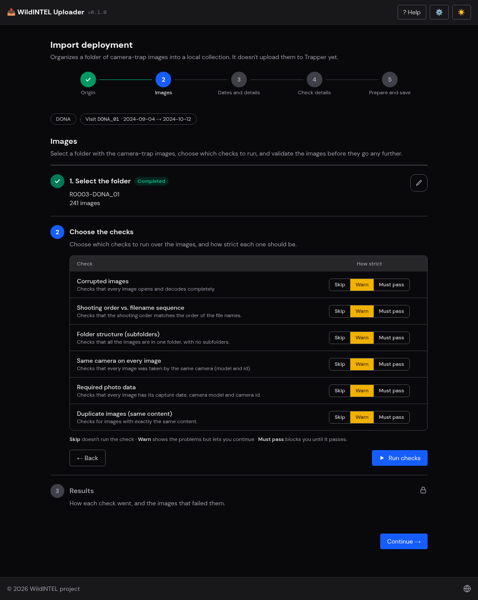

| Check | Looks for |
|---|---|
| Corrupted images | Files that aren't readable images. |
| Shooting order vs. filename sequence | Images whose order by name differs from their order by time. |
| Folder structure | Subfolders inside the deployment's folder. |
| Same camera | More than one camera model or id among the images. |
| Required photo data | Images missing the capture date, camera model or id. |
| Duplicate images | Files with the same content. |

For each check you choose **how strict** it is: **Skip** doesn't run it, **Warn** shows the problems but lets you
continue, **Must pass** stops you from going on while it fails. The ones that are turned off in the
[settings](#validation) are not shown. Press **Run checks**.

**3. Results.** A small dashboard: when it was last run, the downloads of its [report](#reports) and four figures —
the **valid images**, the **images with issues**, the **checks run** and the ones **with problems**. Under them, one
row per check with its status (✔ passed, ⚠ failed, ✘ failed and *Must pass*) and how many images failed it.

Open a check that failed to see **which images failed it**: as pictures, each
with what is wrong with it (*No date*, *Duplicate*, *Out of order*…) and when it was taken, or as a
list. You can **search by file name**, filter by the kind of error, sort by name or by date, and go
through the pages; **View details** opens the image bigger with everything the report says of it. A check of the whole folder (the
structure, or the camera) has no pictures: it says what it found. **Run again** repeats it.

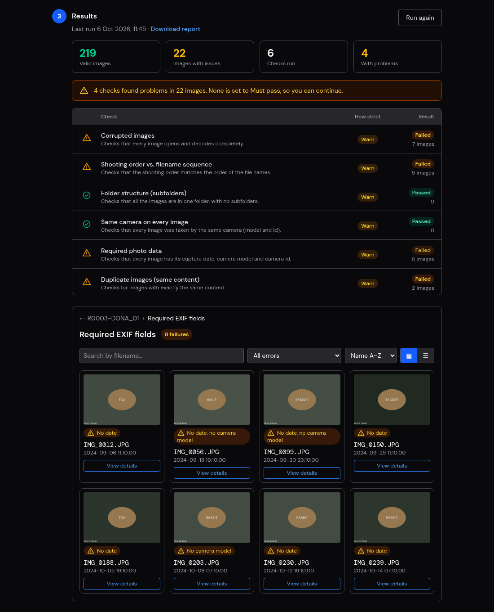

Reading the camera's model and id uses ExifTool, because the serial number of a camera trap lives
in the manufacturer's own metadata. Without it the app falls back to the standard EXIF tags,
which are less complete — it says which it used.

### Stage 2 — Origin and dates

In this stage you tell the app **where and when** the images were taken, and what you know of the camera and the site. You say
which research project and which location they come from — the location brings its coordinates and its timezone —, then the
revision and the period the camera was recording, which the app looks for in several sources and lets you compare before
you pick one. Finally you can add, if you know them, the details of the camera and of the site. With this the deployment gets
its id (`R0003-DONA_01`) and its details. **Only the dates are required: the rest can be completed later.**

The stage has three steps:

**1. Where was it taken?**

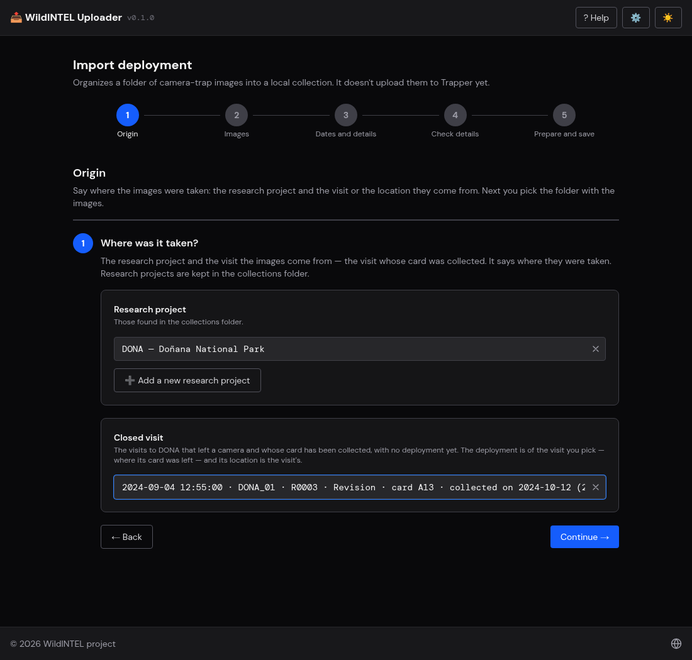

The **research project** and the **location** the images come from. They are
kept in the collections folder; pick one already there, or add a new one:

- **By hand** — the project's name and acronym (which names its folder); a location's id, name,
  latitude, longitude, coordinate uncertainty, **timezone** and whether its cameras ignore summer
  time.
- **From Trapper** — pick the project, or its locations, from your Trapper account and they are
  copied here, with their coordinates and timezone. The app connects by itself with the account
  saved in the settings — it never asks for the credentials again; if there isn't one, it says so.

**2. When was it collected?**

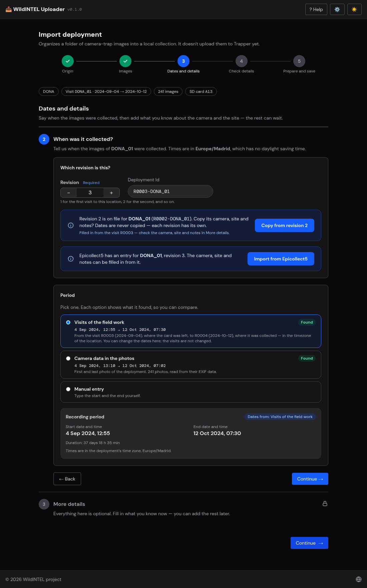

First, the **revision**. It starts as the next one expected for that location — one more than the highest kept — and says
so; change it if needed, and the **deployment id** is built (`R0003-DONA_01`). If an earlier revision of this deployment is
kept, a notice offers to **copy from it** its camera, site and notes — the dates are never copied. If the deployment
**already exists** in the collections folder you are told, and the import would be refused as it would mix two sets of
images: choose another revision or location, or move that folder away.

Then the **period**: when the camera started and stopped recording, as the clock of the location's timezone (the one
said above, which is never asked for again). The dates are not typed from scratch — the app looks for them in several
**sources**, and shows **what each one found** side by side so you can compare them and **pick one**:

| Source | Where the dates come from |
|---|---|
| **Epicollect5 project** | The entry of your Epicollect5 form for this location and this revision (each row of the form is one deployment). Only if Epicollect5 is [turned on](#epicollect5) in the settings. |
| **Camera data in the photos** | The first and the last photo of the folder: the earliest and the latest capture date in their EXIF data. |
| **Manual entry** | You type the start and the end yourself. It is the only one that lets you edit them. |

Each option says **Found** — with the start and end it found — or **Nothing found**, and why (*Epicollect5 is turned off
in the settings*, *Nothing found for DONA_01, revision 3*). Below them, **Recording period** shows the dates taken, which
source they are **from**, and the **duration**.

The app picks for you the first source that has dates, in this order: **Epicollect5, then the photos**; by hand only when
neither has found anything. Photos are read and Epicollect5 is asked in the background, so a better source that turns up a moment
later replaces the one taken — until you pick one yourself, which is then left as it is.

!!! note "How an Epicollect5 entry gives its dates"
    Epicollect5 has no question for a date and a time together, so the form asks the **day** and the **time** apart (mapped
    in [Settings › Epicollect5](#epicollect5)). A day with no time takes the time the photos gave on that same day, or else
    the whole day: from its first second (00:00:00) for the start, to its last (23:59:59) for the end. If there are several
    entries for the location and the revision, the newest one is used. The entry is read with the client saved in the
    settings, so Epicollect5 may refuse for a while if it limits the requests.

When Epicollect5 has an entry, a notice also offers **Import from Epicollect5**, which fills the **camera, the site and the
notes** from it (the dates follow the source you picked). The location's own data — its id, name and coordinates — are never
taken from the entry, and the camera model and id only complete what the photos didn't give. Answers that no field is mapped to can go to
the comments (see the [settings](#epicollect5)).

If the deployment's collection has a `<COLLECTION>_FileTimestampLog.csv` (the file wildintel-tools asks for), going on from *More details*
**adds the deployment's row to that file**. A log that is already there is
used for the dates in an [*Import session*](#6-import-a-session).

**3. More details.**

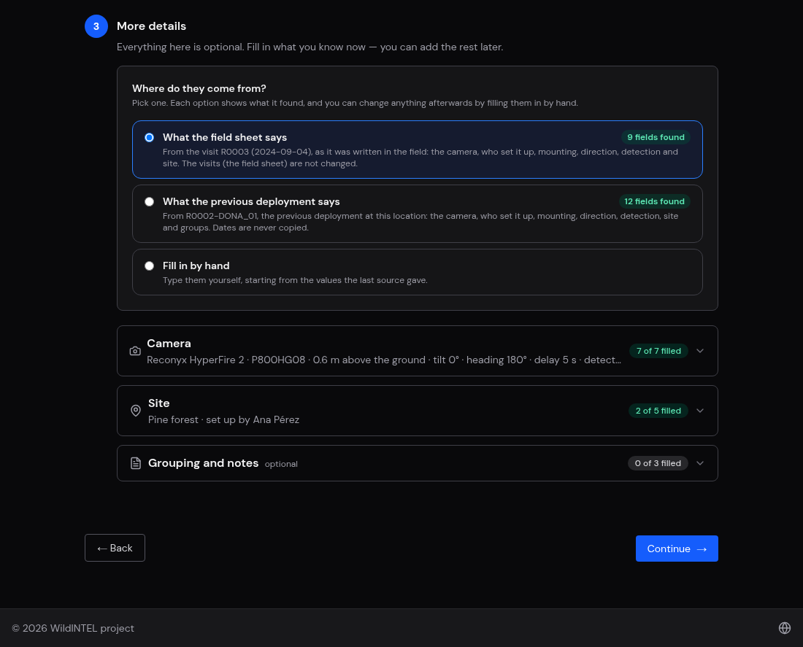

Everything here is optional, and can be completed later in Trapper. The form follows
[Camtrap DP](https://camtrap-dp.tdwg.org)'s deployment table — the same fields as Trapper's own deployment form. Each
section is a card that says how many of its fields are filled in; open it to fill it in.

| Section | Fields |
|---|---|
| **Camera** | Camera id and model (read from the images when they all share them), delay between triggers, height *or* depth (not both), tilt, heading, detection distance. |
| **Site** | Feature type (road, trail, burrow, water source…), habitat, set up by, bait used, timestamp issues. |
| **Grouping and notes** | Deployment groups, tags, comments. |

The form is validated as you type, in the browser and again in the server: dates in order,
latitude and longitude in range, tilt between −90 and 90, heading between 0 and 360.

When you continue, the deployment is added to the collection's timestamp log.

### Stage 3 — Check details

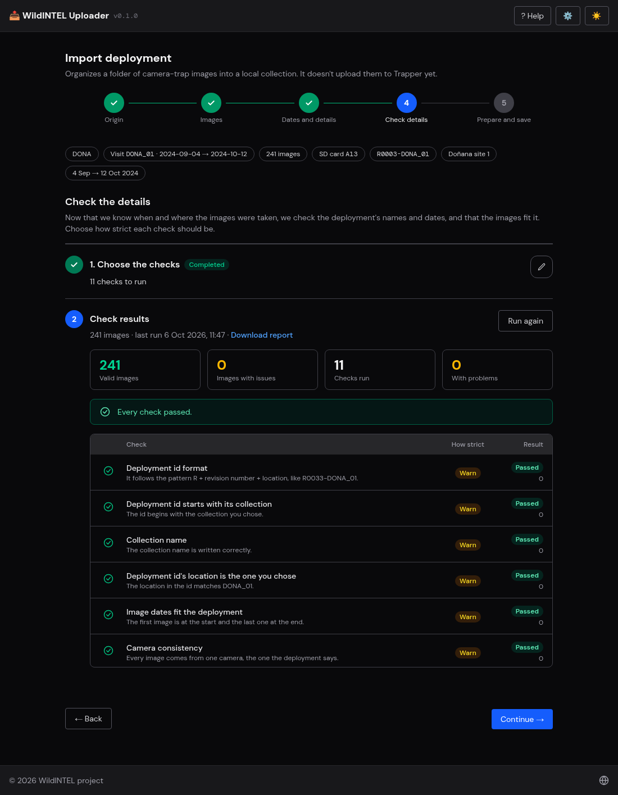

Now that you know when, how and where the images were taken, new checks are run: the deployment's names and dates, and the images against it:

| Check | Looks for |
|---|---|
| Deployment id format | `R0033-DONA_01`. |
| Deployment id starts with its collection | `R0033-…` belongs to `R0033`. |
| Collection name | `R0033`. |
| The id's location is the one chosen | The location in the id is the one from stage 2. |
| Image dates fit the deployment | The first image at the start, the last at the end, within the tolerance. |
| Camera consistency | The camera in the images is the one in the details. |
| Number of images | Like the previous revisions of the location. |
| Number of sequences | Like the previous revisions of the location. |
| Length of the sequences | Like the previous revisions of the location. |

The last three are **statistical**: a location is visited again and again, so what earlier
revisions looked like says what this one should — about as many photos, about as many sequences,
as long. A camera that fired non-stop, or died early, stands out, and is worth a look *before* it
is uploaded. They need at least the *previous revisions needed* of the settings, or they are
skipped; what a sequence is, what "similar" means and what it is compared to are the
[Postvalidation settings](#postvalidation).

When the checks are run on a **session**, the results show the same as those of its folders: the figures, a message that says
whether you can continue, and the deployments — or, by check, the table — with the checks each one failed, **View the images**
and **Download report**.

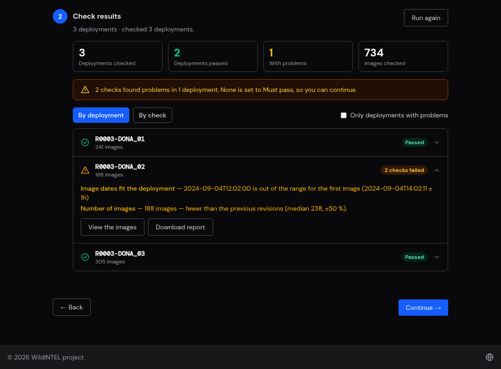

It has the same two steps as the images' checks: **choose how strict** each one is (skip, warn, must pass), press
**Run checks**, and read the **results** — when it was run, the figures, the table, and, opened from a check, the images that
failed it (*Out of range*, *Other camera*) as thumbnails. The [report](#reports) downloads.

### Stage 4 — Prepare and save

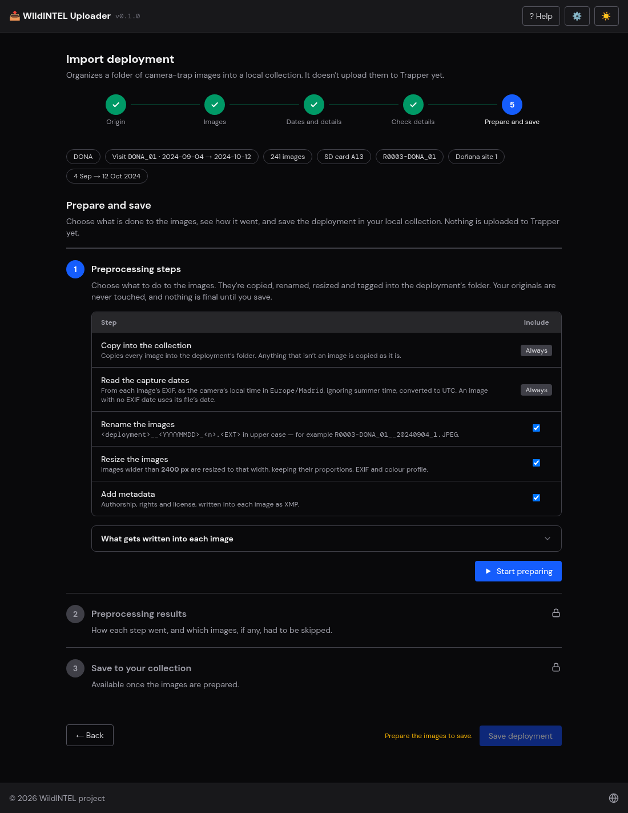

**1. Prepare images.** Choose what to do to the images; the table says what each step does. Press **Start preparing**.

1. **Copy into the collection** — always. Anything that isn't an image is copied as it is.
2. **Read the capture dates** — always. From each image's EXIF, as the camera's local time in the
   location's timezone — ignoring summer time and converting to UTC, as the settings say. An image
   with no EXIF date uses its file's date.
3. **Rename the images** — `<DEPLOYMENT>__<YYYYMMDD>_<n>.<EXT>` in upper case, `.jpg` becoming
   `.jpeg`, e.g. `R0003-DONA_01__20240904_1.JPEG`; *n* is the image's place in file-name order.
4. **Resize the images** — to the width of the settings, keeping proportions, EXIF and colour
   profile. Unlike wildintel-tools, the resized image is the one that is kept.
5. **Add metadata** — authorship, rights and license, written into each image as XMP with
   ExifTool: *Creator*, *Owner*, *Publisher*, *Rights*, *License*, *Coverage* and the hash of the
   original and of the image kept, so each can be traced back. It is switched off, with the reason
   given, if ExifTool isn't available. Check the owner and publisher in the settings first: if
   they're blank, the step says so.

Each optional step can be switched off for this run (its checkbox). Its values come from the
[Preprocessing settings](#preprocessing). The images go into the deployment's folder in the collections folder; the
originals are never touched. Nothing is final yet: you can go back, change something and **Prepare again** — the folder is
simply redone.

**2. Prepared images.** The images processed and skipped, a status for each step and, opened from it, the skipped
images as thumbnails. The [report](#reports) says what was done to each image. **Continue to save** goes on.

**3. Save to your collection.**

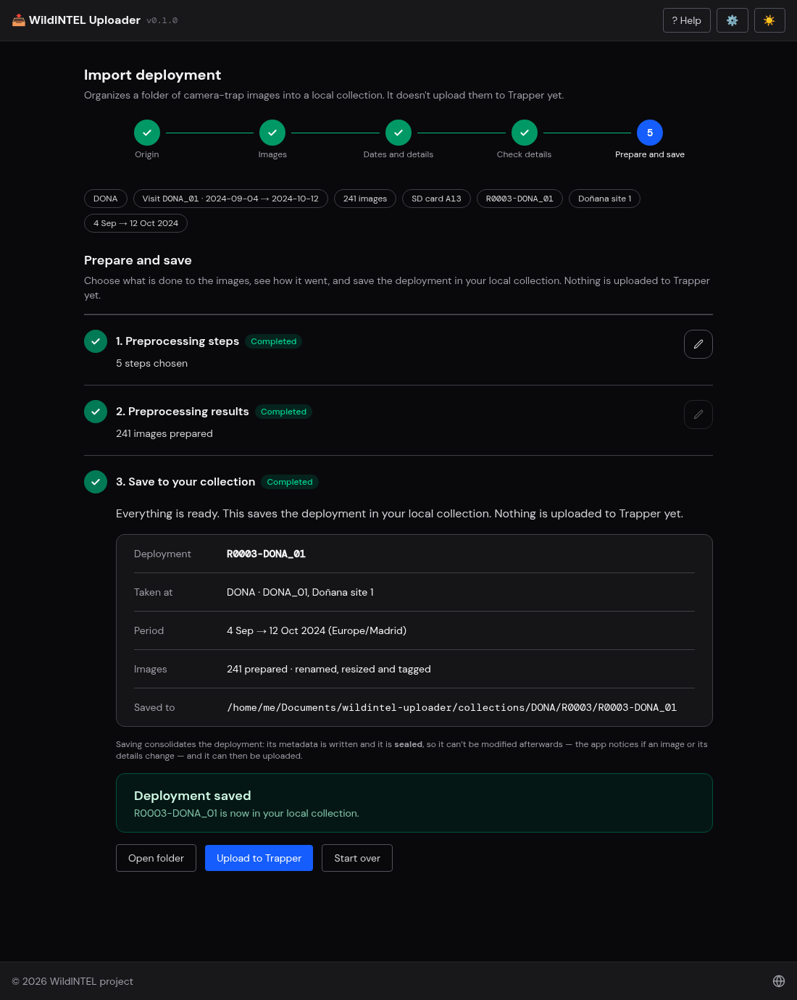

The images are ready, so this step **consolidates** the deployment: press **Save deployment** and its
`deployment.json` is written and the deployment is **sealed**. From then on it can't be modified — the app notices if an image
or its details change — and it can be uploaded.

A good save says where the deployment was kept, and offers:

- **Open folder** in the file explorer.
- **Upload to Trapper** — straight to [the upload page](#7-upload-a-deployment-to-trapper) with the
  research project and the collection already chosen.
- **Start over**.

#### What gets written next to the images

| File | Content |
|---|---|
| `deployment.json` | The details of stage 2. |
| `images.json` | Per image: its name (and the original, if renamed), when it was taken — the camera's wall clock and the instant —, the camera, size and pixels, and hashes. It lets later checks, and the statistics of the next revisions, work without opening the images again. |
| `preprocessing.json` | What was done to each image, with its hashes: `source_hash` of the original, `hash` of the image kept, `final_hash` of the file with its metadata. |
| `seal.json` | Which validation and postvalidation checks the deployment and each image passed, and the hash of everything. |

The **seal** protects against changes by mistake: if an image or `deployment.json` is changed
after the import, the seal no longer matches, and the app can tell. It is not a signature —
whoever edits the files on purpose could seal them again.

## 6. Import a session

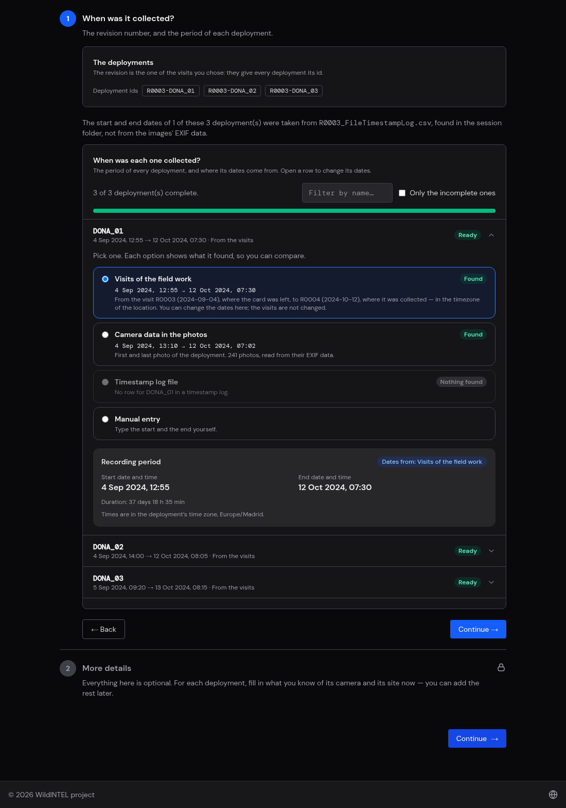

Press **🗂️ Import session**. A **session** is a folder with **one subfolder per deployment** — the
usual way a field trip's images come home. The revision, the checks and the preprocessing are the
same for all; the location, dates and camera are asked for each deployment.

The four stages are those of [Import a deployment](#5-import-a-deployment), with the differences below.

1. **Images** — *Session folder*: choose the folder and **Scan**; its subfolders are listed, each with its images
   and warnings, and you tick the ones to import. Then *Choose the checks* and *Results*: the checks run over every
   chosen deployment, and the result is shown **by folder** or **by check** (with *Only folders with problems*). **Leave them
   out** drops the folders that failed from the session; **Continue with N folders** goes on.
2. **Origin and details** — *Where were they taken?*: one research project for the whole session, and a location for each
   deployment (the ones whose folder name matches a location of the project are suggested, and **Assign** takes them all at once).
   No two deployments can share one. *When was it collected?*: first the **revision**, common to the session, which names
   all the deployments (`R0003-DONA_01`, `R0003-DONA_02`…) and is taken from the log's ids when it has them; the
   previous-revision and Epicollect5 notices are the same as in a single deployment. Then the **list** of deployments, each with
   its period and **where it comes from** (*From Epicollect5*, *From R0003_FileTimestampLog.csv*, *From the images*,
   *Entered by hand*), how many are complete (*"12 of 40 deployments complete"*), a *filter by name* and *Only the incomplete ones*.
   *More details*: the camera and the site of each, with **Fill in from the previous revision** for the ones that have one.

3. **Check details** — the deployments' checks, for each deployment, by folder or by check.
4. **Prepare and save** — one list of steps to prepare the images for all, then each deployment in turn, with its own result.
   If some fail, **Import the N left** resumes with the ones that are still pending. Saving seals each of them.

When it ends, **Upload to Trapper** goes to the upload page with the collection chosen.

#### Where the dates of each deployment come from

Each deployment has its own period and its own **source**. Open its row to see what **every source found** for it, as in a
single deployment, and pick one. There are four, and a session adds the **timestamp log**:

| Source | Where the dates come from |
|---|---|
| **Epicollect5 project** | The entry for that deployment's location and the revision. One request looks up all the deployments at once. |
| **Timestamp log file** | The row of that deployment in the `<COLLECTION>_FileTimestampLog.csv` found in the session folder — the file wildintel-tools asks for beside a collection's deployments —, with the set-up and pick-up times someone wrote down. The row is found by the folder's name or by the id the log gives (`R0003-DONA_02`). |
| **Camera data in the photos** | The first and the last photo of that deployment's folder. They are read in the background, a folder after another, so a row may say *Reading the images…* for a moment. |
| **Manual entry** | You type the start and the end. |

Each deployment takes **the first source that has its dates, in this order: Epicollect5, the timestamp log, the photos** — by
hand only if none does — and a better one found later replaces it, unless you picked one yourself for that deployment. So in a
session some deployments may come from Epicollect5, others from the log and others from the photos, each row saying which.
A notice above the list says how many of the deployments the log gave dates to.

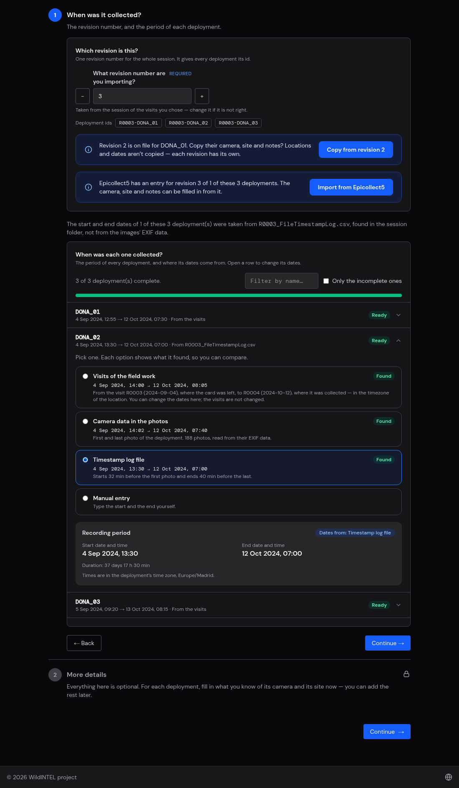

The log's option compares itself with the photos — *Starts 32 min before the first photo and ends 40 min before the last* — a
quick way to notice a log row that doesn't fit its images, which is also reported when a row or a folder matches no deployment. When
a deployment shows *Dates needed* or *To fix*, open it and pick another source or type the dates.

## 7. Upload a deployment to Trapper

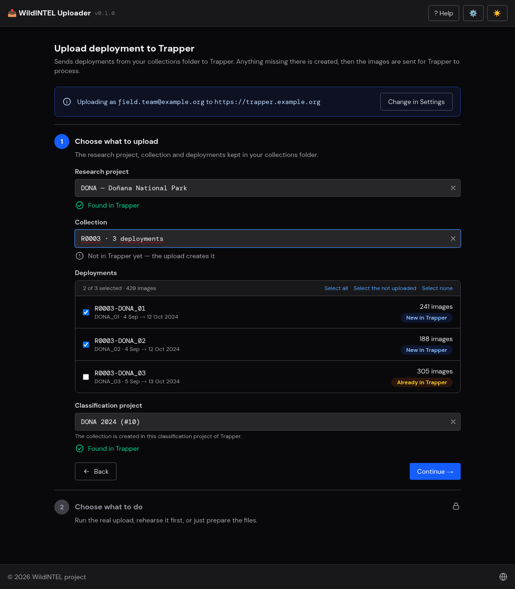

Press **☁️ Upload deployment to Trapper**. It sends deployments kept in the collections folder.
For each one it does what wildintel-tools did in three commands:

1. creates the **location** in Trapper, from the deployment's coordinates, if the research project
   doesn't have it, and the **deployment**, from its details;
2. packs the images in **zips** and the **yaml** that describes them — what was recorded when —,
   splitting in several parts when a zip would be larger than the limit;
3. uploads each zip and its yaml, and tells Trapper to **process them into a collection**.

The deployment must have been imported with the wizard — the yaml needs the dates its
`preprocessing.json` records. One that wasn't says "Not preprocessed — import it again through the
wizard before uploading it", and can't be ticked.

A note at the top says which Trapper account is used: the one saved in the settings (**Change in Settings** takes you
there; **Test connection** is in [Settings › Trapper](#trapper)). The page is a wizard of its own.

### Step 1 — Choose what to upload

1. **Research project** — those kept in the collections folder.
2. **Collection** — and under it a table of its deployments: how many images, its dates, whether Trapper already has it (*New in
   Trapper* or *Already in Trapper*) and the day it was uploaded, if it was (from its `upload.json`, a local note). The ones left to send
   start ticked; **Select all**, **Select the not uploaded** and **Select none**, or the box in the table's header, change the choice.
   As soon as the research project and the collection are chosen, a message says whether it is **found in Trapper** and whether the
   collection is already there, so the upload adds to it, or the upload creates it.
3. **Classification project** — the collection is created in one of Trapper's classification
   projects for the research project: pick it (or, if there is only one, it is used). Without a
   Trapper account, type its pk.

### Step 2 — Choose what to do

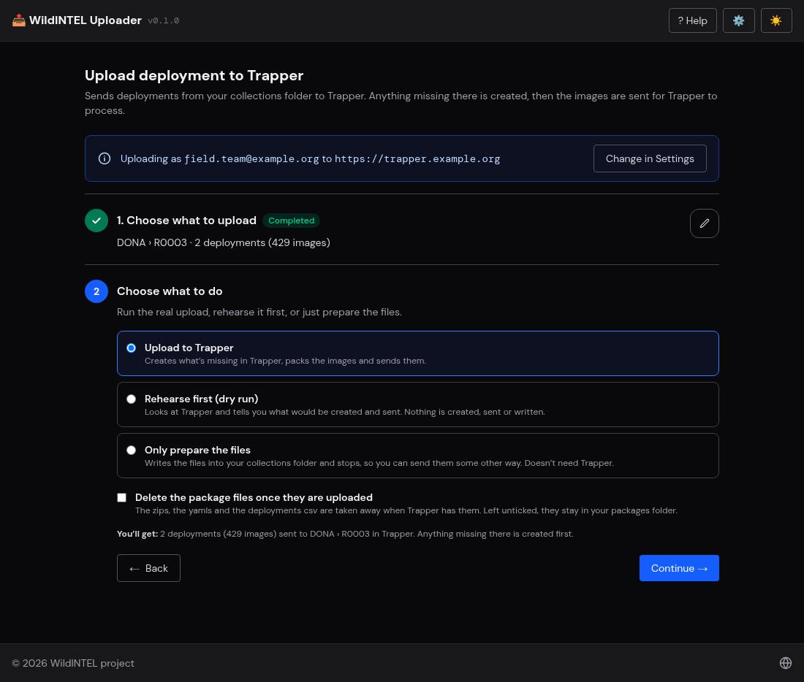

| Mode | What it does |
|---|---|
| **Upload to Trapper** | The real thing. |
| **Rehearse first (dry run)** | Looks at Trapper and says what would be created and how the images would be packed. Nothing is created, sent or written. |
| **Only prepare the files** | Writes the zips, the yamls and the collection's `_deployments.csv` and leaves them, to send some other way. Needs no account if the research project was filled in from Trapper. |

With **Upload to Trapper**, tick **Delete the package files once they are uploaded** to take the zips, the yamls and the deployment's row of the `_deployments.csv` away when Trapper has them. Unticked (the default) they stay in the packages folder, as when only preparing them, and the result says where. The option is also offered when you go on to upload files you have just prepared.

The size of the zips is a setting: [Settings › Trapper](#trapper). The page says what you will get before you go on.

### Step 3 — Upload

Press **Continue**. The upload shows in three phases — *Set up Trapper*, *Send the images* (with a bar, the amount sent and the
time left) and *Trapper processes them*, which happens on Trapper's side and needs no waiting — and, under them, how many
deployments and images have been sent and a row for each deployment with its state. A deployment's steps (*connect*, *classification*, *location*, *deployment*, *package*, *csv*, *upload*,
*process*, *wait*) are each marked as running, done or skipped. The steps that made or found something in Trapper — the *location*, the *deployment* and, at the end, the
*collection* — show **a link to its page in Trapper** (for example `https://trapper.example.org/geomap/deployment/detail/47/`),
to check there that it was created or updated. A dry run links to what is already there; what it would create has no page yet. **Stop** ends it —
what is already in Trapper stays there. When one fails, the others go on, and the summary says so: *"1 deployment uploaded, 1
could not be uploaded."* The failed one is in the list with its reason — when Trapper refuses a deployment because its location belongs to
someone else, the reason says who owns it. The page shows the date of the run and a **Download report** link: the report of the upload is kept with the others
(*Settings › Reports*), a row per deployment and step. **Upload more** starts over.

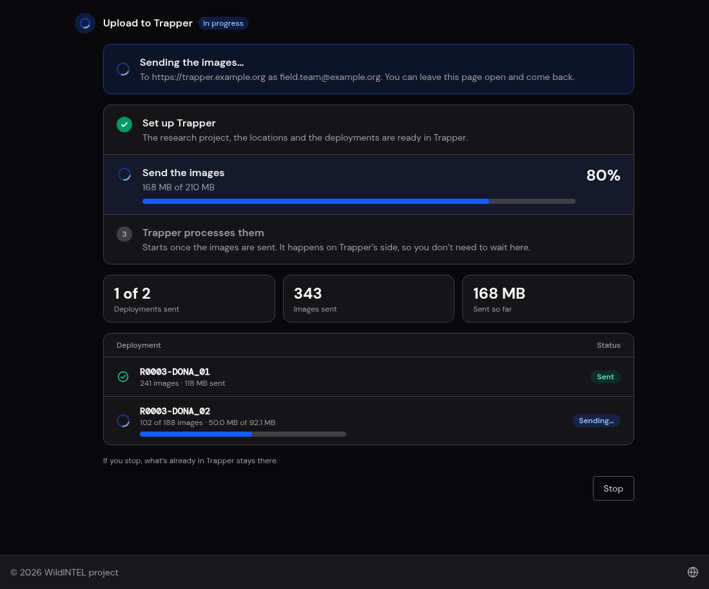

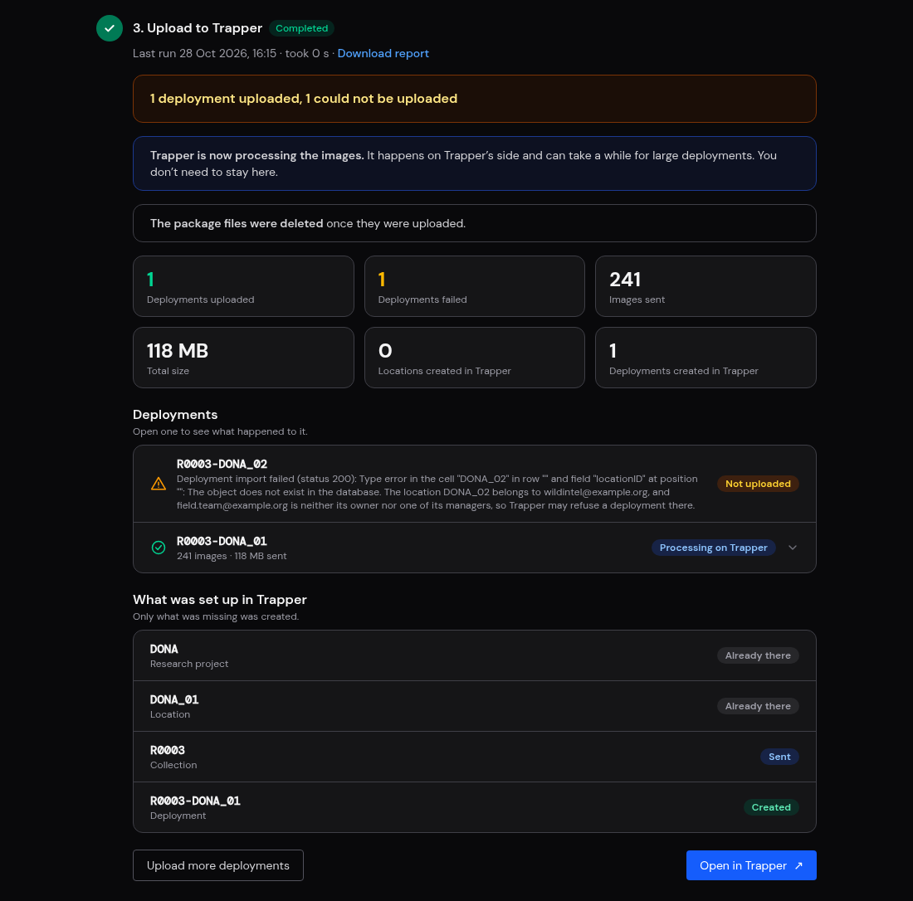

The zips and yamls are written under `<data folder>/packages/<research project>/`. A deployment
that was uploaded gets an `upload.json`, which is what the list uses to say so.

## 8. Utils

Press **🧰 Utils**, under the task cards of the menu. It holds the maintenance tasks of the local collections; pick one,
and **Back** returns to the list.

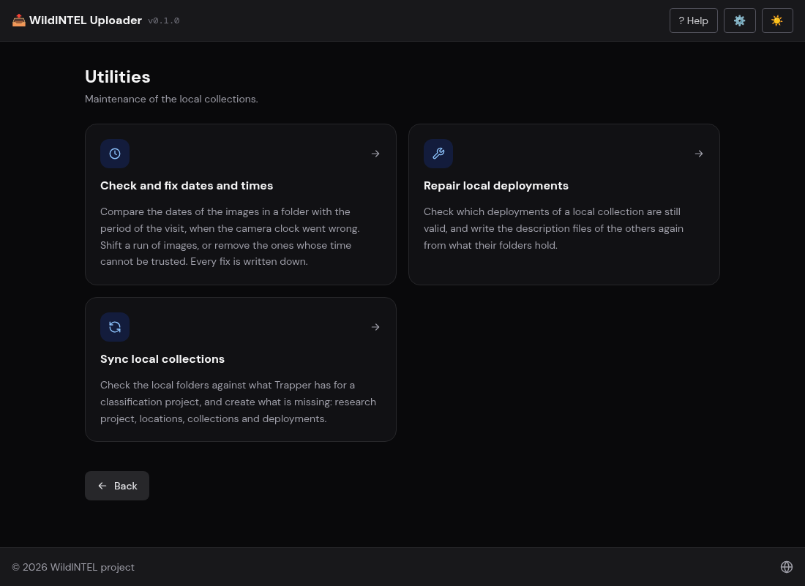

### Sync local collections

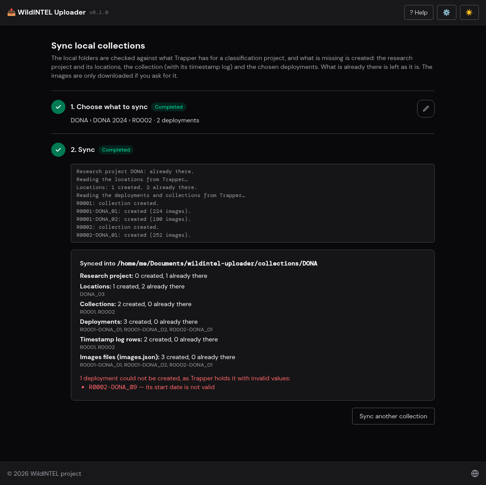

Press **🔄 Sync local collections**. Use it when Trapper already has deployments that the
collections folder doesn't — say, imported years ago, or from another computer — so that the
statistics of the *next* revisions can compare with them, and the folder reflects what Trapper
holds.

1. Pick a **research project**, then one of its **classification projects**.
2. Pick a **collection** (those of the classification project whose name starts with `R`) and,
   under it, the **deployments** to sync — with *Select all*.
3. Tick **Also download the images from Trapper** if you want them too (see below).
4. Press **Sync**.

What is missing is created, one deployment at a time, and a live log says what is happening:

- the research project (`research_project.json`) and its `locations.json`;
- the collection (with its `collection.json` and `<collection>_FileTimestampLog.csv`);
- each chosen deployment's `deployment.json`, in the collection its id starts with, and an
  `images.json` made from what Trapper holds for its images (names, when they were taken,
  observations).

What is already in the folder is **left as it is**, whatever Trapper says. **Nothing is changed in
Trapper**, and **no image is downloaded unless you ask for it** — so there is no `preprocessing.json`, and the size,
pixels and hashes are missing from `images.json`, which is marked `"source": "trapper"`. A
deployment synced this way is *read-only* for the app: what Trapper holds isn't modified here.

#### Downloading the images

With **Also download the images from Trapper** ticked, each chosen deployment's images are also downloaded, four at a time, into
its folder — named as Trapper names them (`R0003-DONA_01__20240901_1.JPEG`), the file Trapper holds. A deployment can have
thousands of images, so it can take long and need a lot of disk space. The log says how far each deployment is.

- The files come through the **classification project** you picked: Trapper only gives the access token of a file — private
  ones too, for an account that can see them — in the media of a classification project, so an image that isn't in a collection of
  that project can't be downloaded. The result says how many of each deployment weren't.
- What is already in the folder is kept, so syncing again **completes** a download that was stopped, or retries the images that failed.
  A file is written under a temporary name and moved into place when whole: a stop never leaves half an image.
- The deployment is still a *synced* one: its images aren't preprocessed, renamed or sealed, so it can't be uploaded or repaired from here.

The result lists, per kind, what was created and what was already there, the deployments no
collection of the classification project claims, and any that Trapper holds in a way that isn't a
valid deployment — with the reason — and were left out.

### Repair local deployments

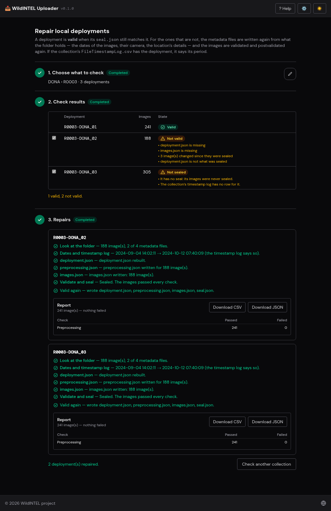

Press **🛠️ Repair local deployments**. Use it when a deployment of the collections folder has lost its metadata files, or
its images were touched — so it no longer matches its seal — and you want it back in working order.

1. Pick a **research project** and one of its **collections**, both from the collections folder.
2. Press **Check the deployments**. A deployment is **valid** if its `seal.json` still matches it: every image and its
   `deployment.json` are as they were sealed. Anything else — no seal, changed or missing images, a missing or unreadable
   metadata file — is *not valid*, and the table says what is wrong. A deployment synced from Trapper is not touched.
3. The ones that are not valid start ticked (*Select all*, *Select the not valid* and *Select none* change it). Press **Repair**.

Each deployment is repaired in turn, with its steps shown:

- **Dates.** The capture date of every image is read from its EXIF, as the camera's wall clock, and the deployment's period
  is decided: if the collection's `<collection>_FileTimestampLog.csv` has a row for it, **the log says it**, whatever the
  images say; otherwise the period is the one the `deployment.json` that is left has, or else the one of the images, and the
  row is **added to the log**. The log itself is never rewritten but to add that row.
- **`deployment.json`** — what is left of it, plus the location's details (name, coordinates), the camera of the images,
  and the period. If something required can't be known — the location has no coordinates, say — the repair stops and says so.
- **`preprocessing.json`** and **`images.json`** — one entry for every image in the folder, with its date, hashes, camera and size.
  What can't be known is left empty: the original name of a renamed image, unless an earlier `preprocessing.json` says it, and the
  hash of the original, unless the image's XMP metadata does.
- **`seal.json`** — the images are **validated and postvalidated** again, as in the wizard, and sealed with the result (marked as
  *recovered*). A deployment is sealed even if its images fail a check: the report says which.

A **report** is written, and shown, with what was written and what the images passed — and four checks of the
**preprocessing** the folder can answer: the names (`<DEPLOYMENT>__<YYYYMMDD>_<n>.<EXT>`, with the day of the capture date and each
number once), the size (not wider than the width of the settings), the XMP metadata (needs ExifTool) and that the images are
still the ones that were preprocessed. What the preprocessing *did* — the resizing, the renaming — can't be checked beyond that:
the originals are gone.

## 9. Troubleshooting

**"Backend not reachable — is the server running?"**
:   The red bar at the top. The window that started the app was closed, or it crashed. Start the app
    again, and look at the log (Settings › General) if it recurs.

**The browser doesn't open**
:   Open <http://127.0.0.1:8769> yourself. If that port was busy the app took the next free one:
    the window that started it says which (`Server on http://127.0.0.1:8770`).

**"Incorrect Trapper username or password"**
:   The username is the **email** of your account. Check it in Settings › Trapper and press
    **Test connection**.

**"Could not connect to the Trapper server"**
:   The URL is wrong — it needs `https://` and no trailing path — or the server is down or
    unreachable from your network.

**The metadata step is greyed out: "ExifTool is not installed"**
:   The downloadable app ships its own ExifTool. Running from the source code, install it
    (`sudo apt install libimage-exiftool-perl`, `brew install exiftool`) — or switch the step off.

**"This deployment already exists"**
:   A deployment with that id is already kept in the collections folder. Choose another revision or
    location, or move that folder away; importing would otherwise mix two sets of images.

**A location has no timezone**
:   Added by hand without one, or synced from a Trapper location that has none. Edit it in the
    *Origin* step; the app won't guess it.

**"Not preprocessed — import it again through the wizard"**
:   The deployment has no `preprocessing.json`: it was copied by hand, or synced from Trapper (which
    already has its images). Only deployments imported with the wizard can be uploaded.

**The upload says Trapper refuses the package**
:   Trapper checks the package's timezone and summer-time setting against the location's. If you
    changed them for the location in Trapper, they must be the same here — edit the location in the
    *Origin* step.

**The upload fails with "Trapper's uploader accepted the login but gave no session"**
:   The uploader's login answered without the session it should hand out. The message includes what
    Trapper said: send it to the Trapper administrator, or attach it to a bug report.

**Files ending in `_exiftool_tmp` in a deployment's folder**
:   ExifTool writes the metadata of each image through a temporary file; one it was interrupted in
    (the app stopped in the middle of an import) is left behind. The app removes them when the
    metadata step ends, or fails, but not if it was killed: delete them, and import again.

**An image was skipped**
:   The import lists skipped images with the reason, and goes on with the rest. A corrupted file is
    the usual cause; the *Corrupted images* validation finds them before importing.

**Reporting a problem**
:   Set the log level to `DEBUG` (Settings › General), repeat the steps and attach the log file
    to the report at
    [github.com/wildintelproject/wildintel-uploader/issues](https://github.com/wildintelproject/wildintel-uploader/issues).
