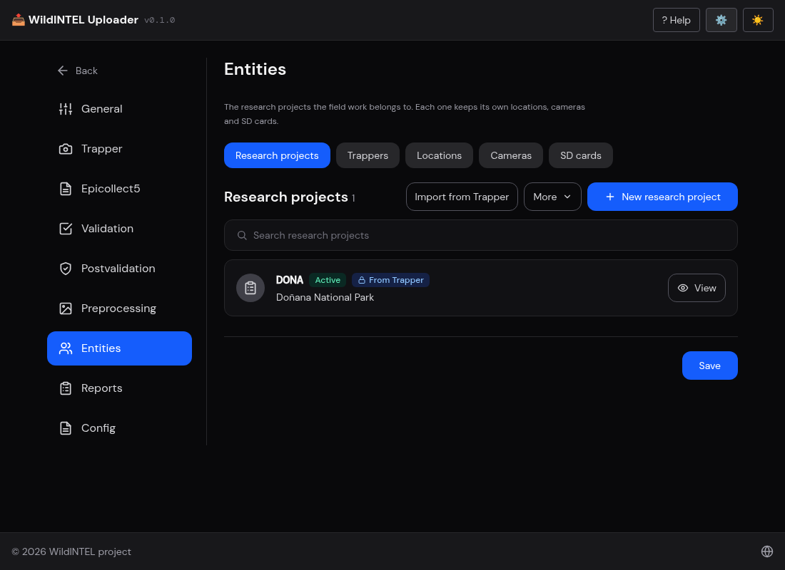
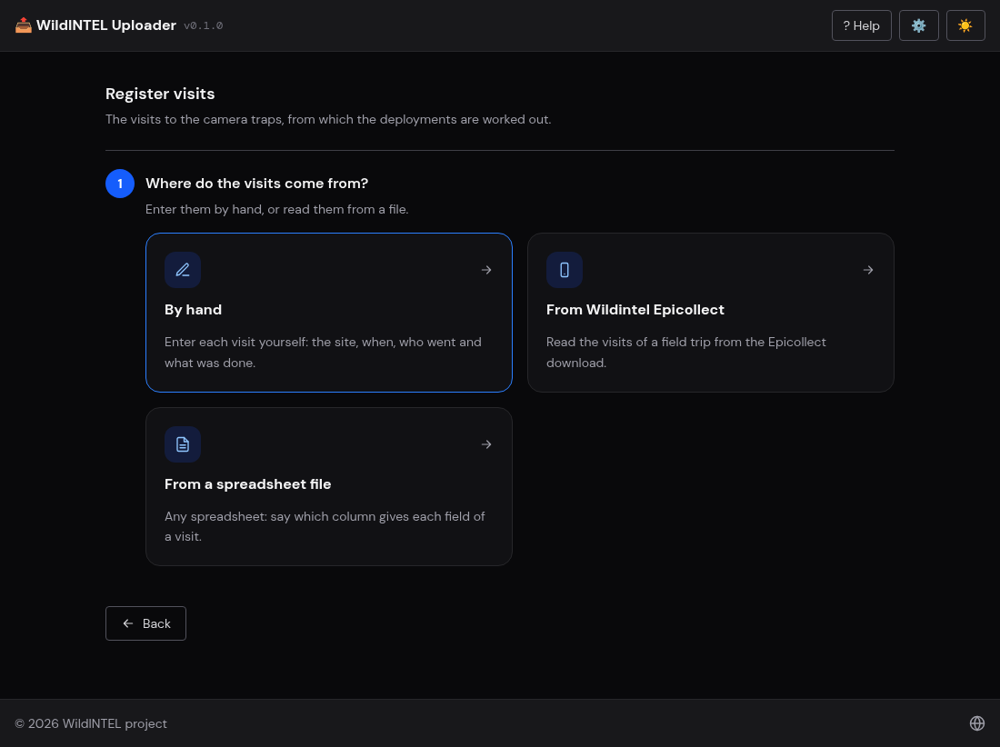
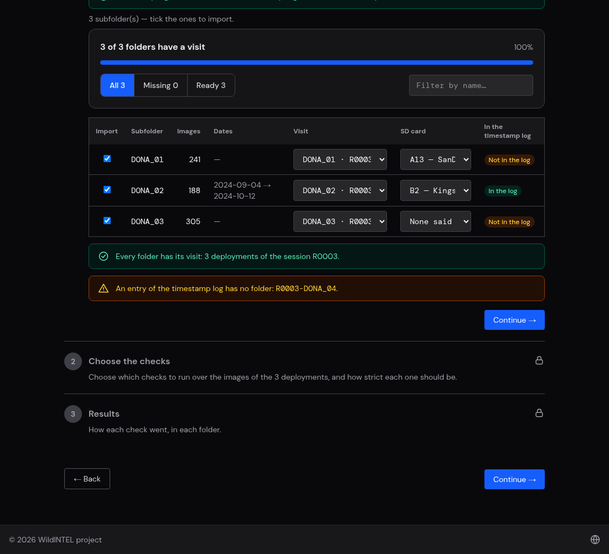

# WildINTEL Uploader — User Manual (web)

This manual covers the web interface. What it shares with the command line — [installation, the
general concepts and the folders it creates](user-manual.md) — is in the common part; read that
first. Part of what the web app does can also be done from a terminal: see the
[command-line manual](user-manual-cli.md).

---

## Table of Contents

1. [Getting started](#1-getting-started)
2. [Settings](#2-settings)
3. [The task menu](#3-the-task-menu)
4. [Unfinished runs](#4-unfinished-runs)
5. [Register visits](#5-register-visits)
6. [Import a deployment](#6-import-a-deployment)
7. [Import a session](#7-import-a-session)
8. [Upload a deployment to Trapper](#8-upload-a-deployment-to-trapper)
9. [Utils: sync, repair and fix dates](#9-utils)
10. [Troubleshooting](#10-troubleshooting)

---

## 1. Getting started

[Install](user-manual.md#1-installation) the app and run it with no arguments. It starts a small server on your computer
and opens the app in your default browser (<http://127.0.0.1:8769>, or the next free port). **Keep the window it
opened until you finish** — closing it stops the app. Everything stays on your machine: the only thing the app talks to is
the Trapper server you configure. The welcome screen says what it does; press **Get Started**.

Before you start using the application it has to be configured. To do so, press **⚙️ Settings** (top right) and fill in the
**Trapper** server, username and password — see [Settings](#2-settings); you can test them right there. Also fill in who owns the
images (Preprocessing › Authorship) if you are going to import some.

## 2. Settings

Press **⚙️ Settings**. It has its own sections on the left; one **Save** saves them all, and a red
dot marks a section with an invalid value.

### General

- **Data folder** — where the app keeps what it makes: the collections, the reports and the packages, each in a folder inside it. Blank uses
  `Documents/wildintel-uploader`; a path must be absolute (or start with `~`).
- **Collections folder**, **Reports folder** and **Packages folder** — where the collections, the reports of the checks and the packages made to upload to Trapper are kept. Blank, each is a folder (`collections`, `reports`, `packages`) inside the data folder; set one to keep it somewhere else, on another disk for instance. A path must be absolute (or start with `~`). What is already kept in the old place is not moved: do it by hand.
- **Workers** — how many images are validated and preprocessed at once. Up to the number of
  processors of your machine pays off; the default is that number, up to 4.
- **Log level** — how much the app logs (`ERROR`, `WARNING`, `INFO`, `DEBUG`). At `DEBUG` it logs
  every step.
- **Log file** — download it, or delete it. It lives in the log folder of your system (`~/.local/state/wildintel-uploader/log` on Linux), which can't be changed. It rotates at 5 MB keeping the last 5. Attach it to any
  bug report.
- **About** — at the top: the app's name and version, **Check for updates** (it offers the download when there is a newer version), and links to **Report a problem** (a GitHub issue that already says the version and your browser), the **Documentation**, the **GitHub** project and **What's new** (the release notes).

### Trapper

The server's **URL**, and the **username** (its email — Trapper's import form only accepts
that) and **password** of your account. **Test connection** reports the research projects it can
see. The password is saved in `settings.toml` but never sent back to your browser.

**Upload packages — Largest package** is the size, in MB, of the packages an [upload](#8-upload-a-deployment-to-trapper) makes: the
images of each deployment are uploaded in packages of this size at most (500 by default, up to 5000).

### Epicollect5

The Epicollect5 project the deployments' information will be imported from (see [Dates and details](#stage-3-dates-and-details)): its **slug**, the
name in its URL (`five.epicollect.net/project/<slug>`), and, only if the project is private, the **client id** and **secret** of
its API client, which you create at <https://developers.epicollect.net>. **Test connection** reads the project with what is typed — saved or not — and says its name and how many inputs
it has; a blank secret is the saved one. The **Import deployment information from Epicollect5** switch turns the use of Epicollect5 on or off — it is off until you turn it on, and while it is off nothing is read from Epicollect5. **Add them to the comments** sends what an entry answers in the inputs that are not mapped to any field to the comments of the deployment, a line each (*question: answer*; photos are left out). Below, the **Mapping** relates each field of a deployment to an input of the project's form. Epicollect5 has no input for a date and a time together, so the day and the time of the start and of the end are mapped apart, along with the revision. What an entry gives fills the camera, the site and the notes of a deployment; it is **no longer a source of its dates** — those come from the visits, the timestamp log or the photos.

### Validation

Which of the [folder checks](#stage-2-images) the wizard shows. Each is an entry with a switch;
turn off the ones you never want to see. They are all on by default.

### Postvalidation

Which of the [postvalidation checks](#stage-4-check-details) the wizard shows, and what the ones
that take a value mean:

| Setting | Default | |
|---|---|---|
| Tolerance | 1 hour | Leeway around a deployment's start and end for the image dates. |
| Sequence gap | 60 s | What a *sequence* is: a new one starts when the gap to the previous image is at least this. |
| Compared with | median | What this revision is compared to: the **median** or **mean** of the earlier ones, the **last** one, or the **range** they span. |
| Previous revisions needed | 2 | With fewer, the statistical checks are skipped. |
| Number of images / sequences / length of sequences | 50 % each | How different a value can be and still count as similar. |
| SD card / Photo count | on | The two checks of a deployment [of a visit](#stage-4-check-details): that the card is the one the visit left and that the photos are those it counted. |

### Preprocessing

What a new import does to the images — the wizard lists it before preparing, and a run can still
switch each step off.

- **Steps** — rename, resize, add metadata.
- **Resize width** — 2400 px by default; wider images are shrunk to it, narrower ones left alone.
- **Authorship** — **Owner**, **Publisher** and **Coverage** (where the images were taken; blank
  uses the deployment's location), written into each image. A blank owner or publisher is written
  as "Unknown".
- **License** — picked from a list: **CC0** (any use, no requirements), **CC BY** (any use with
  attribution) or **CC BY-NC** (with attribution, not for commercial purposes), the default. What is
  written into each image is the license's URL, shown beside each name.
- **Dates** — **Ignore summer time**, and **Convert the dates to UTC**.

### Entities

The things the visits and the deployments refer to, one tab each: **Research projects**, **Locations**, **Trappers**, **SD cards** and **Cameras**.
Each can be added one at a time, taken from Trapper (research projects and locations) or loaded from a CSV with **Import CSV** (there are
examples in `examples/entities_example`, explained in `examples/CSV.md`). Locations, SD cards and cameras belong to a research project: pick it first.
A location's **time zone** (UTC unless you say another) and whether its cameras ignore summer time are chosen when it is created and **cannot be changed afterwards**: the instant of every visit to it was worked out with them. A camera or a card can be *active* or not; the visits only offer the ones in use. A location can be deleted unless it has visits or comes from Trapper,
and an SD card can be marked as stolen. Press **Save** to keep what you changed.

### Reports

Every **validation**, **postvalidation**, **preprocessing** and **repair** leaves a **report** of what it checked and did,
image by image. The step shows it right below its results — the same file you can download, so what you see is
what is kept:

- the **checks**, with how many images passed and how many failed each;
- the **images that failed**, with the check and why — *IMG_0087.JPG · Duplicate images · same content as IMG_0087 (copy).JPG* —
  that can be narrowed to one check, and are shown 100 at a time;
- **Download CSV** — a row per image and check, to open in a spreadsheet — and **Download JSON**, with everything: when it
  was made, the folder, the parameters it was run with and every entry.

What each report holds:

| Report | An entry for | Says |
|---|---|---|
| **Validation** | each image and check — corrupted, shooting order, EXIF fields, duplicates —, and the folder for the structure and camera checks | The ones that passed too, so the report says what was checked, not only what failed. |
| **Postvalidation** | the deployment for the naming and statistical checks, and each image for its date and camera | Why a check failed — *241 images — like the previous revisions (median 238, ±50 %)*. |
| **Repair** | each image and check, and each metadata file | What the repair wrote and what the images passed, as the new seal says — and the preprocessing checks: names, size, metadata. |
| **Preprocessing** | each image | What was done — *IMG_0001.JPG → R0003-DONA_01__20240904_1.JPEG; date 2024-09-04T11:10:00+00:00 (exif); resized* — and the ones that were **skipped**, with the reason. |

**Settings › Reports** lists all of them, newest first, with *View*, *CSV*, *JSON* and *Delete* (which
asks again). They are kept in the `reports` folder of the data folder until you delete them. A check you run twice
makes two reports.

### Multiple configs

The application lets you define several different configurations: **+** adds one with the default
values, and choosing one makes it the active one — handy to switch between two Trapper servers (a
test one and the real one) or two sets of authorship. Each can be downloaded, and its folder opened.

## 3. The task menu

Once it is configured, the menu is where you choose what you want to do:

| Task | What it's for |
|---|---|
| 📋 **Register visits** | Record the visits to the camera traps — who went, when, to which site and what was done. The deployments are worked out from them. |
| 📷 **Import deployment** | Check one folder of images and organize it in the collections folder. |
| 🗂️ **Import session** | The same for a folder holding several deployments, one subfolder each. |
| ☁️ **Upload deployment to Trapper** | Send deployments already kept locally to Trapper. |
| 🧰 **Utils** | *Check and fix dates and times* compares the dates of a folder's images with the period of the visit, when the camera clock went wrong, and shifts or removes the ones that cannot be trusted (every fix is written down). Maintenance of the local collections: *Sync local collections* brings the collections folder up to date with what Trapper already has, and *Repair local deployments* checks which deployments are still valid and writes the metadata files of the others again from their folders. |

The usual order is **Register visits** first, then **Import** (or **Import session**) — which take the location, the camera and the dates from the visits — and then **Upload**. *Sync* is for when
Trapper already holds deployments that this computer's collections folder doesn't know about (**Utils › Sync**).

The title in the top bar takes you back to the welcome screen at any time; **? Help** opens this
documentation, and the sun/moon button switches between dark and light.

If the app was closed in the middle of an import, the first thing you see is the list of
**unfinished runs** — see [Unfinished runs](#4-unfinished-runs).

## 4. Unfinished runs

An import saves its progress as you go. If you close the app, or it fails, the next time you start
it the first screen lists the **unfinished runs** — the folder, the research project and when it
was started — each with **Resume** and **Discard**. Resuming takes you back to the step after the
folder was chosen. Passwords are never saved with a run.

## 5. Register visits

Press **📋 Register visits**.

 A **visit** is one trip to a camera trap: when it was, which site, who went and what was
done. The visits of a research project are kept in its `visits.json`, and the deployments are worked out from them: a
deployment goes from the visit that **left** a camera to the one that **collected** its card. Choose the research project and how
the visits come in:

| Source | What it does |
|---|---|
| **By hand** | You fill in each visit yourself. |
| **From Wildintel Epicollect** | Reads the visits of a field trip from the Epicollect download (a CSV). The time is the `created_at` of the entry, put in the timezone of the location. |
| **From a spreadsheet file** | Any CSV: the page shows its columns and you say which one gives each field of a visit. |

When a file is read, the visits that were found are listed and the ones that are fine can be kept; the rows that cannot be read (*a date that is not a date*,
*actions that are not Installation, Revision, Desinstallation or Stolen*…) are listed with why. The file is treated as the field records are: what the field wrote is
**kept and questioned, not thrown away**:

- **Sites that are not locations.** A site of the file that is not a location of the research project may be a site that is really new or one misnamed in the field. Its visits
  are held, and the site is shown with what tells the two apart: **how far** its first visit was from the nearest location, and the locations whose id is **one character apart**
  from its own (*it may be a misprint*). If it is new, **Add … as a location** keeps it with the coordinates of its first visit and reads the file again; if it is a misprint, correct
  the id in the file and read it again.
- **What to check in the field data.** A camera or an SD card at two sites in one session or in a place it cannot be (a camera installed at another site, a card still in another camera),
  what a visit's actions ask and it lacks (the photos of a Revision, the card of an Installation), two Revisions or two Installations of a site in one session, a visit that is not
  after the one before, a Revision with no photos, and an Installation while the card left before was never collected. They are listed, and the visits are kept as they are.

The same rules protect the form: **by hand**, a visit is refused — by the server, whatever page sends it — if its site is not a location of the project, it is already kept (same site, day and time),
it lacks what its actions ask, or its camera or card are not where it says.

**By hand**, a visit is a form with these parts:

1. **Actions** — one or several of *Installation* (a camera is put up and a card left), *Revision* (the card is collected and another left),
   *Desinstallation* (the camera is taken away with its card) and *Stolen*. The rest of the form depends on what is chosen: what the actions do not
   ask is left out. When the camera was already visited, **the Camera, Site and Grouping sections come filled in from the last visit** (not its notes).
2. **Camera** — the camera (picked from the active ones of the project, or added from here) and how it is placed and set: height or depth, tilt,
   heading, delay, detection distance, its status, whether the batteries and the clock were right. **It comes before the SD card**.
3. **SD card** — the card left in the camera, how many photos the card collected, and whether it was full. It says which card was in the camera
   according to the visit before.
4. **Site** and **Grouping and notes**, as in the details of a deployment.

Each field is marked *required* or *optional* according to the actions.

## 6. Import a deployment

Press **📷 Import deployment**. This option is meant to import the set of images that come from a **single camera**: one
folder, one deployment. For a folder with the images of several cameras, one subfolder each, use
[**Import session**](#7-import-a-session).

It is a wizard of five stages — the bar at the top shows where you are, and a
stage can have steps of its own, which open one after the other. Each stage is **done** (a tick and a
summary, with a pencil to go back and change it), **open** or **locked** until the ones before it are
done. **Back** and **Continue** move between them.

| Stage | What it asks |
|---|---|
| 1. **Origin** | The research project and the visit (or the location) the images are of. |
| 2. **Images** | Which folder, which SD card, which checks, and how the images did. |
| 3. **Dates and details** | The revision, the period, and what you know of the camera and the site. |
| 4. **Check details** | The deployment's names and dates, the images against them, and against the visit. |
| 5. **Prepare and save** | The preprocessing, and saving the deployment in the collection. |

The bar of chips above each stage fills in as you go: the research project, the visit with its range of dates, the number of images and the card, and,
at the end, the id the deployment will have, its location and its dates.

### Stage 1 — Origin

The **research project** the images belong to, and where they were taken. They are kept in the collections folder; pick one already there, or add a new one:

- **By hand** — the project's name and acronym (which names its folder); a location's id, name,
  latitude, longitude, coordinate uncertainty, **timezone** and whether its cameras ignore summer
  time. A new location is **UTC, following summer time**, unless you say otherwise: the cameras' clocks are taken as UTC, and
  the time of a field visit is read in the timezone of its location.
- **From Trapper** — pick the project, or its locations, from your Trapper account and they are
  copied here, with their coordinates and timezone. The app connects by itself with the account
  saved in the settings — it never asks for the credentials again; if there isn't one, it says so.

**The closed visit.** Once the research project is chosen, the **Closed visit** lists the visits to it that left a camera and whose card has been
[collected](#5-register-visits), and that have **no deployment yet** (a visit that already has one is not offered). Picking one gives the deployment
its **location**, its **revision** (the session of the visit) and, later, the camera, the site and the period: the deployment is *of that visit*. If you do
not pick a visit, you pick the **location** yourself and everything else is asked by hand. A project with no closed visits goes on without one.

If you start from a visit — from [Register visits](#5-register-visits) — the project and the visit are already chosen.

### Stage 2 — Images

In this stage you tell the app **which images** you are importing and find out, before anything else is done, **whether they
are in good shape**. You choose the folder with the images of the camera and the app counts what is in it; then you
choose which checks to run over the images alone — corrupted files, shooting order, subfolders, a single camera, the
photo data they need and duplicates — and how strict each one is. The result tells you how many images are valid and which
ones have problems, so you can fix them before going on. **Nothing is copied or changed yet: the source folder is only read.**

The stage has three steps (the first one also asks the SD card):

**1. Select the folder.** Press **Browse…** and choose the folder with the deployment's images (or type its path), then
**Scan**. The scan only **counts**: how many files there are and how many of them are images (by
their extension) — *241 images found* — with a warning if the folder is empty or has no
images. It doesn't open them, which is why it is instant however many there are: reading the
images is what the next steps are for. Copy the images off the camera's memory card first; don't point the app at the card.

Once the folder is scanned, the app asks the **SD card** the images come from, among the cards of the research project (**Select an SD card…**; optional). If the deployment is
of a visit, the card is checked against the one the visit left — see [Check details](#stage-4-check-details).

**2. Choose the checks.** Checks over the images alone, before anything is known about the deployment:

| Check | Looks for |
|---|---|
| Corrupted images | Files that aren't readable images. |
| Shooting order vs. filename sequence | Images whose order by name differs from their order by time. |
| Folder structure | Subfolders inside the deployment's folder. |
| Same camera | More than one camera model or id among the images. |
| Required photo data | Images missing the capture date, camera model or id. |
| Duplicate images | Files with the same content. |

For each check you choose **how strict** it is: **Skip** doesn't run it, **Warn** shows the problems but lets you
continue, **Must pass** stops you from going on while it fails. The ones that are turned off in the
[settings](#validation) are not shown. Press **Run checks**.

**3. Results.** A small dashboard: when it was last run, the downloads of its [report](#reports) and four figures —
the **valid images**, the **images with issues**, the **checks run** and the ones **with problems**. Under them, one
row per check with its status (✔ passed, ⚠ failed, ✘ failed and *Must pass*) and how many images failed it.

Open a check that failed to see **which images failed it**: as pictures, each
with what is wrong with it (*No date*, *Duplicate*, *Out of order*…) and when it was taken, or as a
list. You can **search by file name**, filter by the kind of error, sort by name or by date, and go
through the pages; **View details** opens the image bigger with everything the report says of it. A check of the whole folder (the
structure, or the camera) has no pictures: it says what it found. **Run again** repeats it.

Reading the camera's model and id uses ExifTool, because the serial number of a camera trap lives
in the manufacturer's own metadata. Without it the app falls back to the standard EXIF tags,
which are less complete — it says which it used.

### Stage 3 — Dates and details

Here you tell the app **when** the images were taken and what you know of the camera and the site. With this the deployment gets its id
(`R0003-DONA_01`) and its details. **Only the dates are required: the rest can be completed later.** The stage has two steps.

**1. When was it collected?**

First, the **revision**. If the deployment is of a visit it is the session of the visit; otherwise it starts as the next one expected for the location
— one more than the highest kept — and says so; change it if needed, and the **deployment id** is built (`R0003-DONA_01`). If an earlier revision of this
deployment is kept, a notice offers to **copy from it** its camera, site and notes — the dates are never copied. If the deployment **already exists** in the
collections folder you are told, and the import would be refused as it would mix two sets of images: choose another revision or location, or move that
folder away.

Then the **period**: when the camera started and stopped recording, as the clock of the location's timezone. The dates are not typed from scratch — the app looks for
them in several **sources**, and shows **what each one found** so you can compare them and **pick one**:

| Source | Where the dates come from |
|---|---|
| **Visits of the field work** | Only if the deployment is of a visit: from the visit where the card was left to the one where it was collected, in the timezone of the location. You can change the dates here; **the visits (the field sheet) are not changed**. |
| **Camera data in the photos** | The first and the last photo of the folder: the earliest and the latest capture date in their EXIF data. |
| **Manual entry** | You type the start and the end yourself. It is the only one that lets you edit them. |

Each option says **Found** — with the start and end it found — or **Nothing found**. Below them, **Recording period** shows the dates taken, which source they are
**from**, and the **duration**. The app picks for you the first source that has dates: **the visits, then the photos**; by hand only when neither has found anything. A better
source that turns up later replaces the one taken — until you pick one yourself.

If the deployment's collection has a `<COLLECTION>_FileTimestampLog.csv` (the file wildintel-tools asks for), going on from *More details*
**adds the deployment's row to that file**. A log that is already there is used for the dates in an [*Import session*](#7-import-a-session).

**2. More details.**

Everything here is optional, and can be completed later in Trapper. The form follows [Camtrap DP](https://camtrap-dp.tdwg.org)'s deployment table — the same
fields as Trapper's own deployment form. Each section is a card that says how many of its fields are filled in; open it to fill it in.

| Section | Fields |
|---|---|
| **Camera** | Camera id and model (read from the images when they all share them), delay between triggers, height *or* depth (not both), tilt, heading, detection distance. |
| **Site** | Feature type (road, trail, burrow, water source…), habitat, set up by, bait used, timestamp issues. |
| **Grouping and notes** | Deployment groups, tags, comments. |

**Where do they come from?** When the deployment is of a visit, or an earlier revision is kept, a card asks which source gives these details — each option says
**how many fields it found** and which parts of the form they are:

| Source | What it gives |
|---|---|
| **What the field sheet says** | What the visit wrote down in the field: the camera, who set it up, the placement, the site. The visits are not changed. |
| **What the previous deployment says** | The camera, the site and the notes of the previous revision of the location (never its dates). Not available — *Nothing found* — when there is none. |
| **Fill in by hand** | You type them, **starting from the values the last source gave**. |

With the field sheet or the previous deployment picked, the fields are shown **as that source says them, and cannot be edited**; pick *Fill in by hand* and they
open for editing without losing the values. Picking a source again restores its values (what you changed by hand is lost). What a source does not say is left empty.
When Epicollect5 [is turned on](#epicollect5) and has an entry, a notice under the revision also offers **Import from Epicollect5**, which fills the camera, the site and the notes
from it (and leaves the form to be edited by hand); the location's own data are never taken from the entry.

The form is validated as you type, in the browser and again in the server: dates in order, latitude and longitude in range, tilt between −90 and 90, heading between 0 and 360.

### Stage 4 — Check details

Now that you know when, how and where the images were taken, new checks are run: the deployment's names and dates, and the images against it:

| Check | Looks for |
|---|---|
| Deployment id format | `R0033-DONA_01`. |
| Deployment id starts with its collection | `R0033-…` belongs to `R0033`. |
| Collection name | `R0033`. |
| The id's location is the one chosen | The location in the id is the one from stage 1. |
| Image dates fit the deployment | The first image at the start, the last at the end, within the tolerance. |
| Camera consistency | The camera in the images is the one in the details. |
| Number of images | Like the previous revisions of the location. |
| Number of sequences | Like the previous revisions of the location. |
| Length of the sequences | Like the previous revisions of the location. |
| The SD card is the one the visit left | Only for a deployment of a visit: the card said in stage 2 is the one the visit left in the camera. A card nobody said passes, with a note. |
| The photos are those the visit counted | Only for a deployment of a visit: the number of images is the number of photos the visit that collected the card counted. A visit that counted none passes, with a note. |

The three on the number of images, the number of sequences and their length are **statistical**: a location is visited again and again, so what earlier
revisions looked like says what this one should — about as many photos, about as many sequences,
as long. A camera that fired non-stop, or died early, stands out, and is worth a look *before* it
is uploaded. They need at least the *previous revisions needed* of the settings, or they are
skipped; what a sequence is, what "similar" means and what it is compared to are the
[Postvalidation settings](#postvalidation).

When the checks are run on a **session**, the results show the same as those of its folders: the figures, a message that says
whether you can continue, and the deployments — or, by check, the table — with the checks each one failed, **View the images**
and **Download report**.

It has the same two steps as the images' checks: **choose how strict** each one is (skip, warn, must pass), press
**Run checks**, and read the **results** — when it was run, the figures, the table, and, opened from a check, the images that
failed it (*Out of range*, *Other camera*) as thumbnails. The [report](#reports) downloads.

### Stage 5 — Prepare and save

**1. Preprocessing steps.** Choose what to do to the images; the table says what each step does. Press **Start preparing**.

1. **Copy into the collection** — always. Anything that isn't an image is copied as it is.
2. **Read the capture dates** — always. From each image's EXIF, as the camera's local time in the
   location's timezone — ignoring summer time and converting to UTC, as the settings say. An image
   with no EXIF date uses its file's date.
3. **Rename the images** — `<DEPLOYMENT>__<YYYYMMDD>_<n>.<EXT>` in upper case, `.jpg` becoming
   `.jpeg`, e.g. `R0003-DONA_01__20240904_1.JPEG`; *n* is the image's place in file-name order.
4. **Resize the images** — to the width of the settings, keeping proportions, EXIF and colour
   profile. Unlike wildintel-tools, the resized image is the one that is kept.
5. **Add metadata** — authorship, rights and license, written into each image as XMP with
   ExifTool: *Creator*, *Owner*, *Publisher*, *Rights*, *License*, *Coverage* and the hash of the
   original and of the image kept, so each can be traced back. It is switched off, with the reason
   given, if ExifTool isn't available. Check the owner and publisher in the settings first: if
   they're blank, the step says so.

Each optional step can be switched off for this run (its checkbox). Its values come from the
[Preprocessing settings](#preprocessing). The images go into the deployment's folder in the collections folder; the
originals are never touched. Nothing is final yet: you can go back, change something and **Prepare again** — the folder is
simply redone.

**2. Preprocessing results.** The images processed and skipped, a status for each step and, opened from it, the skipped
images as thumbnails. The [report](#reports) says what was done to each image. **Continue to save** goes on.

**3. Save to your collection.**

The images are ready, so this step **consolidates** the deployment: press **Save deployment** and its
`deployment.json` is written and the deployment is **sealed**. From then on it can't be modified — the app notices if an image
or its details change — and it can be uploaded.

A good save says where the deployment was kept, and offers:

- **Open folder** in the file explorer.
- **Upload to Trapper** — straight to [the upload page](#8-upload-a-deployment-to-trapper) with the
  research project and the collection already chosen.
- **Start over**.

#### What gets written next to the images

| File | Content |
|---|---|
| `deployment.json` | The details of stage 3. |
| `images.json` | Per image: its name (and the original, if renamed), when it was taken — the camera's wall clock and the instant —, the camera, size and pixels, and hashes. It lets later checks, and the statistics of the next revisions, work without opening the images again. |
| `preprocessing.json` | What was done to each image, with its hashes: `source_hash` of the original, `hash` of the image kept, `final_hash` of the file with its metadata. |
| `seal.json` | Which validation and postvalidation checks the deployment and each image passed, and the hash of everything. |

The **seal** protects against changes by mistake: if an image or `deployment.json` is changed
after the import, the seal no longer matches, and the app can tell. It is not a signature —
whoever edits the files on purpose could seal them again.

## 7. Import a session

Press **🗂️ Import session**. A **session** is a folder with **one subfolder per deployment** — the
usual way a field trip's images come home. The revision, the checks and the preprocessing are the
same for all; the location, dates and camera are asked for each deployment.

The stages are those of [Import a deployment](#6-import-a-deployment), with the differences below.

1. **Origin** — the **research project** for the whole session and, if it has closed visits (see [Register visits](#5-register-visits)), the
   **Visits** to tick: the ones this session is of — **all of one session**, which is the revision (once one is ticked, the visits of other sessions are
   disabled). The list has a **search** (by site, card, date…). Without closed visits, the session goes on as it always did, asking a location for each folder.
2. **Images** — *Session folder*: choose the folder and **Scan**; its subfolders are listed, each with its images and warnings, and you tick the ones to import.
   With visits, each folder is **linked to a visit** — a folder named after a site takes the visit of that site by itself; change it if it is not right — and
   says its **SD card** (optional). A header above the list says how many of the ticked folders have a visit, with a progress bar, the tabs *All*, *Missing* and
   *Ready* and a filter by name; a folder with no visit has to be linked or unticked before going on, and a visit is of one folder only.
   Then *Choose the checks* and *Results*: the checks run over every chosen deployment, by folder or by check (with *Only folders with problems*).
   **Leave them out** drops the folders that failed from the session; **Continue with N folders** goes on.
3. **Dates and details** — with visits, the **locations are the visits'**: nothing is asked of where they were taken and the stage starts at *When was it collected?*.
   Without visits, *Where were they taken?* asks the location of each deployment (the ones whose folder name matches a location are suggested, and **Assign** takes
   them all at once; no two deployments can share one).
   *When was it collected?*: first the **revision**, common to the session, which names all the deployments (`R0003-DONA_01`, `R0003-DONA_02`…); it is the session of the
   visits, or is taken from the log's ids. Then the **list** of deployments, each with its period and **where it comes from**
   (*From the visits*, *From R0003_FileTimestampLog.csv*, *From the images*, *Entered by hand*), how many are complete (*"12 of 40 deployments complete"*), a *filter by name* and
   *Only the incomplete ones*. *More details*: the camera and the site of each; for a deployment of a visit, the same
   [source card](#stage-3-dates-and-details) as in a single deployment — the field sheet, the previous deployment or by hand — for each one.
4. **Check details** — the deployments' checks, by folder or by check; for deployments of visits they include the two checks against the visit (the card and the number of photos).
5. **Prepare and save** — one list of preprocessing steps for all, then each deployment in turn, with its own result.
   If some fail, **Import the N left** resumes with the ones that are still pending. Saving seals each of them, and **links each visit to the deployment it gave**.

The chips above each stage fill in as you go: the research project, the visits with their range of dates, the images and the cards, and, at the end, the revision, the
deployments and the dates they cover.

When it ends, **Upload to Trapper** goes to the upload page with the collection chosen.

#### Where the dates of each deployment come from

Each deployment has its own period and its own **source**. Open its row to see what **every source found** for it, as in a
single deployment, and pick one. There are four, and a session adds the **timestamp log**:

| Source | Where the dates come from |
|---|---|
| **Visits of the field work** | When the deployment is of a visit: from the visit where the card was left to the one where it was collected. You can change the dates; the visits are not changed. |
| **Timestamp log file** | The row of that deployment in the `<COLLECTION>_FileTimestampLog.csv` found in the session folder — the file wildintel-tools asks for beside a collection's deployments —, with the set-up and pick-up times someone wrote down. The row is found by the folder's name or by the id the log gives (`R0003-DONA_02`). |
| **Camera data in the photos** | The first and the last photo of that deployment's folder. They are read in the background, a folder after another, so a row may say *Reading the images…* for a moment. |
| **Manual entry** | You type the start and the end. |

Each deployment takes **the first source that has its dates, in this order: the visits, the timestamp log, the photos** — by
hand only if none does — and a better one found later replaces it, unless you picked one yourself for that deployment. So in a
session some deployments may come from the visits, others from the log and others from the photos, each row saying which.
A notice above the list says how many of the deployments the log gave dates to.

The log's option compares itself with the photos — *Starts 32 min before the first photo and ends 40 min before the last* — a
quick way to notice a log row that doesn't fit its images, which is also reported when a row or a folder matches no deployment. When
a deployment shows *Dates needed* or *To fix*, open it and pick another source or type the dates.

## 8. Upload a deployment to Trapper

Press **☁️ Upload deployment to Trapper**. It sends deployments kept in the collections folder.
For each one it does what wildintel-tools did in three commands:

1. creates the **location** in Trapper, from the deployment's coordinates, if the research project
   doesn't have it, and the **deployment**, from its details;
2. packs the images in **zips** and the **yaml** that describes them — what was recorded when —,
   splitting in several parts when a zip would be larger than the limit;
3. uploads each zip and its yaml, and tells Trapper to **process them into a collection**.

The deployment must have been imported with the wizard — the yaml needs the dates its
`preprocessing.json` records. One that wasn't says "Not preprocessed — import it again through the
wizard before uploading it", and can't be ticked.

A note at the top says which Trapper account is used: the one saved in the settings (**Change in Settings** takes you
there; **Test connection** is in [Settings › Trapper](#trapper)). The page is a wizard of its own.

### Step 1 — Choose what to upload

1. **Research project** — those kept in the collections folder.
2. **Collection** — and under it a table of its deployments: how many images, its dates, whether Trapper already has it (*New in
   Trapper* or *Already in Trapper*) and the day it was uploaded, if it was (from its `upload.json`, a local note). The ones left to send
   start ticked; **Select all**, **Select the not uploaded** and **Select none**, or the box in the table's header, change the choice.
   As soon as the research project and the collection are chosen, a message says whether it is **found in Trapper** and whether the
   collection is already there, so the upload adds to it, or the upload creates it.
3. **Classification project** — the collection is created in one of Trapper's classification
   projects for the research project: pick it (or, if there is only one, it is used). Without a
   Trapper account, type its pk.

### Step 2 — Choose what to do

| Mode | What it does |
|---|---|
| **Upload to Trapper** | The real thing. |
| **Rehearse first (dry run)** | Looks at Trapper and says what would be created and how the images would be packed. Nothing is created, sent or written. |
| **Only prepare the files** | Writes the zips, the yamls and the collection's `_deployments.csv` and leaves them, to send some other way. Needs no account if the research project was filled in from Trapper. |

With **Upload to Trapper**, tick **Delete the package files once they are uploaded** to take the zips, the yamls and the deployment's row of the `_deployments.csv` away when Trapper has them. Unticked (the default) they stay in the packages folder, as when only preparing them, and the result says where. The option is also offered when you go on to upload files you have just prepared.

The size of the zips is a setting: [Settings › Trapper](#trapper). The page says what you will get before you go on.

### Step 3 — Upload

Press **Continue**. The upload shows in three phases — *Set up Trapper*, *Send the images* (with a bar, the amount sent and the
time left) and *Trapper processes them*, which happens on Trapper's side and needs no waiting — and, under them, how many
deployments and images have been sent and a row for each deployment with its state. A deployment's steps (*connect*, *classification*, *location*, *deployment*, *package*, *csv*, *upload*,
*process*, *wait*) are each marked as running, done or skipped. The steps that made or found something in Trapper — the *location*, the *deployment* and, at the end, the
*collection* — show **a link to its page in Trapper** (for example `https://trapper.example.org/geomap/deployment/detail/47/`),
to check there that it was created or updated. A dry run links to what is already there; what it would create has no page yet. **Stop** ends it —
what is already in Trapper stays there. When one fails, the others go on, and the summary says so: *"1 deployment uploaded, 1
could not be uploaded."* The failed one is in the list with its reason — when Trapper refuses a deployment because its location belongs to
someone else, the reason says who owns it. The page shows the date of the run and a **Download report** link: the report of the upload is kept with the others
(*Settings › Reports*), a row per deployment and step. **Upload more** starts over.

The zips and yamls are written under `<data folder>/packages/<research project>/`. A deployment
that was uploaded gets an `upload.json`, which is what the list uses to say so.

## 9. Utils

Press **🧰 Utils**, under the task cards of the menu. It holds the maintenance tasks of the local collections; pick one,
and **Back** returns to the list.

### Sync local collections

Press **🔄 Sync local collections**. Use it when Trapper already has deployments that the
collections folder doesn't — say, imported years ago, or from another computer — so that the
statistics of the *next* revisions can compare with them, and the folder reflects what Trapper
holds.

1. Pick a **research project**, then one of its **classification projects**.
2. Pick a **collection** (those of the classification project whose name starts with `R`) and,
   under it, the **deployments** to sync — with *Select all*.
3. Tick **Also download the images from Trapper** if you want them too (see below).
4. Press **Sync**.

What is missing is created, one deployment at a time, and a live log says what is happening:

- the research project (`research_project.json`) and its `locations.json`;
- the collection (with its `collection.json` and `<collection>_FileTimestampLog.csv`);
- each chosen deployment's `deployment.json`, in the collection its id starts with, and an
  `images.json` made from what Trapper holds for its images (names, when they were taken,
  observations).

What is already in the folder is **left as it is**, whatever Trapper says. **Nothing is changed in
Trapper**, and **no image is downloaded unless you ask for it** — so there is no `preprocessing.json`, and the size,
pixels and hashes are missing from `images.json`, which is marked `"source": "trapper"`. A
deployment synced this way is *read-only* for the app: what Trapper holds isn't modified here.

#### Downloading the images

With **Also download the images from Trapper** ticked, each chosen deployment's images are also downloaded, four at a time, into
its folder — named as Trapper names them (`R0003-DONA_01__20240901_1.JPEG`), the file Trapper holds. A deployment can have
thousands of images, so it can take long and need a lot of disk space. The log says how far each deployment is.

- The files come through the **classification project** you picked: Trapper only gives the access token of a file — private
  ones too, for an account that can see them — in the media of a classification project, so an image that isn't in a collection of
  that project can't be downloaded. The result says how many of each deployment weren't.
- What is already in the folder is kept, so syncing again **completes** a download that was stopped, or retries the images that failed.
  A file is written under a temporary name and moved into place when whole: a stop never leaves half an image.
- The deployment is still a *synced* one: its images aren't preprocessed, renamed or sealed, so it can't be uploaded or repaired from here.

The result lists, per kind, what was created and what was already there, the deployments no
collection of the classification project claims, and any that Trapper holds in a way that isn't a
valid deployment — with the reason — and were left out.

### Repair local deployments

Press **🛠️ Repair local deployments**. Use it when a deployment of the collections folder has lost its metadata files, or
its images were touched — so it no longer matches its seal — and you want it back in working order.

1. Pick a **research project** and one of its **collections**, both from the collections folder.
2. Press **Check the deployments**. A deployment is **valid** if its `seal.json` still matches it: every image and its
   `deployment.json` are as they were sealed. Anything else — no seal, changed or missing images, a missing or unreadable
   metadata file — is *not valid*, and the table says what is wrong. A deployment synced from Trapper is not touched.
3. The ones that are not valid start ticked (*Select all*, *Select the not valid* and *Select none* change it). Press **Repair**.

Each deployment is repaired in turn, with its steps shown:

- **Dates.** The capture date of every image is read from its EXIF, as the camera's wall clock, and the deployment's period
  is decided: if the collection's `<collection>_FileTimestampLog.csv` has a row for it, **the log says it**, whatever the
  images say; otherwise the period is the one the `deployment.json` that is left has, or else the one of the images, and the
  row is **added to the log**. The log itself is never rewritten but to add that row.
- **`deployment.json`** — what is left of it, plus the location's details (name, coordinates), the camera of the images,
  and the period. If something required can't be known — the location has no coordinates, say — the repair stops and says so.
- **`preprocessing.json`** and **`images.json`** — one entry for every image in the folder, with its date, hashes, camera and size.
  What can't be known is left empty: the original name of a renamed image, unless an earlier `preprocessing.json` says it, and the
  hash of the original, unless the image's XMP metadata does.
- **`seal.json`** — the images are **validated and postvalidated** again, as in the wizard, and sealed with the result (marked as
  *recovered*). A deployment is sealed even if its images fail a check: the report says which.

A **report** is written, and shown, with what was written and what the images passed — and four checks of the
**preprocessing** the folder can answer: the names (`<DEPLOYMENT>__<YYYYMMDD>_<n>.<EXT>`, with the day of the capture date and each
number once), the size (not wider than the width of the settings), the XMP metadata (needs ExifTool) and that the images are
still the ones that were preprocessed. What the preprocessing *did* — the resizing, the renaming — can't be checked beyond that:
the originals are gone.

## 10. Troubleshooting

**"Backend not reachable — is the server running?"**
:   The red bar at the top. The window that started the app was closed, or it crashed. Start the app
    again, and look at the log (Settings › General) if it recurs.

**The browser doesn't open**
:   Open <http://127.0.0.1:8769> yourself. If that port was busy the app took the next free one:
    the window that started it says which (`Server on http://127.0.0.1:8770`).

**"Incorrect Trapper username or password"**
:   The username is the **email** of your account. Check it in Settings › Trapper and press
    **Test connection**.

**"Could not connect to the Trapper server"**
:   The URL is wrong — it needs `https://` and no trailing path — or the server is down or
    unreachable from your network.

**The metadata step is greyed out: "ExifTool is not installed"**
:   The downloadable app ships its own ExifTool. Running from the source code, install it
    (`sudo apt install libimage-exiftool-perl`, `brew install exiftool`) — or switch the step off.

**"This deployment already exists"**
:   A deployment with that id is already kept in the collections folder. Choose another revision or
    location, or move that folder away; importing would otherwise mix two sets of images.

**A location has no timezone**
:   Added by hand without one, or synced from a Trapper location that has none. Edit it in the
    *Origin* step; the app won't guess it.

**"Not preprocessed — import it again through the wizard"**
:   The deployment has no `preprocessing.json`: it was copied by hand, or synced from Trapper (which
    already has its images). Only deployments imported with the wizard can be uploaded.

**The upload says Trapper refuses the package**
:   Trapper checks the package's timezone and summer-time setting against the location's. If you
    changed them for the location in Trapper, they must be the same here — edit the location in the
    *Origin* step.

**The upload fails with "Trapper's uploader accepted the login but gave no session"**
:   The uploader's login answered without the session it should hand out. The message includes what
    Trapper said: send it to the Trapper administrator, or attach it to a bug report.

**Files ending in `_exiftool_tmp` in a deployment's folder**
:   ExifTool writes the metadata of each image through a temporary file; one it was interrupted in
    (the app stopped in the middle of an import) is left behind. The app removes them when the
    metadata step ends, or fails, but not if it was killed: delete them, and import again.

**An image was skipped**
:   The import lists skipped images with the reason, and goes on with the rest. A corrupted file is
    the usual cause; the *Corrupted images* validation finds them before importing.

**Reporting a problem**
:   Set the log level to `DEBUG` (Settings › General), repeat the steps and attach the log file
    to the report at
    [github.com/wildintelproject/wildintel-uploader/issues](https://github.com/wildintelproject/wildintel-uploader/issues).
