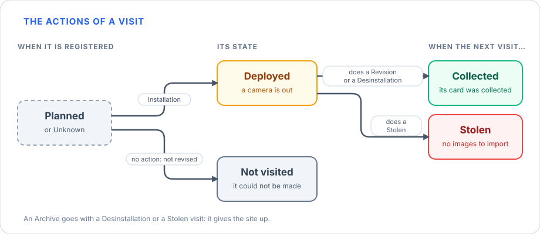

# WildINTEL Uploader — User Manual

**WildINTEL Uploader** is an application for camera-trap projects. It takes a set of images — copied off the camera's 
memory card —, checks them, organizes them in a local folder with their metadata (renamed, resized, tagged with 
authorship and license and sealed), and sends them to different camera-trap projects like [Trapper](https://gitlab.com/trapper-project/trapper). 
It runs on your own  computer, nothing leaves it but what you send to the Trapper server you configure, and it comes in
two faces that share the same settings, the same log and the same collections folder:

- a **web application**, with a guided interface in your browser — the complete one;
- a **command line**, for the quick jobs.

---

## Table of Contents

1. [Installation](#1-installation)
2. [General concepts: deployments, locations, revisions and collections](#2-general-concepts-deployments-locations-revisions-and-collections)
3. [The folders and files it creates](#3-the-folders-and-files-it-creates)
4. [Where to go next](#4-where-to-go-next)

---

## 1. Installation

Download the file for your system from the
[releases page](https://github.com/wildintelproject/wildintel-uploader/releases). 

=== "Linux"

    Download `wildintel-uploader-X.Y.Z-linux-x86_64.AppImage`, make it executable and run it:

    <div class="termy">

    ```console
    $ chmod +x wildintel-uploader-X.Y.Z-linux-x86_64.AppImage
    $ ./wildintel-uploader-X.Y.Z-linux-x86_64.AppImage
    ```

    </div>

=== "Windows"

    Download `wildintel-uploader-X.Y.Z-windows-x64.exe` and double-click it. If Windows SmartScreen
    warns that the publisher is unknown, choose **More info → Run anyway**.

=== "macOS"

    Download `wildintel-uploader-X.Y.Z-macos-arm64.dmg` (Apple Silicon), open it and copy
    `wildintel-uploader` out of it to a folder of your own (for example *Applications* or your home folder).

    !!! warning "The app isn't signed by an Apple developer"
        macOS blocks what it can't verify, so the first time it will refuse to open it ("Apple could not
        verify…"). Either:

        - Try to open it once, then go to **System Settings › Privacy & Security**, scroll down to the
          message about `wildintel-uploader` and press **Open Anyway**; or
        - remove the quarantine mark from a terminal, once, and run it:

        <div class="termy">

        ```console
        $ xattr -d com.apple.quarantine ./wildintel-uploader
        $ chmod +x ./wildintel-uploader
        $ ./wildintel-uploader
        ```

        </div>

!!! tip "Running it from the source code"
    To run the app from its source code — or to change it — see the
    [developer manual](developer-manual.md#2-development-setup).

One download gives you both the web application and the command line.

## 2. General concepts: deployments, locations, revisions and collections

Before explaining how the application works, it is necessary to clarify the following concepts. The visits come first, because everything else is worked out from them.

### 2.1 Visits and revisions

A **visit** is one trip to one camera trap, to do something with it. It is the field record: it says when it was, at which site, who went, what was done to the camera and the card, and what was found. The visits of a research project are registered in *Manage visits* — see the [web manual](user-manual-web.md#5-manage-visits) — and everything else is worked out from them.


A **revision** is one visit to every site: the round of visits to all the locations of a research project that are not archived — the 1st, the 2nd, the 3rd one, called `R0001`, `R0002`, `R0003`… A site is visited **once** in a revision, and a revision does not start until the one before it is finished (every location has its visit in it). Revisions are in order: every visit of a revision is after those of the revisions before it.


#### The states of a visit

A visit has a state that follows its life. A visit that left no camera has none.


The drawing reads from left to right, and the state of a visit is decided in three moments:

1. **Before it is registered**, a visit is *planned* or *unknown*. It is **planned** when the revision has visits and the site has none yet: it is the visit that is expected. It is **unknown** when nothing is known of it — the first visit kept to a site is of a later revision, so the revisions before it have no visit of that site: no day, no camera, no card. Nothing is checked against an unknown visit, it counts as a visit to finish its revision, and a visit that comes later takes its place.
2. **When it is registered**, what the visit did gives its state. If it **left a camera** — an Installation, or a Revision, which looks at the camera and leaves it out again — it is **Deployed**: the camera is out and its card is still to be collected. If it **could not be made** (its status is *Not revised*) it is **Not visited**: nothing was done at it. If it **left no camera** — a Desinstallation takes it away, a Stolen visit finds it gone, an Archive gives the site up — it has **no state**.
3. **When a later visit to the site** collects the card, or finds the camera stolen, the **Deployed** visit is closed: **Collected** if its card was collected, **Stolen** if the camera was found stolen — there are no images to import. While neither happens it stays *Deployed*. A Revision does both things: it closes the visit before it and, when it leaves a card, it is itself *Deployed* until the next visit.

The table sums up each state and what it means.

| State | What it says |
|---|---|
| **Planned** | The visit is not made yet: a location with no visit in a revision that has them. |
| **Deployed** | It left a camera that is still out: its card has not been collected. |
| **Collected** | A later visit collected the card it left. |
| **Stolen** | The camera it left was stolen: its deployment is closed with no images, and there is nothing to create. |
| **Not visited** | The visit could not be made. |
| **Unknown** | A revision of a site of which nothing is known: no visit of that site is kept to it. |

Whether the images of a visit are stored is another thing: they are once its deployment is made.

#### The actions of a visit

When a visit goes from one state to another, **one or several actions** are done in it, and they decide the state it takes and what happens to the visit before it:



- With **no action** (the visit could not be made, *Not revised*) a planned visit is *Not visited*, and the visit before it stays *Deployed*: no card was collected.
- An **Installation** leaves the visit *Deployed*: a camera is out.
- A **Revision** closes the *Deployed* visit before it, which is *Collected*, and the visit is itself *Deployed* if it leaves a card.
- A **Desinstallation** also closes the visit before it as *Collected*, and the visit has no state: no camera is left.
- **Stolen** closes the visit before it as *Stolen*, and the visit has no state.
- An **Archive** gives the site up, and goes with a Desinstallation or a Stolen visit: the visit has no state.

| Action | What it is | What it asks |
|---|---|---|
| **Installation** | A camera is put up at the site and an SD card is left in it. The first visit to a site is always an Installation. | The camera, the card left, and how it is set up: height or depth, tilt, heading, delay and whether bait is used. |
| **Revision** | The camera is looked at: its card is collected and another one may be left. | The camera and the photos on the card collected (not when the card was full). The card left is optional. |
| **Desinstallation** | The camera is taken away, with its card. | The camera and the photos collected. |
| **Stolen** | The camera is found stolen, and its card with it: there will be no images. | The camera. |
| **Archive** | The location is given up: no visit is kept to it afterwards. The camera that is out is taken away in the same visit (a Desinstallation, or a Stolen camera), and none is put up. | Nothing else. |

A visit can do several things at once: *Revision + Installation* (the camera is looked at and another put up: a replacement), *Revision + Desinstallation*, *Stolen + Installation* (stolen and replaced) or *Stolen + Archive* (stolen and the site given up). A visit that **could not be made** — the status *Not revised* — has no action: nothing was done at it.

#### What a visit records

| | What is recorded |
|---|---|
| **Who and where** | The site (a location of the research project), the revision, who went and who set the camera up. |
| **When** | The day and the time, as the clock of the location says them; what is kept is the instant in UTC. |
| **What was done** | The actions. |
| **The SD card** | The card left in the camera; the photos counted on the card collected; how the card and the batteries were (*OK*, *Card full*, *No batteries*, *Card full and no batteries*). |
| **The camera** | Its id and its model; how it is placed and set (height or depth, tilt, heading, delay, detection distance, bait use, feature type, habitat); its status (*OK*, *Altered*, *Knocked down*, *Damaged*…); whether its clock was right and whether it was calibrated. |
| **The site and the notes** | The coordinates where the note was taken, the groups and tags of the deployment, and the notes. |

Which of them are required depends on the actions: an Installation asks for the camera and the card it leaves, a Revision for the photos it collected… Nothing is asked of a visit that could not be made.

### 2.2 Deployments, locations and collections

A **deployment** is the set of images taken by one camera, at one **location** — some GPS coordinates and a timezone —, between two **consecutive visits** to it: the one that **left** the camera and its card, and the next one that **collected** the card. Between them the camera was set up under specific configuration conditions (height, tilt, delay between triggers…). A deployment whose camera is still out, because the card has not been collected, is *open*; when the card is collected, it is *closed* and its images can be imported. The deployment of a camera that was stolen has no images.

All the deployments of a revision form a **collection**: *collection* and *revision* are synonyms. A deployment belongs to the revision of the visit that **left** the camera — the deployment from the visits of `R0001` to the visits of `R0002` is of `R0001`. The app names everything after that:

| | Example | |
|---|---|---|
| Revision | `3` | |
| Location id | `DONA_01` | |
| **Deployment id** | `R0003-DONA_01` | `R` + the revision as four digits + `-` + the location id |
| **Collection** | `R0003` | the name of a revision: `R` + its number as four digits — all its deployments |
| Research project | `DONA` | the project they all belong to, by its acronym |

The deployment id is never typed: you give the revision and the location, and the app builds it.

### 2.3 The location owns the timezone

A camera's clock has no timezone of its own: its images say "13:10", and the same camera,
elsewhere, would say it too. So the **timezone** (and whether the cameras there **ignore summer
time**) belongs to the **location**, never to a deployment. They are asked for when a location is
added, and every deployment there is read in them. The deployment's details say it before you fill anything in. A location
without a timezone is reported — the app doesn't guess one.

## 3. The folders and files it creates

As said before, the application runs locally and stores all the information it needs in a series of files and folders.

### The collections folder

Imported deployments are kept in your **collections folder** until they are uploaded — by default
`Documents/wildintel-uploader/collections`:

```text
collections/
└── DONA/                                   ← research project
    ├── research_project.json
    ├── locations.json                      ← its locations, with timezone and coordinates
    ├── cameras.json, sd_cards.json         ← its cameras and its SD cards
    ├── visits.json                         ← the visits kept
    ├── unknown_visits.json                 ← the revisions of a site of which nothing is known
    └── R0003/                              ← collection (one revision)
        ├── collection.json
        ├── R0003_FileTimestampLog.csv      ← the start and end of each deployment
        └── R0003-DONA_01/                  ← deployment
            ├── R0003-DONA_01__20240904_1.JPEG …    the images
            ├── deployment.json             ← its details
            ├── images.json                 ← what is known of each image
            ├── preprocessing.json          ← what was done to each image
            ├── seal.json                   ← what was checked, tied to the content
            └── upload.json                 ← written once it has been uploaded
```

Your **source folder is never touched**: the images are copied, and the copy is what gets renamed,
resized and tagged.

!!! warning "Copy the images off the camera's memory card first"
    Point the app at a folder on your computer, not at the memory card. The app only *reads* the
    source folder, but working from the card is slow and risks losing files if it is removed
    half-way.

### The rest of the app's folders

| What | Where |
|---|---|
| Settings | `settings.toml` in the app's config folder: `~/.config/wildintel-uploader/` (Linux), `%APPDATA%\wildintel-uploader\` (Windows), `~/Library/Application Support/wildintel-uploader/` (macOS). More configs in `configs/` there. |
| Log | `logs/wildintel-uploader.log` next to it. |
| Collections | `Documents/wildintel-uploader/collections/` (or the *Data folder* or *Collections folder* of the settings). |
| Packages to upload | `Documents/wildintel-uploader/packages/`. |
| Unfinished runs | `Documents/wildintel-uploader/sessions/`. |
| Reports | `Documents/wildintel-uploader/reports/` — one JSON file each. |

## 4. Where to go next

| If you want to… | Read |
|---|---|
| Do everything — import, upload, repair, sync — with a guided interface | [User manual — web app](user-manual-web.md) |
| Test the connection, change the settings, look up Trapper's ids or make a quick import from a terminal | [User manual — command line](user-manual-cli.md) |
| Know what the application does, in detail | [Features](features.md) |
