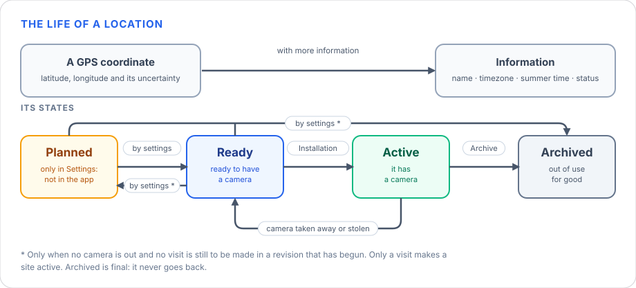
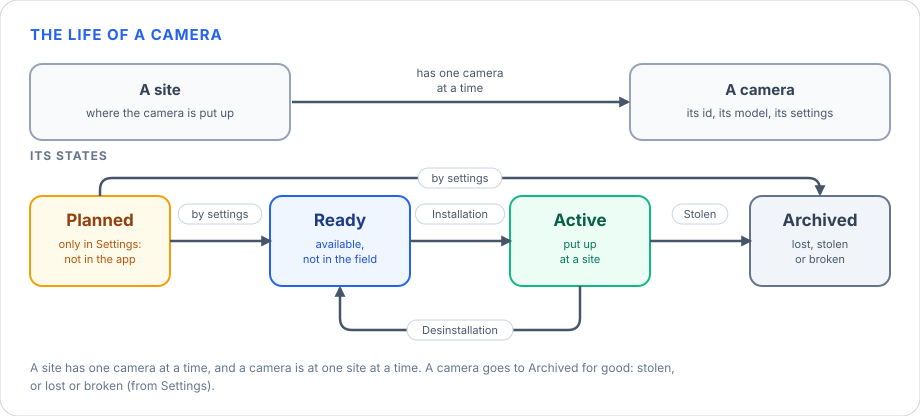
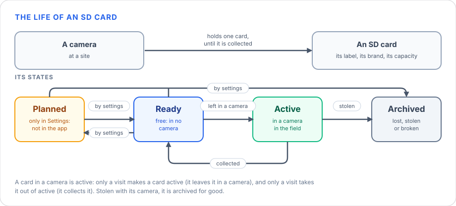
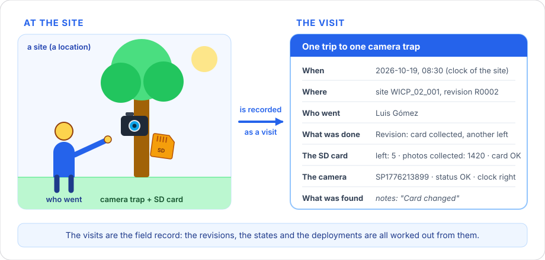
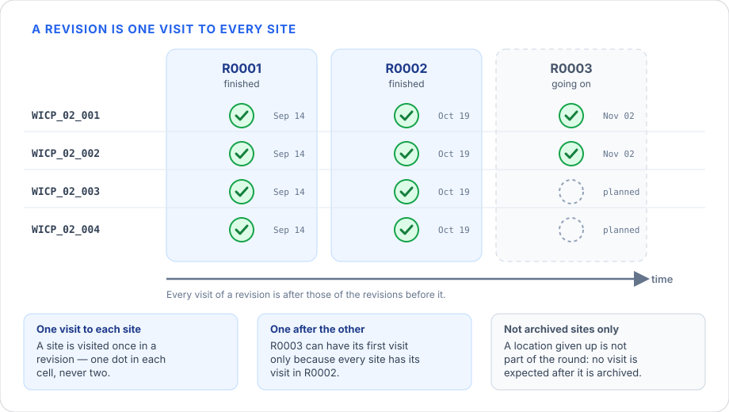
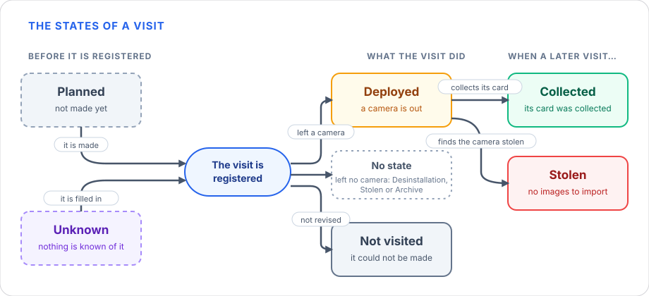
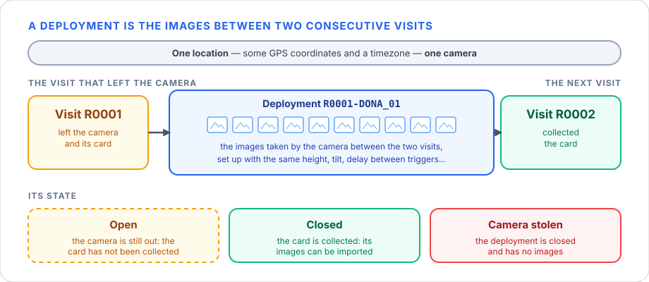
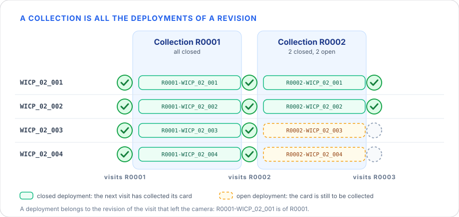

# WildINTEL Uploader — User Manual

**WildINTEL Uploader** is an application for camera-trap projects. It takes a set of images — copied off the camera's 
memory card —, checks them, organizes them in a local folder with their metadata (renamed, resized, tagged with 
authorship and license and sealed), and sends them to different camera-trap projects like [Trapper](https://gitlab.com/trapper-project/trapper). 
It runs on your own  computer, nothing leaves it but what you send to the Trapper server you configure, and it comes in
two faces that share the same settings, the same log and the same collections folder:

- a **web application**, with a guided interface in your browser — the complete one;
- a **command line**, for the quick jobs.

---

## Table of Contents

1. [Installation](#1-installation)
2. [General concepts: deployments, locations, revisions and collections](#2-general-concepts-deployments-locations-revisions-and-collections)
3. [The folders and files it creates](#3-the-folders-and-files-it-creates)
4. [Where to go next](#4-where-to-go-next)

---

## 1. Installation

Download the file for your system from the
[releases page](https://github.com/wildintelproject/wildintel-uploader/releases). 

=== "Linux"

    Download `wildintel-uploader-X.Y.Z-linux-x86_64.AppImage`, make it executable and run it:

    <div class="termy">

    ```console
    $ chmod +x wildintel-uploader-X.Y.Z-linux-x86_64.AppImage
    $ ./wildintel-uploader-X.Y.Z-linux-x86_64.AppImage
    ```

    </div>

=== "Windows"

    Download `wildintel-uploader-X.Y.Z-windows-x64.exe` and double-click it. If Windows SmartScreen
    warns that the publisher is unknown, choose **More info → Run anyway**.

=== "macOS"

    Download `wildintel-uploader-X.Y.Z-macos-arm64.dmg` (Apple Silicon), open it and copy
    `wildintel-uploader` out of it to a folder of your own (for example *Applications* or your home folder).

    !!! warning "The app isn't signed by an Apple developer"
        macOS blocks what it can't verify, so the first time it will refuse to open it ("Apple could not
        verify…"). Either:

        - Try to open it once, then go to **System Settings › Privacy & Security**, scroll down to the
          message about `wildintel-uploader` and press **Open Anyway**; or
        - remove the quarantine mark from a terminal, once, and run it:

        <div class="termy">

        ```console
        $ xattr -d com.apple.quarantine ./wildintel-uploader
        $ chmod +x ./wildintel-uploader
        $ ./wildintel-uploader
        ```

        </div>

!!! tip "Running it from the source code"
    To run the app from its source code — or to change it — see the
    [developer manual](developer-manual.md#2-development-setup).

One download gives you both the web application and the command line.

## 2. General concepts: deployments, locations, revisions and collections

Before explaining how the application works, it is necessary to clarify the following concepts. The things the visits are about come first — the locations, the cameras and the SD cards —, then the visits, because everything else is worked out from them.

### 2.1 Locations

A **location** is a **GPS coordinate** — a latitude, a longitude and how uncertain it is — to which we add the information the app needs: its **id** (what the visits say: `DONA_01`), its **name**, its **timezone**, whether its cameras **ignore summer time**, and its **status**.



A location is always in one of four states:

<div class="states" markdown>

| State | Meaning |
|---|---|
| **Planned** | The site is planned. It is only in **Settings**, to link cameras and cards to it: it is **not in the app** — no visit is kept to it and no list offers it. |
| **Ready** | The site is **ready to have a camera**. It is in the app: the revisions count it, and a visit can put a camera up there. |
| **Active** | The site **has a camera**. It is in the app, as a ready one. |
| **Archived** | The site is **out of use for good**. It is **final**: it never goes back, and no visit is kept to it after the day it was archived. |

</div>

The **actions done in a visit** (see [the actions of a visit](#the-actions-of-a-visit)) can change the state of a site, and so can the **settings** (see [Settings › Entities](user-manual-web.md#entities)), where you can set it by hand. In particular, what moves a location from one state to another:

- **Planned → Ready**: you say so in Settings, when the site is ready to be used.
- **Ready → Active**: a visit does an **Installation**, which puts a camera up. Only a visit makes a site active: it cannot be set by hand.
- **Active → Ready**: a visit takes the camera away (**Desinstallation**) or finds it stolen (**Stolen**), and puts no other one up. A replacement — the camera is taken away and another put up — keeps it active.
- **Ready → Planned**: in Settings, to take the site out of the app again.
- **→ Archived**: an **Archive** visit gives the site up (it goes with a Desinstallation or a Stolen visit, as no camera can be left), or you archive it in Settings, **from any state** — a planned site that is given up before it is used included. It never goes back.

What Settings can do is limited by what the visits say. A site goes **out of the app** — to *Planned* or to *Archived* — only when **no camera is out** there (no visit of it is *Deployed*) and **no visit is still to be made** in a revision that has begun: a revision needs the visit of every site in it. Until then Settings says what is in the way, and the site stays as it was.

The dashboards and the revisions consider the sites that are **ready or active**: a revision is one visit to each of them.

### 2.2 Cameras

A **camera** is one device — its serial number, its model and how it is set up — and it is **put up at a site** by a visit. A site has **one camera at a time**, and a camera is at **one site at a time**: it cannot be put up where it already is, nor at a second site before it is taken away from the first, and no other camera can be put up at a site that has one until it is taken away — a replacement is a Revision, a Desinstallation and an Installation in one visit.



A camera is always in one of four states:

<div class="states" markdown>

| State | Meaning |
|---|---|
| **Planned** | The camera is registered in **Settings** but it is **not in the app** yet: no visit offers it. |
| **Ready** | The camera is **available**, and not in the field. A visit can put it up. |
| **Active** | The camera is **put up at a site**. |
| **Archived** | The camera is **out of use for good**: stolen, lost or broken (the reason is kept). It is **final**. |

</div>

The **actions done in a visit** (see [the actions of a visit](#the-actions-of-a-visit)) can change the state of a camera, and so can the **settings** (see [Settings › Entities](user-manual-web.md#entities)), where you can set it by hand. In particular:

- **Planned → Ready**: you say so in Settings.
- **Ready → Active**: an **Installation** puts the camera up at a site, and the site becomes active with it. Only a visit makes a camera active: it cannot be set by hand.
- **Active → Ready**: a **Desinstallation** takes it away; a replacement takes the old camera away and puts the new one up.
- **Ready → Planned**: in Settings, to take the camera out of the app again.
- **→ Archived**: a **Stolen** visit finds it gone, or you archive it in Settings — a lost or a broken camera — when it is *planned* or *ready*. It never goes back.

A camera that is put up at a site is **Active**, and only a visit makes it so or takes it out of that state — an Installation puts it up; a Desinstallation, or a Stolen visit, takes it away. So Settings cannot change an active camera, and cannot make one active.

### 2.3 SD cards

An **SD card** is kept in a camera: a visit **leaves** it there (an *Installation*, or a *Revision* that changes the card) and the next visit **collects** it (a *Revision* or a *Desinstallation*) — its images are the deployment. A card is in **one camera at a time**.



An SD card is always in one of four states:

<div class="states" markdown>

| State | Meaning |
|---|---|
| **Planned** | The card is registered in **Settings** but it is **not in the app** yet. |
| **Ready** | The card is **free**: it is in no camera, and a visit can leave it in one. |
| **Active** | The card is **in a camera**, in the field. |
| **Archived** | The card is **out of use for good**: stolen with its camera, lost or broken. It is **final**. |

</div>

The **actions done in a visit** (see [the actions of a visit](#the-actions-of-a-visit)) can change the state of an SD card, and so can the **settings** (see [Settings › Entities](user-manual-web.md#entities)), where you can set it by hand. In particular:

- **Planned → Ready**: you say so in Settings.
- **Ready → Active**: a visit **leaves** the card in a camera (*Installation* or *Revision*). Only a visit makes a card active: it cannot be set by hand.
- **Active → Ready**: a visit **collects** it (*Revision* or *Desinstallation*), and the card is free again — it cannot be left again in the same revision.
- **Ready → Planned**: in Settings, to take the card out of the app again.
- **→ Archived**: a **Stolen** visit archives it with its camera, because it went with it, or you archive it in Settings — a lost or a broken card — when it is *planned* or *ready*. It never goes back.

A card that is in a camera is **Active**, and only a visit makes it so or takes it out of that state — it leaves the card in a camera, or collects it. So Settings cannot change an active card, and cannot make one active.

### 2.4 Visits and revisions

A **visit** is one trip to one camera trap, to do something with it. It is the field record: it says when it was, at which site, who went, what was done to the camera and the card, and what was found. The visits of a research project are registered in *Manage visits* — see the [web manual](user-manual-web.md#5-manage-visits) — and everything else is worked out from them.



A **revision** is one visit to every site: the round of visits to all the locations of a research project that are not archived — the 1st, the 2nd, the 3rd one, called `R0001`, `R0002`, `R0003`… A site is visited **once** in a revision, and a revision does not start until the one before it is finished (every location has its visit in it). Revisions are in order: every visit of a revision is after those of the revisions before it.



#### The states of a visit

A visit has a state that follows its life. A visit that left no camera has none.



The drawing reads from left to right, and the state of a visit is decided in three moments:

1. **Before it is registered**, a visit is *planned* or *unknown*. It is **planned** when the revision has visits and the site has none yet: it is the visit that is expected. It is **unknown** when nothing is known of it — the first visit kept to a site is of a later revision, so the revisions before it have no visit of that site: no day, no camera, no card. Nothing is checked against an unknown visit, it counts as a visit to finish its revision, and a visit that comes later takes its place.
2. **When it is registered**, what the visit did gives its state. If it **left a camera** — an Installation — it is **Deployed**: the camera is out and its card is still to be collected. If it **could not be made** (its status is *Not revised*) it is **Not visited**: nothing was done at it. If it **left no camera**, its state is **No camera**: no camera is out and nothing is waited for. A Desinstallation takes the camera away, a Stolen visit finds it gone and an Archive gives the site up; the visit before them, the one that left that camera, is the one that becomes **Collected** (its card was collected) or **Stolen** (its camera was found stolen).
3. **When a later visit to the site** collects the card, or finds the camera stolen, the **Deployed** visit is closed: **Collected** if its card was collected, **Stolen** if the camera was found stolen — there are no images to import. While neither happens it stays *Deployed*. A Revision or a Desinstallation collects the card, and a Stolen visit finds the camera stolen: each closes the *Deployed* visit before it.

The table sums up each state and what it means.

<div class="states" markdown>

| State | What it says |
|---|---|
| **Planned** | The visit is not made yet: a location with no visit in a revision that has them. |
| **Deployed** | It left a camera that is still out: its card has not been collected. |
| **Collected** | A later visit collected the card it left. |
| **Stolen** | The camera it left was stolen: its deployment is closed with no images, and there is nothing to create. |
| **Not visited** | The visit could not be made. |
| **No camera** | It left no camera: it took it away (Desinstallation), found it stolen (Stolen) or gave the site up (Archive). Nothing is waited for. |
| **Unknown** | A revision of a site of which nothing is known: no visit of that site is kept to it. |

</div>

Whether the images of a visit are stored is another thing: they are once its deployment is made.

#### The actions of a visit

The **actions that can be done during a visit** depend on **what the visit before it left at the site** — the last one made there, or the one before it if that was not visited. The diagram below details the relationship between the **state the visit before had** and the **new state it takes** (*Deployed → Collected*), the **actions done in this visit** — the ones that cause that change in the visit before —, the **state this visit is left in**, and the **changes it produces in other entities**: the cameras, the SD cards and the site.


- **No visit before** the site, or one that left **no camera** (a Desinstallation, a Stolen visit or an Archive): there is no camera to look at, so the visit can only put one up — an **Installation**, which leaves it **Deployed** —, give the site up (**Archive**, which leaves it **No camera**) or not be made. The first visit to a site is always an Installation.
- **A Deployed visit** — a camera is out — is closed by the visit after it: **Collected** when it collects its card (a **Revision** or a **Desinstallation**) and **Stolen** when it finds the camera gone (**Stolen**). That visit is left **Deployed** if it puts a camera up (a Revision, a replacement, or a Stolen visit and an Installation) and **No camera** if it does not.
- **No camera** is a **final** state: nothing waits for that visit, so it never changes to another one.
- **Not visited** changes nothing: the camera is where it was, and the next visit is of the visit before.
- **After an Archive** the site is closed: no visit follows.
- **The site, the camera and the card.** An **Installation** moves the site, the camera and the card it leaves from **ready** to **active**. What a visit takes away — the camera it removes, the card it collects — is **ready** again, and so is the site when it is left with no camera. A camera found stolen is **archived** with its card, and an Archive archives the site: an archived one is never changed. See [Locations](#21-locations), [Cameras](#22-cameras) and [SD cards](#23-sd-cards).

The following table sums up each action, what it is and what it asks.

| Action | What it is | What it asks |
|---|---|---|
| **Installation** | A camera is put up at the site and an SD card is left in it. The first visit to a site is always an Installation. | The camera, the card left, and how it is set up: height or depth, tilt, heading, delay and whether bait is used. |
| **Revision** | The camera is looked at: its card is collected and another one may be left. | The camera and the photos on the card collected (not when the card was full). The card left is optional. |
| **Desinstallation** | The camera is taken away, with its card. | The camera and the photos collected. |
| **Stolen** | The camera is found stolen, and its card with it: there will be no images. | The camera. |
| **Archive** | The location is given up: no visit is kept to it afterwards. The camera that is out is taken away in the same visit (a Desinstallation, or a Stolen camera), and none is put up. | Nothing else. |

A visit can do several things at once: *Revision + Desinstallation + Installation* (the camera is looked at, taken away and another put up: a replacement), *Revision + Desinstallation*, *Stolen + Installation* (stolen and replaced) or *Stolen + Archive* (stolen and the site given up). A visit that **could not be made** — the status *Not revised* — has no action: nothing was done at it.

#### What a visit records

Every visit — the one typed in the form and each row of a file alike — is **checked before it is kept**: a visit that does not pass is not kept, and the app says which field is wrong. It checks **each field on its own** (its kind, its range, the values it may take) and a few of them **together**.

Depending on the actions done during a visit, some of the fields of a visit **must be filled in**: an Installation asks for the camera, the card it leaves and how the camera is set up; a Revision or a Desinstallation, for the camera and the photos collected; a Stolen visit, for the camera… The table of the actions above says what each one asks. Nothing is asked of a visit that could not be made.

The following table sums up what a visit records and what is validated in each field.

| | Fields | What is validated |
|---|---|---|
| **Who and where** | `location_id`, `session`, `trappers`, `setup_by` | The site is a location id (1 to 100 characters); the revision is written `R` and its number (`R0003`); who went and who set the camera up are text (who went is then looked for in the settings: see below). |
| **When** | `date`, `time`, `when` | The day and the time have to be a real date and a real time, as the clock of the location says them. `when` is the instant in UTC (ISO 8601, with a `Z`): it is worked out from them when it is left out. |
| **What was done** | `actions` | Any of *Installation*, *Revision*, *Desinstallation*, *Stolen* and *Archive*, each one once. Only a visit that could not be made (its status is *Not revised*) has none. |
| **The SD card** | `sd`, `num_photos`, `card_status` | The photos counted are a whole number, zero or more. The state of the card (`card_status`) is *OK* or *CardFull*. With the card full its photos are **not counted**, and their number **cannot be given**: a visit that says both is refused. |
| **The camera** | `camera_id`, `camera_model`, `camera_interval`, `camera_height`, `camera_depth`, `camera_tilt`, `camera_heading`, `detection_distance`, `bait_use`, `feature_type`, `habitat`, `camera_status`, `battery_status`, `date_time_ok`, `timestamp_issues`, `calibration` | The state of the batteries (`battery_status`) is *OK* or *NoBatteries* (there were none). A CSV that has one column for both, `card_batteries_ok` (*OK*, *CarFull*, *NoBatteries*, *CarFullNoBatteries*, or *SinPilas*), is read as the two. The status of the camera (`camera_status`; a CSV may call its column *Status of the camera* or *status*) is one of *OK*, *Altered* (moved or changed), *Knocked down* (fallen or tilted), *Damaged* (broken or harmed), *Stolen*, *Not revised* (the visit could not be made), and, from the field form, *New site* and *Inactive site*. The interval, the height, the depth and the detection distance are zero or more; the tilt is between -90 and 90 degrees and the heading between 0 and 360; the bait use and the calibration are yes or no; the feature type is one of the values of Camtrap DP. |
| **The site and the notes** | `latitude`, `longitude`, `deployment_groups`, `tags`, `comments` | The latitude is between -90 and 90 and the longitude between -180 and 180 (WGS84 decimal degrees). The groups, the tags and the notes are free text. |

Two things are checked on the **whole visit**, with several fields together:

- **A visit does something.** It has at least one action: only a visit that could not be made (*Not revised*) has none.
- **Height or depth, not both.** A camera is set up at a height or at a depth: `camera_height` and `camera_depth` are mutually exclusive.

Some things are not typed: the app fills them in. The **state** of the visit (*Planned*, *Deployed*, *Collected*, *Stolen*, *Not visited*, *No camera* or *Unknown*, as above); the **deployment** the visit closed, once its images are imported; the **instant** of the visit in UTC; and **when the visit was registered and when it was last changed**. A visit that is saved again with nothing changed keeps both dates; an edit, or a later visit that closes it, changes the second. The cameras and the SD cards keep the same two dates.

**A visit remembers which location, camera, SD card and trappers it is of**, not only what they are called. So **a name can be corrected**: rename an SD card or a trapper and every visit that points to it says the new name, with no visit rewritten. What a visit says that the research project does not have (a card nobody registered) is kept as it was said, and is linked when it is registered.

#### What a visit is checked against

First a visit is looked at **alone**. But the values entered in a revision can also be **validated against other visits**: those of the **same revision** and those of **other revisions**. A camera cannot be put up where it already is, a card cannot be in two cameras, a visit cannot be before the one it follows… — that is only known by looking at what was done before. The app does it with the visits kept **before the date and the time of the visit** — not only with the revision before it —, and again with those after it when a visit is edited.

The rules are the same **by hand and from a file**: a visit that breaks one is refused, and it says why; what only *looks odd* is kept, with a warning. They are of five kinds.

**When the visit was — the revisions**

- A site has **one visit in a revision**, whatever the day, and never two at the same day and time.
- A visit is **after the last one to its site**.
- The revisions are **in order**: every visit of a revision is after all those of the revisions before it and before all those of the revisions after it, whichever the site.
- A revision **starts when the one before is finished**: every location that is not archived has its visit in it. When the next revision is started, the sites with no visit are marked as *Not visited*. A revision that is finished is *closed*: nothing new is added to it.

**What the site is**

- The site has to be a **location of the research project**. If it is not, the app tells a really new site from a misnamed one: it shows the nearest location and the ids that are one character apart.
- The **first visit** to a site can only be an **Installation**: it puts the camera up.
- An **archived** location has no visits after the day it was archived. The visit that archives it (*Archive*) puts no camera up, and takes the one that is out away (*Desinstallation*) or finds it stolen (*Stolen*).

**Where the camera is**

A camera is at a site from the visit that puts it up (an Installation, or a Revision that leaves it out again) until a visit takes it away or finds it stolen. So:

- A **Revision**, a **Desinstallation** or a **Stolen** visit is of **the camera that is at the site**. If it was replaced, the visit adds a Desinstallation and an Installation.
- A site has **one camera at a time**: another is not put up where one is, until it is taken away (a Desinstallation, or a Stolen visit).
- Where the camera was taken away or found stolen, the site has **none**: there is nothing to look at, to take away or to find stolen. Only an **Installation**, an **Archive** or a **visit that is not made** can follow.
- A camera is **not put up where it already is**, nor while it is at **another site**: it has to be uninstalled there first.

**Where the SD card is**

A card is in a camera from the visit that leaves it until a visit collects it. So the card a visit leaves cannot be **archived**, nor be **in the camera of another site** (it has to be collected first), nor be **the one the same visit collects** (the card left has to be another), nor have been **collected in the same revision**.

**What exists**

The camera, the SD card and who went have to **exist** in the research project and in the settings, unless the import is asked to create the camera or the card.

What the app only **questions** — it asks the one who knows the field, it does not refuse the visit — is: a Revision with no photos (no deployment comes out of it); an Installation while the card left before was not collected (no Revision or Desinstallation closed that deployment); a camera or a card at two sites in the same revision; a visit whose time is not after the one of an earlier revision; and a jump in the numbers of the revisions (a trip is missing).

**What cannot be known cannot be checked.** An *unknown* visit — a revision of a site of which nothing is known — has no camera, no card and no day, so nothing is checked against it. And what was left at a site before an unknown revision cannot be trusted after it: the camera or the card may have been moved in it. That is why the first visit to a site after an unknown revision may be any, and a file is only excused this: what depends on a revision that nobody knows.

### 2.5 Deployments, locations and collections

A **deployment** is the set of images taken by one camera, at one **location** — some GPS coordinates and a timezone —, between two **consecutive visits** to it: the one that **left** the camera and its card, and the next one that **collected** the card. Between them the camera was set up under specific configuration conditions (height, tilt, delay between triggers…). A deployment whose camera is still out, because the card has not been collected, is *open*; when the card is collected, it is *closed* and its images can be imported. The deployment of a camera that was stolen has no images.



All the deployments of a revision form a **collection**: *collection* and *revision* are synonyms. A deployment belongs to the revision of the visit that **left** the camera — the deployment from the visits of `R0001` to the visits of `R0002` is of `R0001`. 

The app names everything after that:

| | Example | |
|---|---|---|
| Revision | `3` | |
| Location id | `DONA_01` | |
| **Deployment id** | `R0003-DONA_01` | `R` + the revision as four digits + `-` + the location id |
| **Collection** | `R0003` | the name of a revision: `R` + its number as four digits — all its deployments |
| Research project | `DONA` | the project they all belong to, by its acronym |

The deployment id is never typed: you give the revision and the location, and the app builds it.

### 2.6 The location owns the timezone

A camera's clock has no timezone of its own: its images say "13:10", and the same camera,
elsewhere, would say it too. So the **timezone** (and whether the cameras there **ignore summer
time**) belongs to the **location**, never to a deployment. They are asked for when a location is
added, and every deployment there is read in them. The deployment's details say it before you fill anything in. A location
without a timezone is reported — the app doesn't guess one.

## 3. The folders and files it creates

As said before, the application runs locally and stores all the information it needs in a series of files and folders.

### The collections folder

Imported deployments are kept in your **collections folder** until they are uploaded — by default
`Documents/wildintel-uploader/collections`:

```text
collections/
└── DONA/                                   ← research project
    ├── research_project.json
    ├── locations.json                      ← its locations, with timezone and coordinates
    ├── cameras.json, sd_cards.json         ← its cameras and its SD cards
    ├── visits.json                         ← the visits kept
    ├── unknown_visits.json                 ← the revisions of a site of which nothing is known
    └── R0003/                              ← collection (one revision)
        ├── collection.json
        ├── R0003_FileTimestampLog.csv      ← the start and end of each deployment
        └── R0003-DONA_01/                  ← deployment
            ├── R0003-DONA_01__20240904_1.JPEG …    the images
            ├── deployment.json             ← its details
            ├── images.json                 ← what is known of each image
            ├── preprocessing.json          ← what was done to each image
            ├── seal.json                   ← what was checked, tied to the content
            └── upload.json                 ← written once it has been uploaded
```

Your **source folder is never touched**: the images are copied, and the copy is what gets renamed,
resized and tagged.

!!! warning "Copy the images off the camera's memory card first"
    Point the app at a folder on your computer, not at the memory card. The app only *reads* the
    source folder, but working from the card is slow and risks losing files if it is removed
    half-way.

### The rest of the app's folders

| What | Where |
|---|---|
| Settings | `settings.toml` in the app's config folder: `~/.config/wildintel-uploader/` (Linux), `%APPDATA%\wildintel-uploader\` (Windows), `~/Library/Application Support/wildintel-uploader/` (macOS). More configs in `configs/` there. |
| Log | `logs/wildintel-uploader.log` next to it. |
| Collections | `Documents/wildintel-uploader/collections/` (or the *Data folder* or *Collections folder* of the settings). |
| Packages to upload | `Documents/wildintel-uploader/packages/`. |
| Unfinished runs | `Documents/wildintel-uploader/sessions/`. |
| Reports | `Documents/wildintel-uploader/reports/` — one JSON file each. |

## 4. Where to go next

| If you want to… | Read |
|---|---|
| Do everything — import, upload, repair, sync — with a guided interface | [User manual — web app](user-manual-web.md) |
| Test the connection, change the settings, look up Trapper's ids or make a quick import from a terminal | [User manual — command line](user-manual-cli.md) |
| Know what the application does, in detail | [Features](features.md) |
